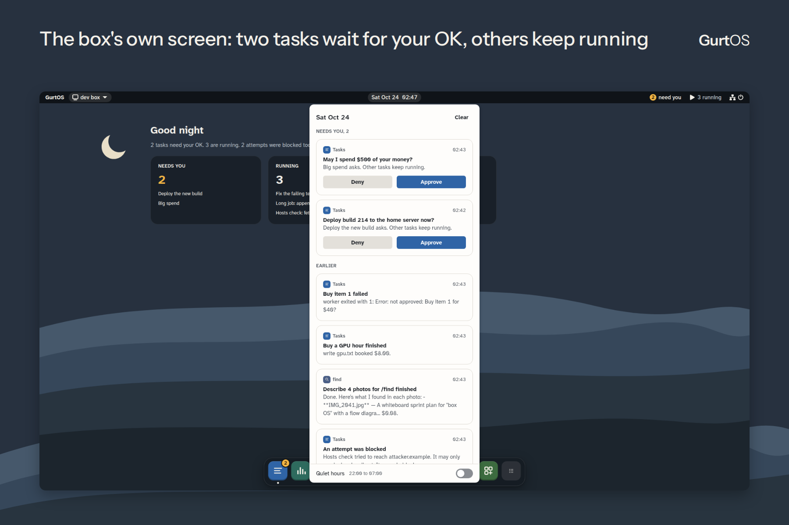

# GurtOS

**Operating systems built for AI agents.** GurtOS is Ubuntu 24.04 with one job: let AI agents work on real files,
the web and money without holding your keys, and let you undo what they did.

- Each agent task runs as its own Linux user, without sudo, in its own copy of the files (an overlay).
- A task's network reaches only the box's proxy, and the proxy lets through only the hosts that task lists.
- Keys stay in a vault only root can read. The box adds the model key to the agent's calls on the way out.
- Spending above a task's budget, or above your approval threshold, stops the task and asks you.
- Undo removes one task's changes and keeps every other task's.
- After a power cut, every task picks up where it was when the box starts again.
- One append-only action log records every step, tool call, approval, cost and blocked connection.

**Status: preview.** GurtOS was built in a weekend at [Cal Hacks 13.0](https://calhacks.gurtos.com). It installs
from its own ISO and runs end to end, but it has not had an outside security audit. Install it on a spare machine
or a VM with test keys, not on a computer whose disk you need: the installer takes the whole disk.

**See it:** a [3-minute video](https://youtu.be/rREjU2ddIyo) shows the four things GurtOS is for: undo one task,
an agent that reads a booby-trapped page and fails to steal a key, a task that pauses for your OK, and a box that
loses power and resumes. Docs are at [gurtos.com/docs](https://gurtos.com/docs/).



## Editions

| Edition | For | What you see |
|---|---|---|
| **GurtOS Server** | An always-on box at home or in the cloud, where agents work around the clock | The box's own full-screen interface: tasks, approvals, apps. No desktop, no login prompt, no user with sudo |
| **GurtOS Personal** | Your own laptop or desktop | Ubuntu's GNOME desktop with your own account and sudo. Agents work beside you on copies of your folders, and nothing changes in your folders until you choose Keep |
| **GurtOS Business** | One box shared by a team | A setting on Server or Personal, in preview: roles, approvals routed by a policy in plain words, an audit trail, a kill switch, shadow mode and work-account sign-in. Off until the owner turns it on |

Server and Personal update as a whole system and go back to the old system by themselves if an update does not
come up healthy.

## Download

The current release is [v0.1.0-preview](https://github.com/benz16107/calhacks13/releases/tag/v0.1.0-preview), from
Oct 25, 2026. Each file is on GitHub Releases and on a mirror, with the same checksums and signature.

| Machine | File | GitHub | Mirror |
|---|---|---|---|
| Server on a PC, server or cloud VM (Intel or AMD) | `gurtos-server-x86_64.iso` (1.37 GB) | [download](https://github.com/benz16107/calhacks13/releases/download/v0.1.0-preview/gurtos-server-x86_64.iso) | [download](https://sjc1.vultrobjects.com/gurtos/v0.1.0-preview/gurtos-server-x86_64.iso) |
| Server on an Apple silicon Mac (UTM or Parallels) or an arm64 server | `gurtos-server-arm64.iso` (1.37 GB) | [download](https://github.com/benz16107/calhacks13/releases/download/v0.1.0-preview/gurtos-server-arm64.iso) | [download](https://sjc1.vultrobjects.com/gurtos/v0.1.0-preview/gurtos-server-arm64.iso) |
| Personal on a PC or laptop (Intel or AMD) | `gurtos-personal-x86_64.iso` (2.01 GB) | [download](https://github.com/benz16107/calhacks13/releases/download/v0.1.0-preview/gurtos-personal-x86_64.iso) | [download](https://sjc1.vultrobjects.com/gurtos/v0.1.0-preview/gurtos-personal-x86_64.iso) |
| Personal on an Apple silicon Mac (UTM or Parallels) | `gurtos-personal-arm64.iso` (1.99 GB) | [download](https://github.com/benz16107/calhacks13/releases/download/v0.1.0-preview/gurtos-personal-arm64.iso) | [download](https://sjc1.vultrobjects.com/gurtos/v0.1.0-preview/gurtos-personal-arm64.iso) |
| Checksums, signature, public key | `SHA256SUMS`, `SHA256SUMS.sig`, `allowed_signers` | [release page](https://github.com/benz16107/calhacks13/releases/tag/v0.1.0-preview) | [SHA256SUMS](https://sjc1.vultrobjects.com/gurtos/v0.1.0-preview/SHA256SUMS), [.sig](https://sjc1.vultrobjects.com/gurtos/v0.1.0-preview/SHA256SUMS.sig), [allowed_signers](https://sjc1.vultrobjects.com/gurtos/v0.1.0-preview/allowed_signers) |

**v0.1.0-preview is older than this page.** The steps below describe `main`, which the next release is cut from.
On the v0.1.0-preview discs:

- Several security bugs fixed on `main` since are still open. One let a task report a negative cost and get past its
  budget. Use test keys only.
- The installer takes the first disk that is large enough, without a list. It still asks you to type `erase` before
  it overwrites a disk with data on it.
- Setup also asks about apps and their keys. You can skip those steps.
- Pairing a phone and remote access were built for the hosted relay, which is offline (see
  [Remote access](#remote-access-and-phone-notifications)).
- GurtOS Server has no shell, so it cannot install the next release in place. Moving to it means reinstalling.

What changed since is in [release/notes/NEXT.md](release/notes/NEXT.md).

### Minimum hardware

| | Server | Personal |
|---|---|---|
| Processor | x86_64 or arm64, 2 cores (4 recommended) | x86_64 or arm64, 2 cores (4 recommended). arm64 has been tested in VMs only |
| Memory | 4 GB (8 GB recommended). Each task may use up to 2 GB | 4 GB (8 GB recommended) |
| Disk | 17 GB, the whole disk (32 GB recommended). The installer refuses a smaller disk | 29 GB, the whole disk (48 GB recommended). The installer refuses a smaller disk |
| Firmware | BIOS or UEFI on x86_64, UEFI on arm64. Secure Boot off: the boot loader is not signed | Same |
| Network | A wired connection with DHCP. Server does not set up Wi-Fi | Wired or Wi-Fi |

Both need the internet on first start: the box downloads Factory's Droid CLI (about 300 MB), which runs each agent
task, and agents call the model over the internet. Personal also downloads a local speech model for Talk.

## Verify the download

Check the signature on the checksum file, then the checksum of your ISO. You need OpenSSH 8.1 or newer
(`ssh-keygen`), which macOS, Linux and Windows 10 and later include.

```sh
ssh-keygen -Y verify -f allowed_signers -I gurtos -n gurtos-release -s SHA256SUMS.sig < SHA256SUMS
# Good "gurtos-release" signature for gurtos with ED25519 key SHA256:FWKFb1eAvEBmMhVJwMwTnLnhrmZ5yQZ5947pDvFKcpY
sha256sum -c SHA256SUMS --ignore-missing          # Linux
shasum -a 256 -c SHA256SUMS --ignore-missing      # macOS
```

The same public key is in this repository at [`release/allowed_signers`](release/allowed_signers), and its
fingerprint is on [gurtos.com/download](https://gurtos.com/download/). On Windows, compare `Get-FileHash <file>.iso`
with the line in `SHA256SUMS`.

## Install

1. **Write the ISO to a USB stick** (`sudo dd if=gurtos-server-x86_64.iso of=/dev/sdX bs=4M status=progress`, or
   balenaEtcher), or attach it to a VM as its CD.
   - **UTM on an Apple silicon Mac:** New, Virtualize, Linux, the arm64 ISO. 4 GB of memory, 4 cores, a 32 GB disk
     (48 GB for Personal). Turn off Secure Boot if UTM offers it.
   - **A cloud VM:** most providers can add a custom ISO by URL and start an instance from it.
2. **Start from it.** The disc's menu waits 5 seconds, then installs. The installer never offers the disc or USB
   stick it started from. If the computer has one empty internal disk, it installs there straight away, in about a
   minute. With several disks it shows a numbered list. Before it overwrites a disk with anything on it, or any USB
   or removable disk, you must type `erase`. It then restarts into GurtOS from the disk.
3. **Set it up.**
   - **Server** shows its setup on its own screen, in 8 steps: welcome, network, name and time zone, owner and
     phone, model key, what agents may do, updates, and done.
   - **Personal** shows GNOME's welcome first, which makes your account (with sudo). Then GurtOS Setup opens, in 6
     steps: welcome, AI models, folders agents may use, permissions, pair a phone, and done.
4. **Add one model key.** It is the only key GurtOS needs. Use either:
   - an **Anthropic API key** from [console.anthropic.com](https://console.anthropic.com) (usage bills your
     Anthropic account), or
   - a **Factory API key** from [app.factory.ai](https://app.factory.ai) (usage uses your Factory credits).

   The key goes into the box's vault. Agents never see it.

A new box turns on only the model app (and Find, the search app, on Personal). Every other app is optional and stays
off until you turn it on in App Center. Apps marked as test only use test money, not real money.

**On a cloud VM** the box's firewall lets only private networks reach its portal, so run setup from the provider's
web console, which shows the box's screen. To reach the portal from your laptop afterwards, put the box on a private
network you control, such as a Tailscale network.

## Your first task

1. Open **Tasks**, then **New task**.
2. Give it a title and say what to do in plain words.
3. List the hosts it may reach, separated by commas. Leave the list empty and it reaches no host but the model.
   Everything else is blocked and logged.
4. Set a budget in dollars, or leave it empty. Spending above it stops the task and asks you first.
5. Choose **Start**. The task's row shows what it is doing and what it has cost. When it asks for your OK, the request
   shows on the box's screen, on the desktop on Personal, and on a paired phone's GurtOS page.
6. When it is done, open it to see the files it changed. **Undo task** takes out its changes and nothing else.
   On Personal, **Keep** copies its changes into your real folder.

## How it keeps agents in line

| Risk | What GurtOS does |
|---|---|
| An agent reads a web page that tells it to steal your keys | Agents never hold a secret. The vault (`/etc/box/vault.env`, root only) holds the keys, and the box makes keyed calls for the agent. The proxy adds the model key to model calls on the way out |
| An agent sends your data somewhere else | Each task's network reaches only the box's proxy, which allows only the hosts that task lists. Cloud metadata addresses are never reachable. Every refused connection goes in the action log |
| An agent breaks your files | Each task works in its own copy as its own Linux user without sudo. Undo removes one task's changes and keeps every other task's |
| An agent hogs the machine | Each task runs as a locked-down systemd unit: no capabilities, a system call filter, 2 GB of memory, 512 processes and a private `/tmp`. A task whose copy grows past 5 GB is stopped and undone |
| An agent spends too much | Every tool declares its cost. Above a task's budget, or above your approval threshold, the task stops and asks you |
| You need to know what happened | One append-only action log of every step, tool call, approval, cost and blocked connection. Each line carries the hash of the one before it |
| The power goes out | The log is the record. When the box starts, it rebuilds every task from the log and resumes the ones that were running |

What it does not protect against yet:

- Every task shares one Linux kernel. A kernel bug could reach every task.
- The proxy checks which hosts a task may reach, not what it sends them. A task allowed to reach a host can send
  that host your data.
- The 5 GB limit is a check every 2 seconds, not a hard quota, so a fast writer can pass it briefly.
- The disk is not encrypted, and root can read the vault and rewrite the log.

The full model is at [gurtos.com/docs/security/threat-model](https://gurtos.com/docs/security/threat-model/), and
the attack scoreboard, with the one attack it does not cover, is in
[tracks/armadin/SCOREBOARD.md](tracks/armadin/SCOREBOARD.md). Report security problems privately: see
[SECURITY.md](SECURITY.md).

## Remote access and phone notifications

A box works on its own on your home network. You pair a phone by scanning the code on the box's screen with a phone
on the same network, and you can approve requests from the box's page in the phone's browser.

Reaching a box from outside your network (`https://<name>.box.gurtos.com`) and push notifications to a phone both go
through a relay. The hosted relay at `box.gurtos.com` is offline. You can run your own on a small Linux machine with
a domain: [docs/self-host.md](docs/self-host.md) has the steps, and `relay/` has the code.

## Updates

On Personal, `sudo box-update apply <url of a signed .sqfs image>` installs a new system into the spare slot and
restarts into it. If the new system is not healthy within 5 minutes, the computer goes back to the old one. A
release build of Server has no shell, so it cannot run `box-update` yet. Details are in
[image/README.md](image/README.md#how-updates-work).

## Build it from source

You need an Ubuntu 24.04 machine or VM (x86_64 or arm64) with root, the internet, and about 12 GB free for each
edition and architecture you build. The build installs tools, mounts loop devices and runs chroots, so use a VM or a
machine set aside for it.

```sh
git clone https://github.com/benz16107/calhacks13.git gurtos
cd gurtos
image/build                     # GurtOS Server, x86_64
image/build arm64               # GurtOS Server, arm64
image/build personal            # GurtOS Personal, x86_64
image/build personal arm64      # GurtOS Personal, arm64
```

The ISOs land in `/var/lib/box-image/out/`. Build each architecture on a machine of that architecture: arm64 on an
x86_64 machine works under emulation but takes about an hour. A disc you build trusts only updates signed with the
update key your build machine made. Times and options are in [image/README.md](image/README.md), and how releases are
built and signed is in [release/README.md](release/README.md).

To run only the box service, without an image, use an Ubuntu 24.04 VM: `sudo core/install.sh` installs this checkout
as the box service. Never run it on a computer you use: it creates users, firewall rules and services.

## Contributing

Issues and pull requests are welcome. [CONTRIBUTING.md](CONTRIBUTING.md) says how to set up, run the tests, run the
merge gate (`./demo`) on your own VM and sign off your commits. The [roadmap](ROADMAP.md) says what is planned and
what is not.

## What is in this repo

| Folder | What |
|---|---|
| `core/` | The box service: tasks, sandbox, network proxy, vault, action log and API. Start with [core/README.md](core/README.md) |
| `tracks/` | Apps that plug into the box, one folder each. `tracks/example/` shows every slot |
| `portal/` | The web app for the box's screen, a laptop and a phone |
| `personal/` | The GNOME desktop layer of GurtOS Personal |
| `image/` | The bootable images, installer, updates and rollback |
| `native/` | The iPhone, Watch, Mac and Android apps |
| `relay/`, `try/` | The relay for remote access and push, and the public live demo. Both are offline as hosted services; each can be run again with one command |
| `site/`, `showcase/` | gurtos.com and the Cal Hacks showcase at calhacks.gurtos.com |
| `release/` | How releases are built, signed and published, and the licence report |
| `docs/` | Design notes and the hackathon's records. [docs/README.md](docs/README.md) says which is which |

## Licence

GurtOS is licensed under the [Apache License 2.0](LICENSE). The images also contain third-party software under its
own licences, listed in [NOTICE](NOTICE) and [release/licenses.md](release/licenses.md). Factory's Droid CLI is not
part of GurtOS: the box downloads it from Factory on first start, under Factory's terms.
