# GurtOS UX audit, Sat Oct 24

A first-time user's walk through every GurtOS surface, before judging on Sunday. Severity: **P0** is broken or
embarrassing in front of a judge, **P1** is wrong or confusing, **P2** is polish. Each finding names the thread
that owns the fix.

Owners: **portal** (portal, phone app, Business, remote access), **personal** (Personal desktop and native app),
**image** (boot, install, first-boot), **core** (wording that comes from the API).

How it was walked:
- Web surfaces (box screen, kiosk, portal, phone, Business, app.gurtos.com, a live remote address): two seeded dev
  boxes from `portal/dev-box.sh` on current main (`bdabe9c`), one Server and one Business, driven by
  `docs/ux/check.mjs`. It screenshots 67 scenes and checks contrast on real pixels, names, tap targets, clipped
  and off-screen text, spinners, em dashes, the word "box" and console errors. Rerun it with the command at the
  top of the file. Screenshots: `shots/web/`, results: `shots/web/report.json`.
- Server and Personal: fresh installs of the final v0.1.0-preview ISOs in QEMU. Screenshots: `shots/server/`,
  `shots/personal/`. Everyday use against stock Ubuntu 24.04: `parity.md`.

## Status

**Fixed 68, closed 1, open 23** (92 findings: 19 web, 22 Server, 36 Personal, 15 parity). Each fixed
finding gets a **Fixed** line with the commit and an after-screenshot in `after/`.

| Owner | Open |
|---|---|
| personal | P-29 waits for Ben |
| image | S2, S15, S16, S24, P-4, P-17, P-28, E-1 to E-11, E-13 (About logo), E-15, then P-1 with release |
| personal (parity) | E-14 (not reproduced; dock settings ruled out; measured once on the rebuilt ISO, quiet host) |

Release (P-1): one rebuild of all four ISOs from one main commit, about 75 minutes to a verified release plus 20 for
the download pages. The UX thread sends the commit once the Personal, image and core P0 and P1 fixes are in. Target
before midnight PT, hard cutoff 6:30 AM PT Sunday (at 5:30 AM the best demo-ready commit goes regardless).

Deployed: the three installed computers run e5d7246 (core, after the UX batches). The live remote addresses serve the
new build (`after/live-remote-address.png`, `after/live-remote-laptop.png`). app.gurtos.com was redeployed from 4e563a7
(portal 0c254e5): "Computer's address", 44 px targets (`after/live-app-gurtos.png`). Roll back with
`vercel promote gurtos-jp6up1pve-benz16107-1762s-projects.vercel.app` from the laptop's Vercel login.

## Top 10

Ranked by how much each changes a judge's first impression. Each links to its full entry below.

1. **The released Personal ISO is older than the native app** (P-1, P0, image and release). Anyone who installs
   v0.1.0-preview Personal gets the web portal in a window, with a second top bar, task ids and workspace names.
   Rebuild and republish both Personal ISOs from main, then rewalk first run and login.
   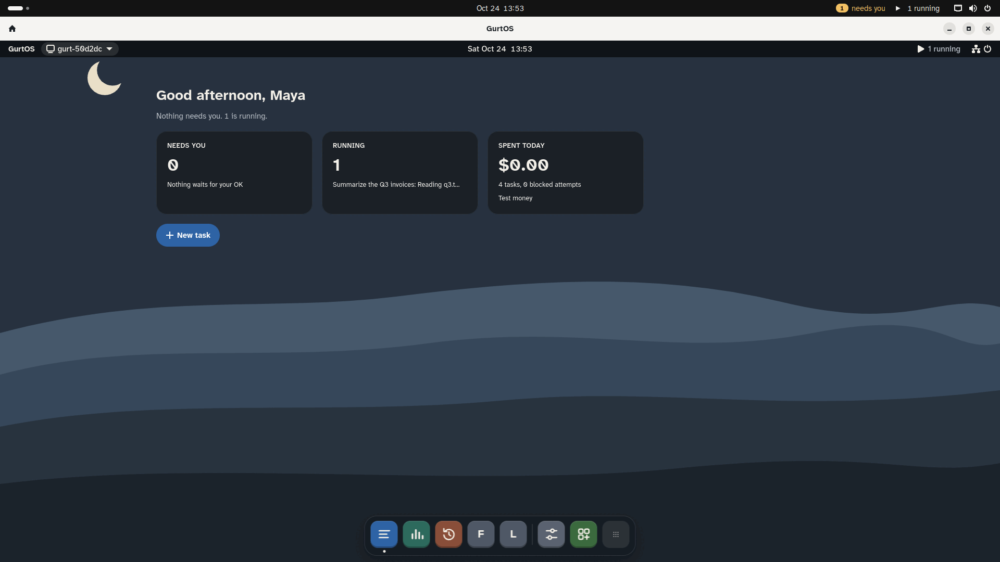
2. **Server boot is 10 s of black, then a white flash** (S2, P0, image). This is what the room watches after "pull
   the plug". Add a Plymouth splash and paint the kiosk window in the wallpaper colour.
   
3. **App lists are sponsor notes and walls of variable names** (W3, S3, P-10, P0; portal, personal, tracks). Setup
   shows 22 `VISA_...` chips for Shopper; App Center shows "!tag:innovationlab !tag:hackathon". One plain sentence
   per app, one "Needs N keys" chip, the curated six in setup.
   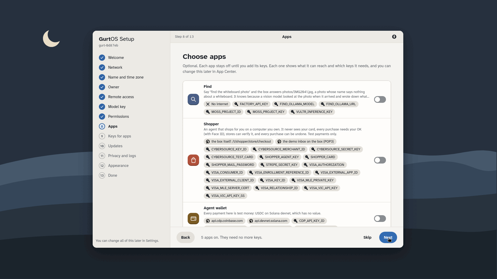
4. **Activity and Audit open with raw JSON** (W2, S10, P-15, P0; core, portal, personal). After setup, 26 rows of
   `setup: {"step":"network"}`, event kinds like `task.state`, and hashes.
   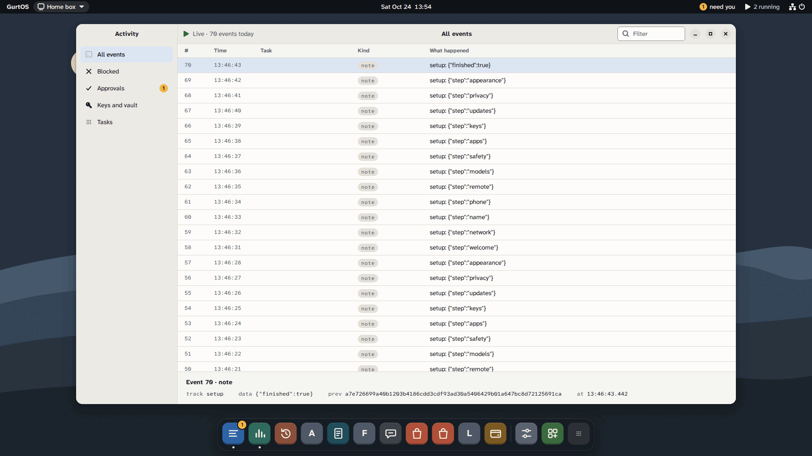
5. **Any model key is accepted, then the first task fails with raw API JSON** (P-2, S5, P0; core, portal, personal).
   An empty key ticks the step; `sk-test-123` is "saved"; the task fails with `401 {"type":"error"...`.
   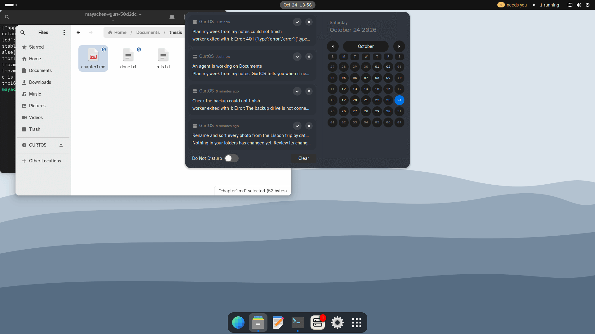
6. **Phone Remote access breaks into one letter per line** (W1, P0, portal).
   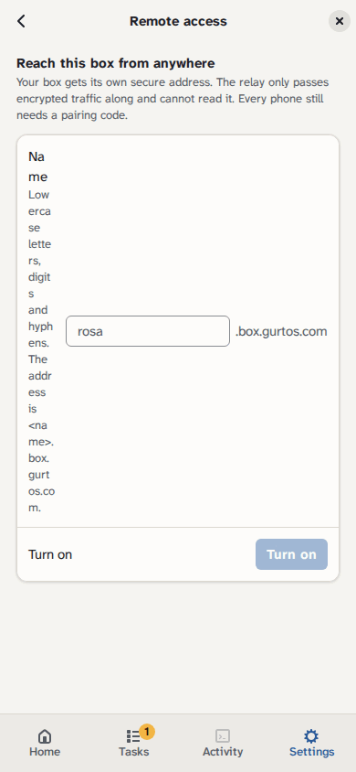
7. **"Not built yet" on screen** (W4, S9, P1, portal). Updates, Restart, Wi-Fi and the lock-screen setting say so in
   words. Hide what doesn't work; show only facts.
   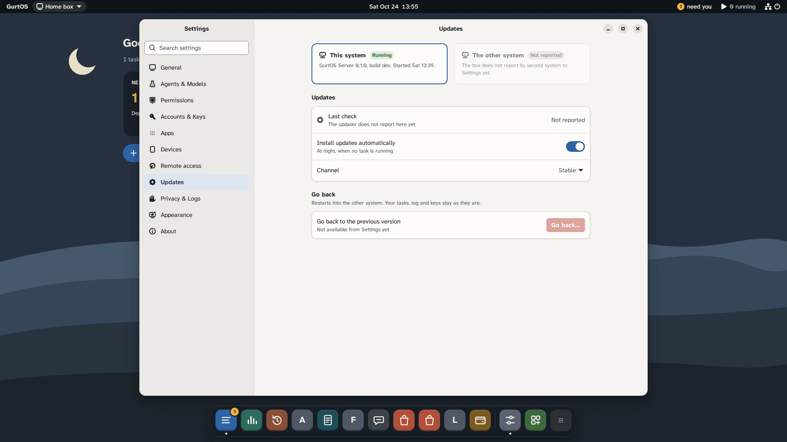
8. **Personal's counts and overflow** (P-5, P-8, P-9, P1, personal). "2 needs you" over one approval; with 12 tasks
   the popover runs off the screen; offline still shows a running task with a moving bar.
   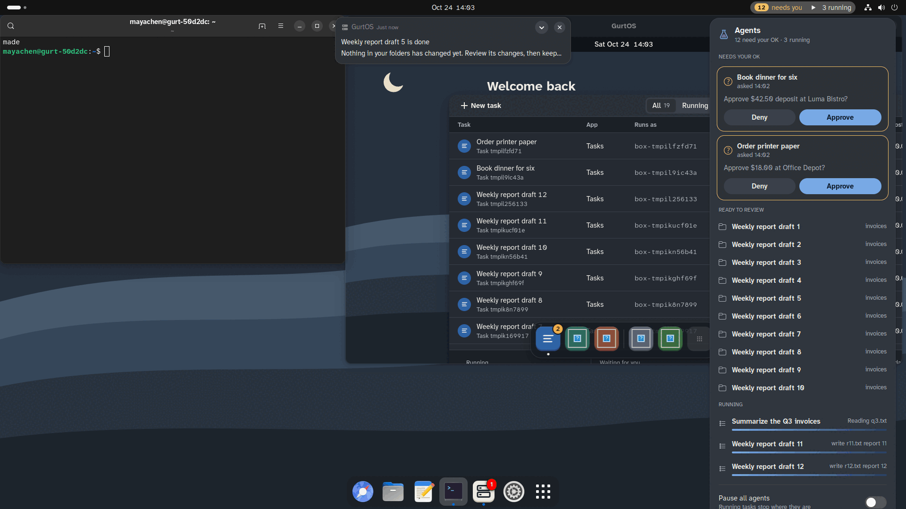
9. **Box, machine or computer** (W6, S4, P1, portal and core). The phone says "Ask the box" where the desktop says
   "New task"; setup says "Name this box"; the phone app says "Machines"; Personal says "this computer".
   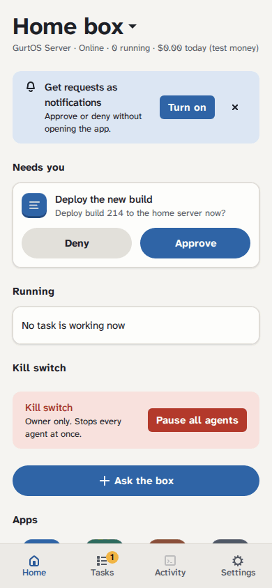
10. **Letter tiles and duplicate icons in the dock** (W5, P1, portal). Four grey letter tiles (A, F, L) and two
    identical red bags in a 15-icon dock.
    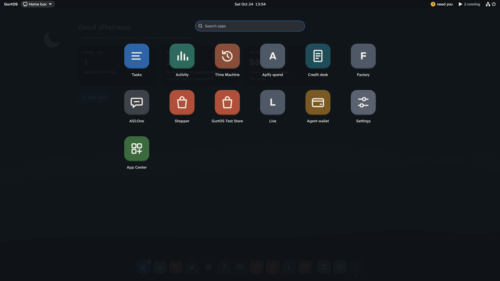

Next after these: the privacy page's "nothing leaves" with the public status page on (S6), phone buttons at 34 px
(W7), Ask an Agent's dead Start button (P-3), the $100 spend default (P-13, S23), and "build dev" on the release
(S8).

## What is already right

- **Contrast passes.** Measured on pixels on every web scene, light and dark, every text run that is on top meets
  WCAG AA. axe alone can't judge the glass surfaces, so the script hides the text, reads the real background and
  computes the ratio.
- **No em dashes** anywhere on the web surfaces, **no spinners**, and no console errors apart from the expected
  401 and 403 before pairing.
- Dark style is complete on every web screen checked. Business reads well: Waiting for me, Rules with the route
  tester, People and the kill switch match the approved frames.

## Web surfaces: portal, box screen, phone, Business, remote access

### W1. P0. Phone, Remote access: the name description breaks into one letter per line

On a 390 px phone the Name row keeps the label, its description and the input on one line, so the description
column shrinks to one character wide ("Na / me / Low / erca / se ..."). Fix: below 700 px, stack the row (label and
description full width, the input full width under them). Owner: portal.

**Fixed in 4cdd461** (portal): the row stacks on phones, the name starts as "home-box" and the address shows as you
type. 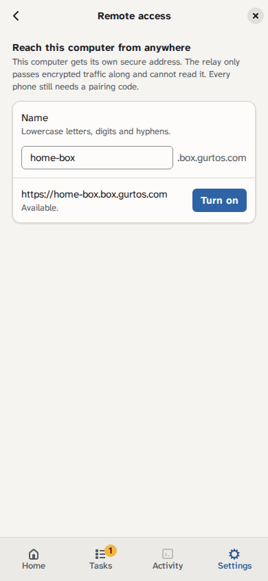
### W2. P0. Activity and Audit open with raw JSON and test steps

After first-run setup, Activity's first 26 rows read `setup: {"step":"network"}`, Kind "note", and the detail pane
shows a 64-character `prev` hash. Audit (Business) shows `Note setup: {"finished":true}` selected, with "Who: The
box". The scripted worker's `sleep 2` and `sleep 900` steps also show as steps. Fix: core writes setup notes as
sentences ("Setup: network checked", "Setup finished") or the portal renders `track: setup` notes that way;
the detail pane hides `prev` behind "Show details"; Audit opens with nothing selected or the newest request.
Owners: core (event text), portal (rendering).

**Fixed in 4cdd461** (portal): sentences ("Setup: Network done"), Kind in words, raw fields under Technical details,
Audit opens with nothing selected and its actor is GurtOS. 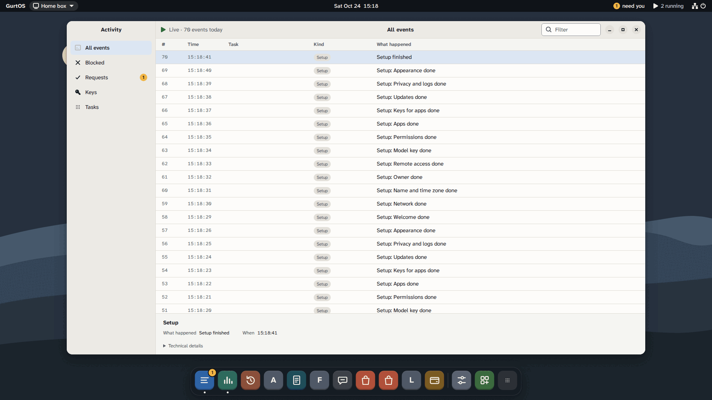 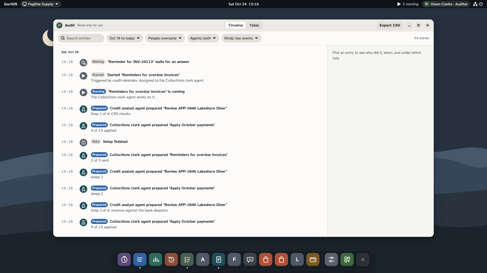
The scripted worker's `sleep` steps are gone too (a6c3552).
### W3. P0. App descriptions are hackathon notes
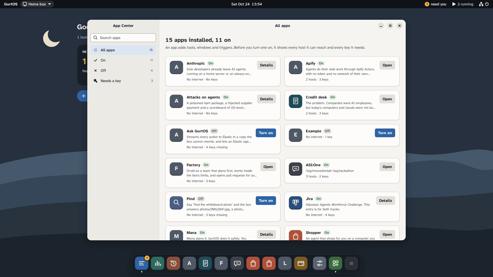
App Center, Settings > Apps and app details show text written for judges and sponsors, not users:
ASI:One "!tag:innovationlab !tag:hackathon", Jira "Atlassian Agentic Workforce Challenge. This entry is for both
tracks.", Credit desk "The problem. Companies want AI employees...", Anthropic "Solo developers already leave AI
agents running...", Attacks on agents "A poisoned npm package...". Fix: one plain sentence per app saying what it
does for the owner, for example ASI:One "Ask agents on Fetch.ai's network to do a job, and pay them from your
budget." Owner: portal, routing each to its track thread (`tracks/*/track.ts` description).

**Fixed in 217ab83** (UX thread): each app's `track.ts` has a title and one plain sentence, so nothing falls back to
its README. 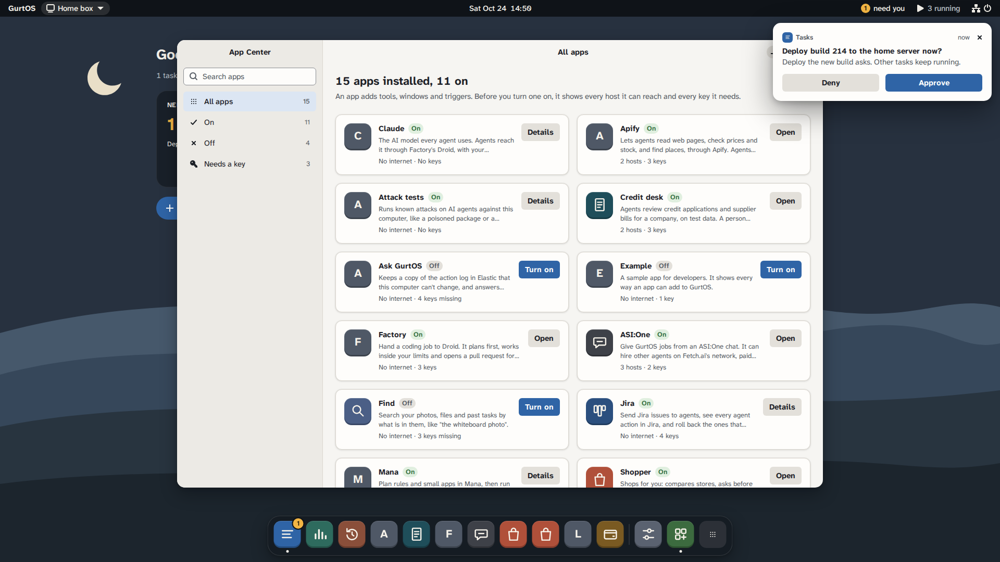

### W4. P1. Unfinished features shown as "not built yet"

Updates: "Not reported", "The box does not report its second system to Settings yet", a disabled "Go back...",
"Not available from Settings yet". General: "Restart: Not built into Settings yet", "Wi-Fi: Joining Wi-Fi from here
is not built yet. Use a cable." Privacy: "Show task titles on the lock screen: Not a setting yet". A judge reads
each one as unfinished. Fix: hide controls that do nothing; show only facts (This system: GurtOS Server 0.1.0,
started 13:39). If core can expose `box-update status` and restart before the freeze, show them for real.
Owners: portal; core for the API.

**Fixed in d99d860** (portal): Restart, Wi-Fi joining, "The other system", Last check, Go back and the lock-screen switch are gone;
Updates shows facts only. 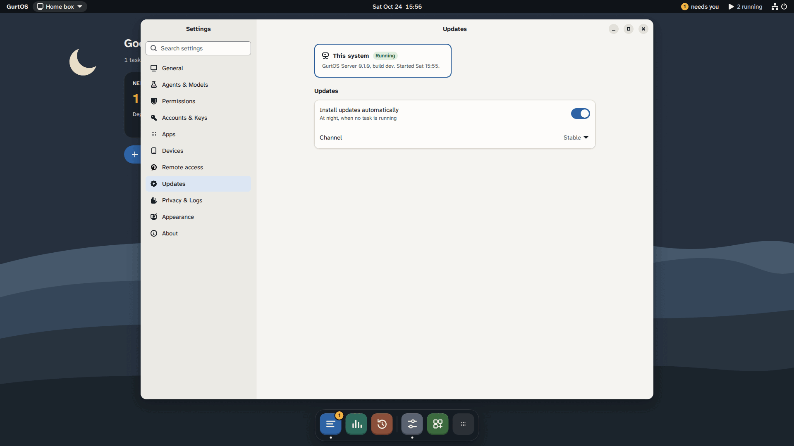
### W5. P1. Four letter tiles and two identical bags in the dock

The dock has 15 icons. Apify, Factory, "Live" (SpacetimeDB) and in App Center Anthropic, Attacks on agents, Ask GurtOS,
Example and Mana are grey letter tiles; Shopper and GurtOS Test Store share the same red bag. Fix: give each a
glyph from the Adwaita set the kit already uses (`portal/src/kit/icons.ts`) and a different colour for the test
store; keep the dock to the five system apps plus apps that have a window the user opened. "Live" and "Apify spend"
are unclear names: say what they show, for example "Live board" and "Apify". Owner: portal.

**Fixed in d99d860** (portal): an Adwaita symbol on its own tile for every app, the Test Store a green house; the dock is the
system apps plus open windows (5 icons on a new Server). 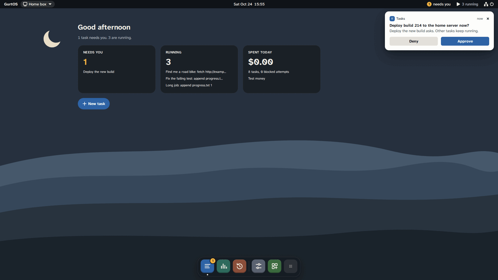 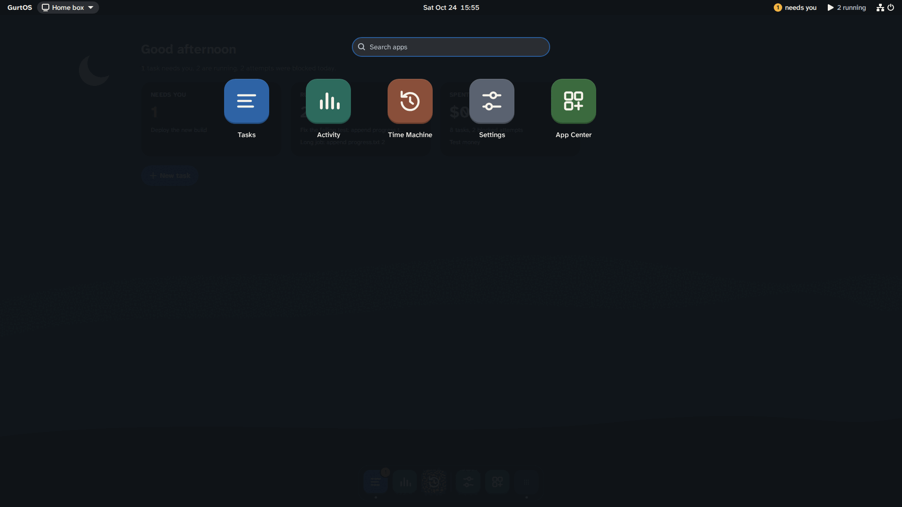
### W6. P1. One machine, three words: box, machine, computer

The Server phone home says "Home box" and "Ask the box"; the top bar's label is "Box: Home box. Switch box"; setup
says "Name this box", "Who owns this box"; pairing says "Box address" and "Code from the box's screen"; About says
"Box ID"; Audit says "Who: The box". The Machines sheet says "machine", and Personal says "this computer". The
main action is "New task" on the desktop and "Ask the box" on the phone. Fix: use `docs/ux/words.md`, settled
once: the computer's own name, otherwise "this computer"; "Computers" and "Switch computer" in the phone app; "New
task" everywhere; the audit actor becomes "GurtOS". Owners: portal;
core for the audit actor and API messages.

**Fixed in d99d860** (portal): "this computer" or its name everywhere, setup and aria-labels included; Computers and Add a
computer on the phone; New task; the actor is GurtOS. 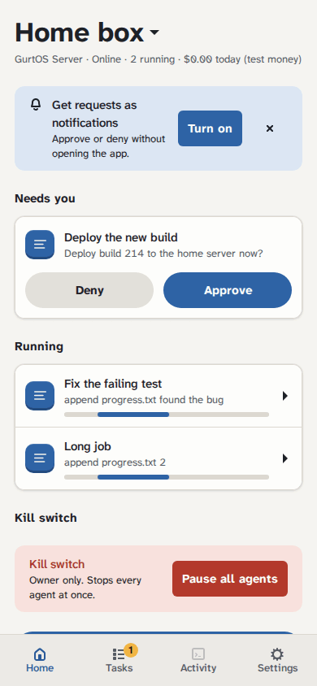 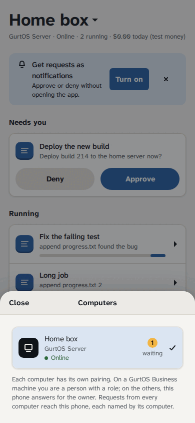
### W7. P1. Phone buttons are 34 px, not 44
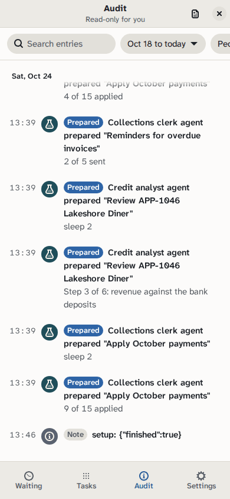
The README says phone buttons are 44 px. Measured on the phone: Turn on (79x34), the notification card's close
(34x34), Export CSV (34x34), All settings (34x34), the audit filter chips (34 tall), the search field (22 tall).
Fix: under `(pointer: coarse)`, `min-height: 44px` on buttons and chips and a 44x44 hit area on icon buttons.
Owner: portal.

**Fixed in d99d860** (portal): 44 px buttons, fields, rows, toggles, pills and window controls on phones.
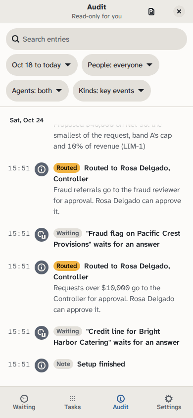
### W8. P1. Accounts & Keys lists variable names
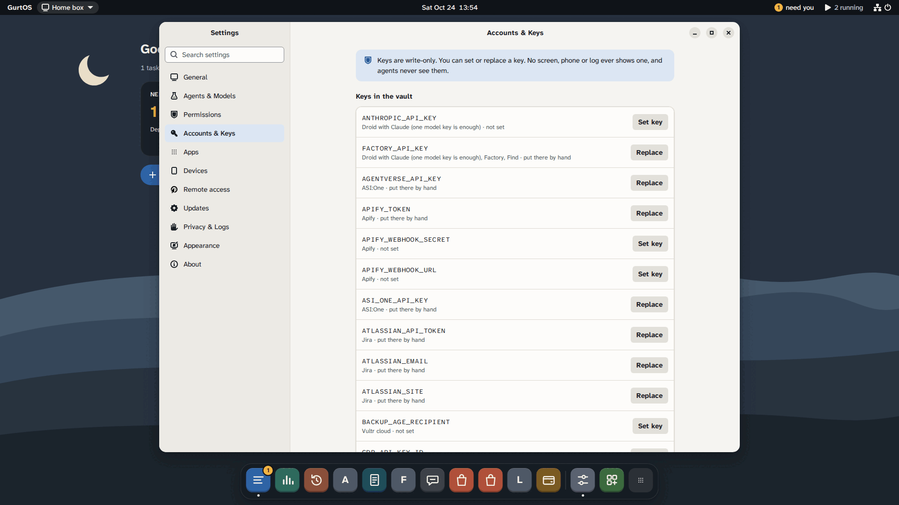
Rows are titled `ANTHROPIC_API_KEY`, `AGENTVERSE_API_KEY`, `BACKUP_AGE_RECIPIENT`, with "put there by hand"
under them. Agents & Models already does it right ("Anthropic API key", variable name underneath). Fix: the same
pattern here, and "put there by hand" becomes "set outside Settings". Owner: portal.

**Fixed in d99d860** (portal): "Anthropic API key" with the variable underneath, "set outside Settings". 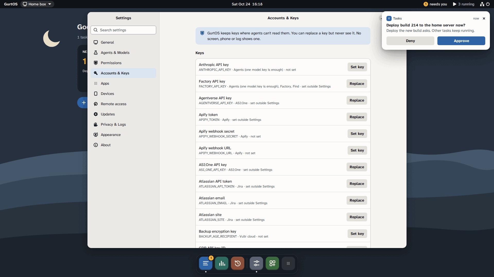
### W9. P1. Remote access suggests "rosa" on a Server box called Home box
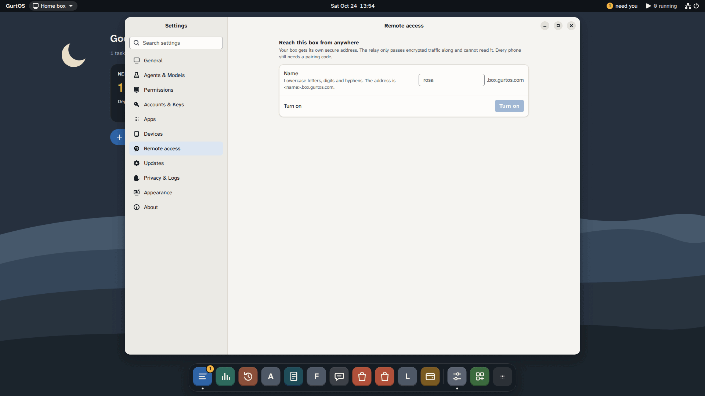
The empty name field's placeholder is `rosa`, the Business demo's person, and Turn on stays disabled until the
owner types a name. Fix: fill the field with the box's name as an address (`home-box`), so Turn on works in one
tap. Owner: portal (`portal/src/apps/remote.tsx:203`).

**Fixed in 4cdd461 and d99d860** (portal): the name starts from the computer's name; a disabled Turn on says why.
### W10. P1. "Undo task" is the red main action on tasks that changed nothing
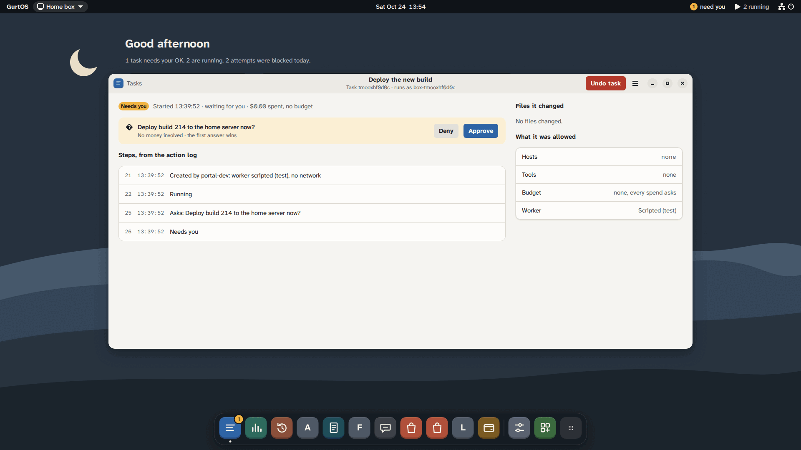
A waiting task (No files changed) and a failed task both show a red Undo task in the header. Fix: show Undo only
when the task changed files or spent money; on a waiting task the header keeps Deny and Approve, which are already
in the body. Owner: portal.

**Fixed in d99d860** (portal): Undo task only on a finished task that changed files or spent. 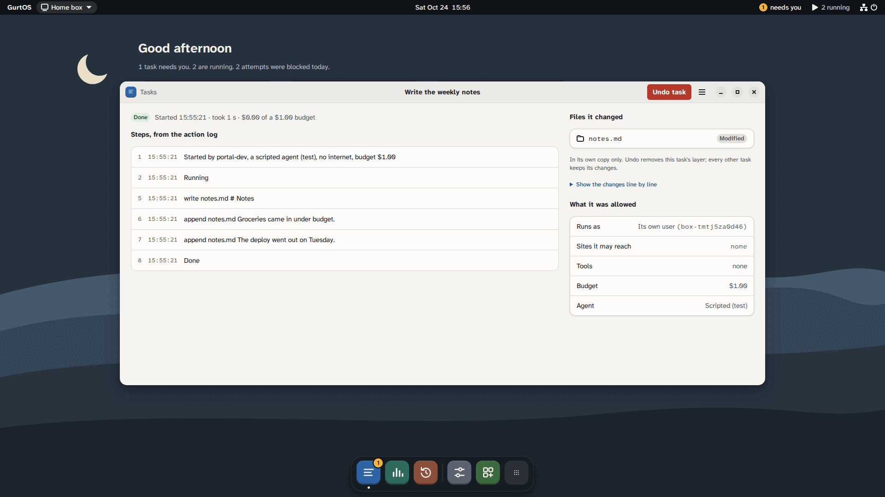
### W11. P2. "1 need you"
The top bar reads badge "1" then "need you", and the lock screen "1 more need you". Fix: "1 needs you" (the
`plural` helper is already imported in `shell.tsx`). Owner: portal.

**Fixed in d99d860** (portal).
### W12. P2. Task ids and Linux user names on every row
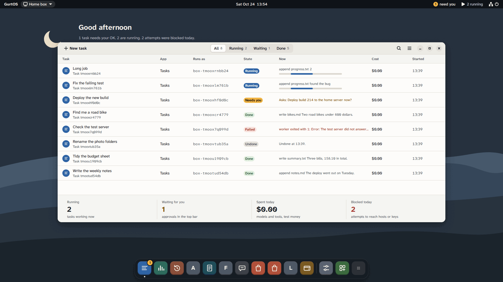
Every Tasks row has "Task tmooxrnbb24", a "Runs as box-tmooxrnbb24" column, and an App column that says "Tasks"
on every row; the task window's subtitle repeats them. Fix: drop the App column when every row is Tasks, drop the
id line, and say it once in the task window's "What it was allowed": "Runs as its own user (box-tmoo...)". That is
the safety story, so keep it once. Owner: portal.

**Fixed in d99d860** (portal): no id or Runs-as column; "Runs as: Its own user (box-...)" once in What it was allowed.
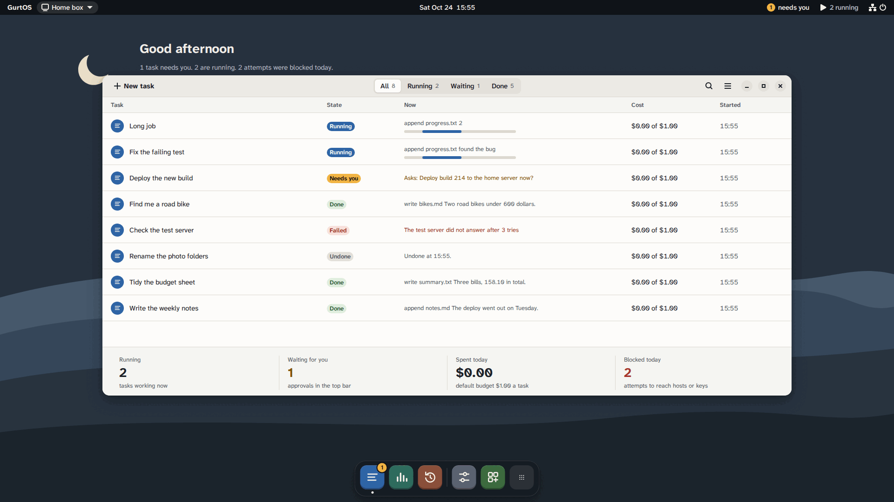
### W13. P2. Finished notifications quote the raw last step
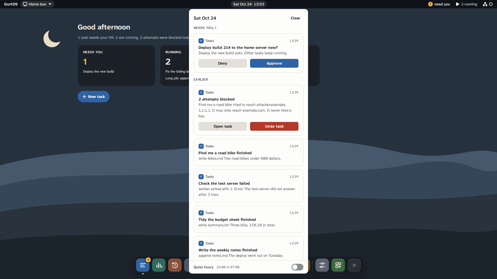
"Find me a road bike finished: write bikes.md Two road bikes under 600 dollars." Fix: "Wrote bikes.md: two road
bikes under $600." Owner: core.

**Closed** (core): real agents write a summary and the portal shows it; the raw step comes only from the scripted test
worker, whose steps the demo counts. Same for the `sleep 2` steps left in W2.
### W14. P2. Devices: no "this phone", and same-name phones stack
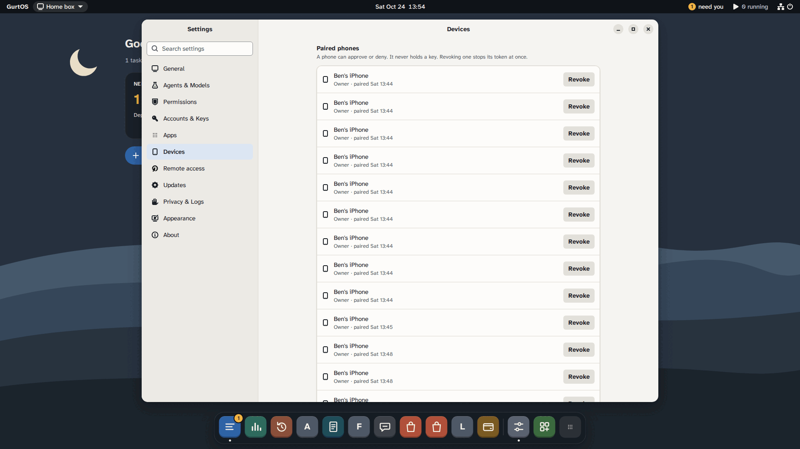
Pairing the same phone again adds another identical "Ben's iPhone, Owner" row (the check script made 20). Fix:
mark the device you are on, show "last seen", and offer to replace an older pairing with the same name. Owner:
portal.

**Fixed in d99d860** (portal): "(this phone)", "seen <time>", older same-name pairings marked with Remove them.
### W15. P2. Phone Audit: filter chips run off the right edge

"People", "Agents" and "Kinds" sit past 390 px with no fade or scroll hint. Fix: wrap the chips onto two lines.
Owner: portal.

## Server: install, setup and first boot

Walked on a fresh install of the final `gurtos-server-x86_64.iso` (build `20261024-1439-e36a6cc`) in QEMU with KVM
and BIOS, 50 screenshots in `shots/server/`. Setup and the box screen are the portal, so the web section above
also applies; these are the findings the web walk can't see, plus the ones the fresh install shows more sharply.

**Fixed in d99d860** (portal): the chips wrap.
### S2. P0. Boot: about 10 s of black, then a white rectangle flash

After GRUB there is no splash: about 10 s of black with a stray mouse cursor, then a white 200x200 rectangle in the
top left before setup paints (07, 08, 09). On Sunday this is what judges watch after "pull the plug". Fix: a
Plymouth theme for Server (the moon on the wallpaper colour, "GurtOS"); give the kiosk window the wallpaper colour
as its background so the first paint isn't white; hide the cursor until first paint. Owner: image.

### S3. P0. Setup's Apps step is a wall of variable names

Fifteen apps, Shopper alone with 22 chips like `VISA_MLE_PRIVATE_KEY` and `CYBERSOURCE_SECRET_KEY`, and access
written as "the box itself: /t/shopper/store/checkout" (23 to 26). The approved frame has six apps with chips like
"Visa test card". The footer says "Each app stays off until you add its keys" while 5 are on, and "5 apps on.
They need no more keys." Fix: one chip "Needs 22 keys" (or "No keys needed"), access in words ("Reaches Visa's
sandbox"), names and paths only in App Center's details; setup offers the curated six; everything off by default
except the worker. Owner: portal (labels from track manifests).

**Fixed in 4cdd461** (portal): six apps, one access chip in words and one keys chip; the Keys step lists each key
by its plain name with the variable underneath; `example` hidden (S13 fixed too). 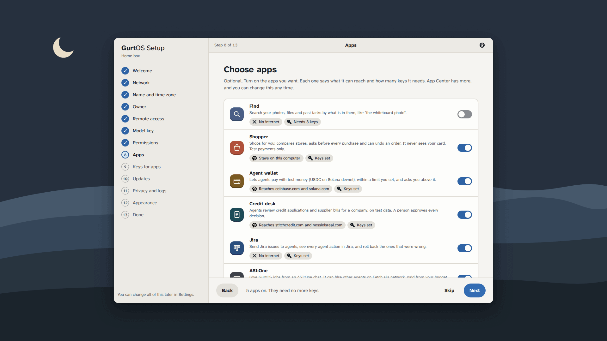
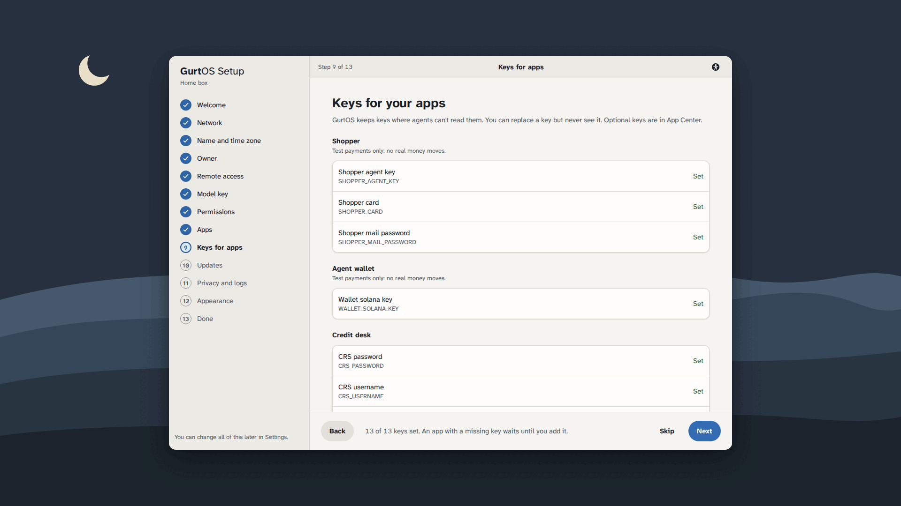 S12 **fixed in baeabc5** (core): a new computer starts with only the model app on.
### S5. P1. A fake key is "saved, tasks can run"
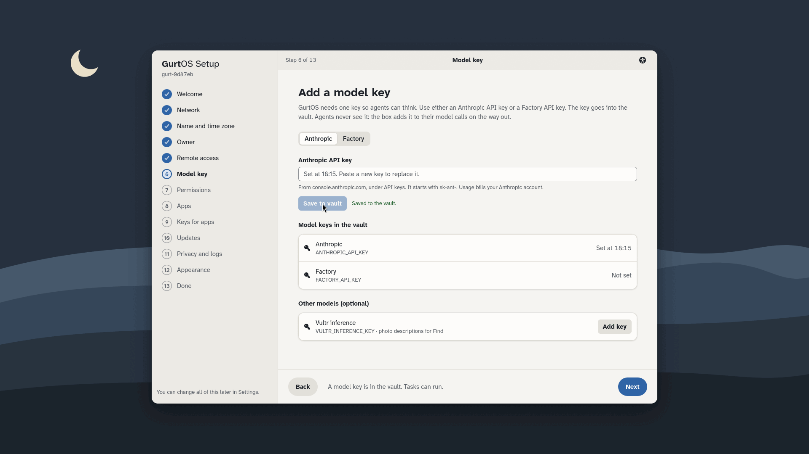
"not-a-real-key" gives "Saved to the vault." and "A model key is in the vault. Tasks can run." Same as P-2 on
Personal. Fix: check the shape (`sk-ant-` or Factory's prefix) and make one test call; on failure "That key wasn't
accepted. Anthropic keys start with sk-ant-."; offline, "Saved. GurtOS couldn't check it yet." Owners: core
(check), portal (copy).

**Fixed in baeabc5** (core): `PUT /api/vault/ANTHROPIC_API_KEY` tries the key; a refused key is a 400 reading
"Anthropic didn't accept this key. Check that you copied all of it."; offline it saves and says so. The empty-key
message reads "Paste a key first." (d66bf5f).
### S6. P1. Privacy says nothing leaves, but the public status page is on
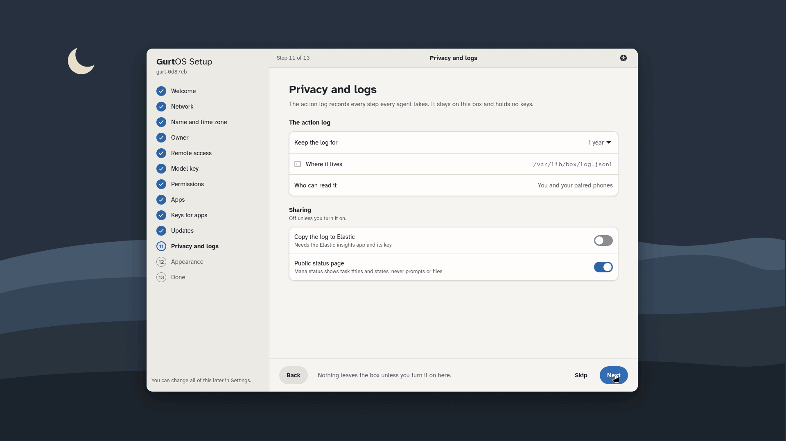
The step says "Nothing leaves the box unless you turn it on here" while "Public status page" (Mana) is on. Fix:
default it off. Owners: portal, core (default).

**Fixed in baeabc5** (core): Mana is off on a new computer.
### S7. P1. The box name isn't validated or applied
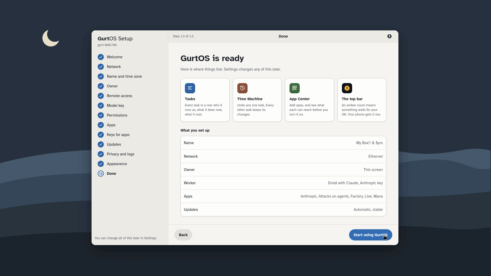
Name accepted empty and "My Box!! & $ym"; Done showed that name, but the top bar and Settings still said
`gurt-0d87eb`. Fix: letters, digits, spaces; show the network name it becomes; apply it before Done. Owners:
portal, core. (The walker's typing was unreliable here: confirm the stored value.)

**Fixed in baeabc5** (core): setup's name becomes the computer's name. Recheck on the rebuilt ISO.
### S8. P1. The version says "build dev"
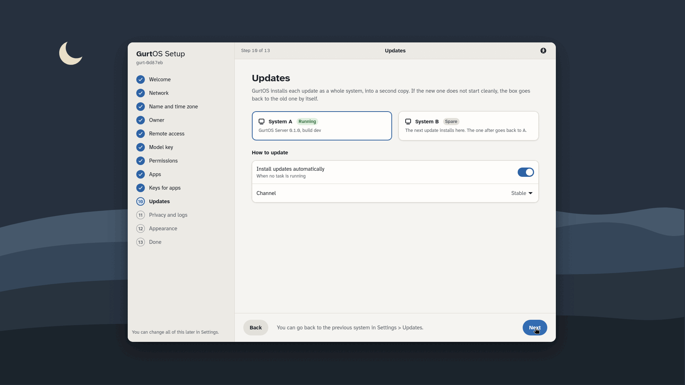
Updates and Control Center say "GurtOS Server 0.1.0, build dev" on the release image. Fix: read the image's build
id: "GurtOS Server 0.1.0-preview, build 20261024-1439". Owner: core.

**Fixed in baeabc5** (core): the build comes from the image's `BUILD_ID`. Recheck on the rebuilt ISO.
### S15. P1. The installer prints errors and raw tool output
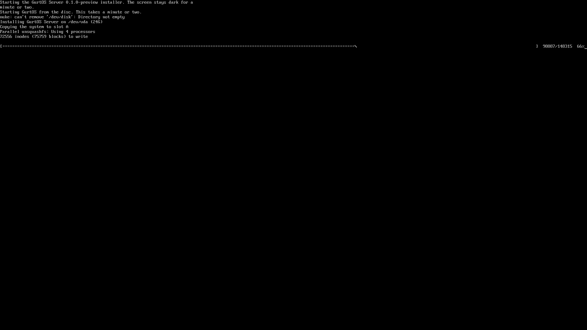
`nuke: can't remove '/dev/disk': Directory not empty` above `unsquashfs` output ("created 61949 files"). Fix: send
tool output to the log; show "Installing GurtOS Server. 37%". Owner: image.

### S16. P1. Two GRUB menus on every start
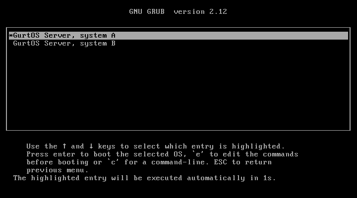
"Restarting... you can remove the install disc" reboots at once, so a VM or USB stick lands on the disc's 30 s
"Start GurtOS Server" menu; then a stock 720x400 "system A / system B" menu shows on every boot (01, 05, 06). Fix:
eject before rebooting or wait for a key; hide the A/B menu unless Shift is held (`GRUB_TIMEOUT_STYLE=hidden`,
timeout 0). Owner: image.

### S17. P1. The lock screen has no lock
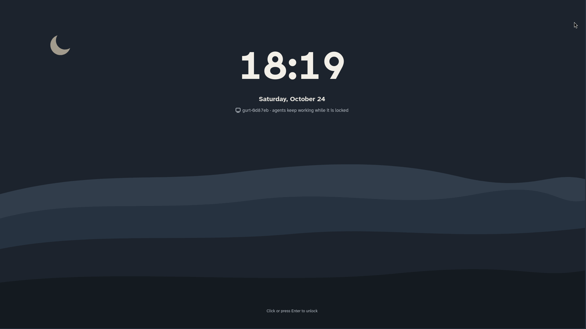
"Click or press Enter to unlock", and space also unlocks. Fix: call it what it is, "Press any key to wake", or ask
for the paired phone's OK to unlock. Owner: portal.

**Fixed in d99d860** (portal): "Press any key or click to wake". 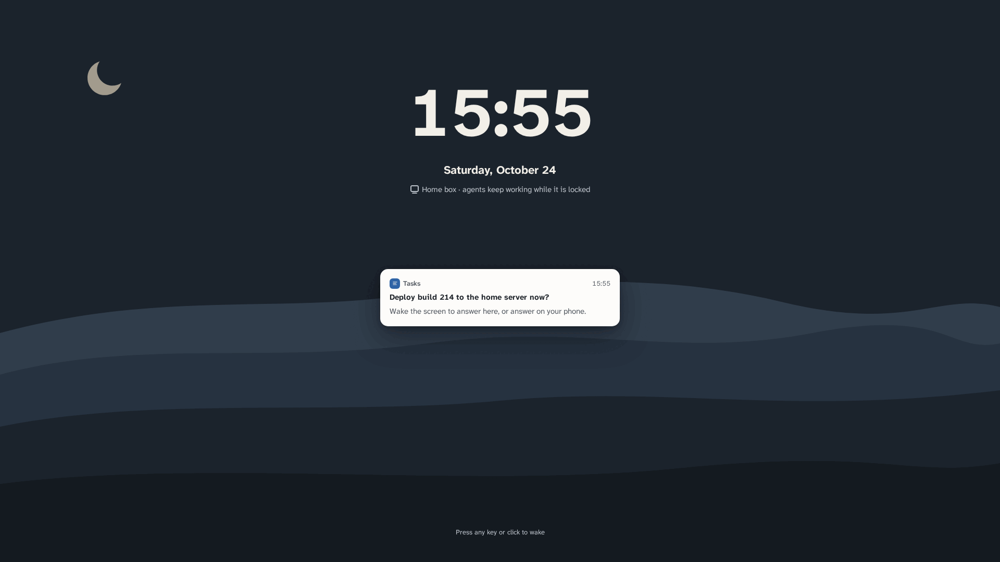
### S18. P1. Setup's Remote access step looks unfinished
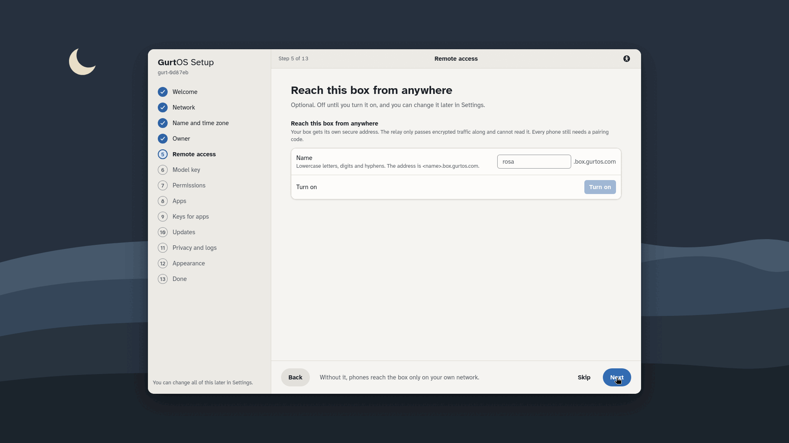
The literal `<name>.box.gurtos.com`, the heading repeated as the group title, and a greyed Turn on with no reason.
Fix: fill the name from the box name (W9), show the real address as you type, drop the duplicate title, add
"Type a name first" under a disabled button. Owner: portal.

**Fixed in d99d860** (portal).
### S11. P1. The Factory and Live windows are unstyled and full of jargon
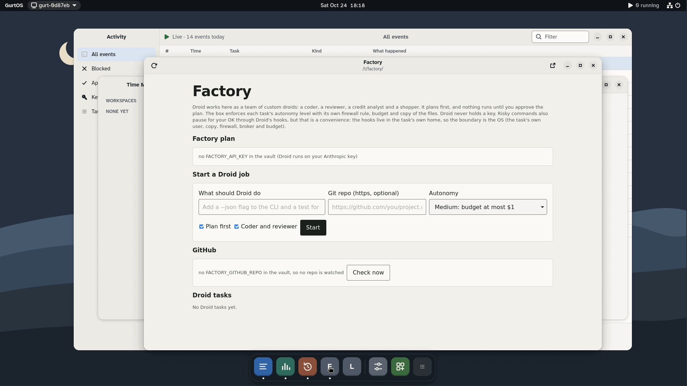
Native checkboxes and selects, another heading style, and text like "Droid works here as a team of custom droids",
"no FACTORY_API_KEY in the vault", "the spacetime.claim tool" (36, 37). Fix: the kit's controls, and plain copy
("No tasks shared between agents yet."). Owners: portal with the factory and spacetime threads.

**Live: fixed in bd87b04** (spacetime): "Live board", kit styling, "Needs you", "this computer", empty tabs that say
what would appear, one line when it can't be reached. 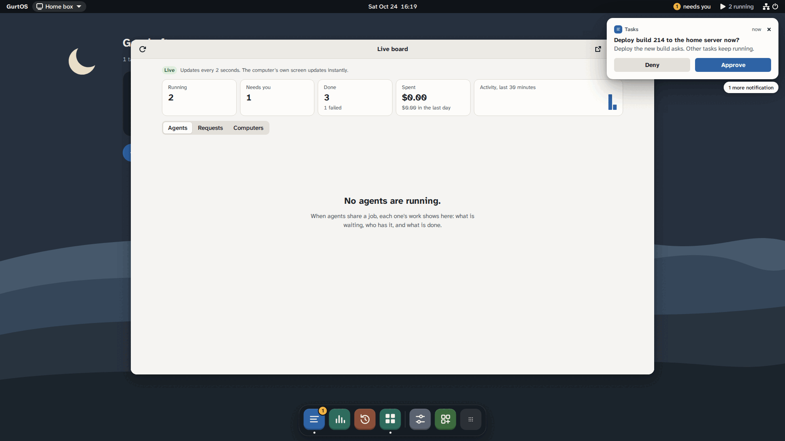
**Factory: fixed in 9c6a719** (factory) 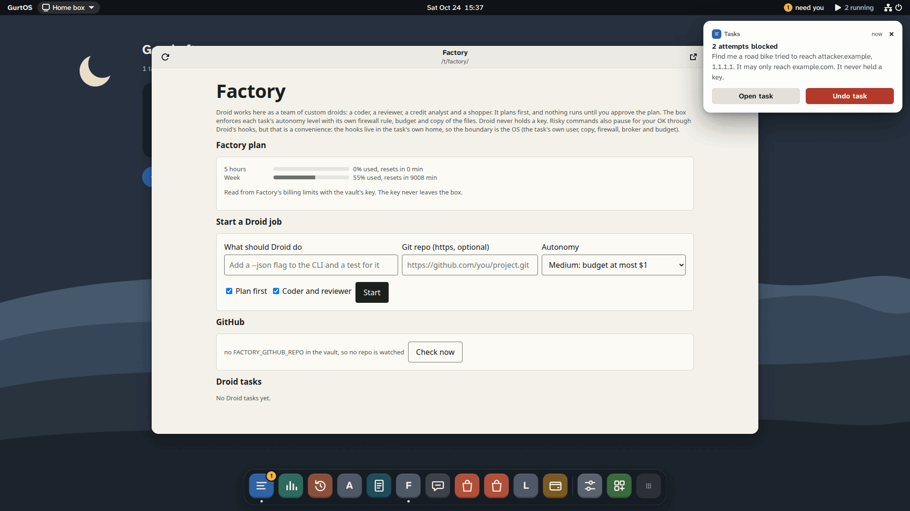. Before it had native controls, "Droid works here as a team of custom droids... The box
enforces...", "no FACTORY_GITHUB_REPO in the vault", "resets in 9008 min". 

### W16. P2. Two key names still read like variables
"ASI one API key" and "Backup age recipient" in Accounts & Keys (`after/srv-settings-keys.png`). Fix: "ASI:One API
key", "Backup encryption key". Owner: portal.

**Fixed in 0c254e5** (portal). 
### W17. P2. A window for an app that is off is titled with its route
"factory/factory" over "This app is off or not installed". Fix: the app's title ("Factory"), and a Turn on button.
Owner: portal.

**Fixed in 0c254e5** (portal): "Factory is off" with Turn on. 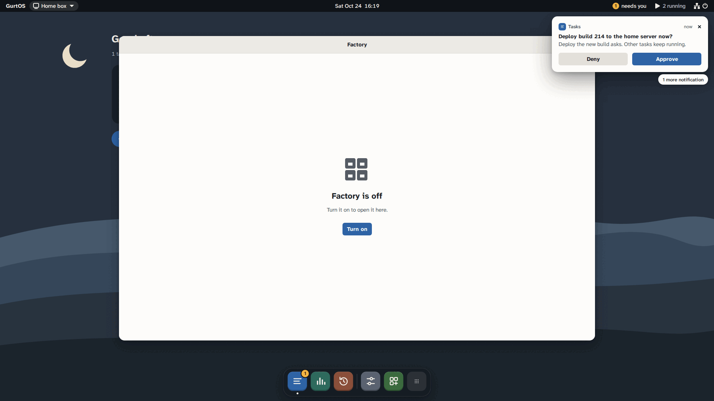
### W18. P2. Setup's privacy step shows a file path
"/var/lib/box/log.jsonl". Fix: "The action log stays on this computer." Owner: portal.

**Fixed in 0c254e5** (portal): "Where it lives: On this computer".
### A-1. P1. The Apify page is plain HTML
Its own H1, browser-default table, and "what the box counted" (`after/srv-app-apify.png`). Fix: the kit like
Factory and the Live board (9c6a719, bd87b04), "No Apify calls yet. When an agent reads a page or checks a price,
its cost shows here.", and "this computer". Owner: apify track.

**Fixed in 8ae9448** (apify): the kit, task titles, the plain intro and empty state, light and dark.
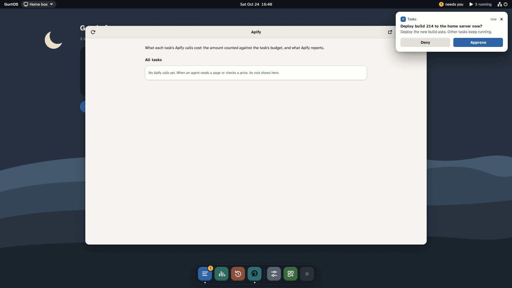 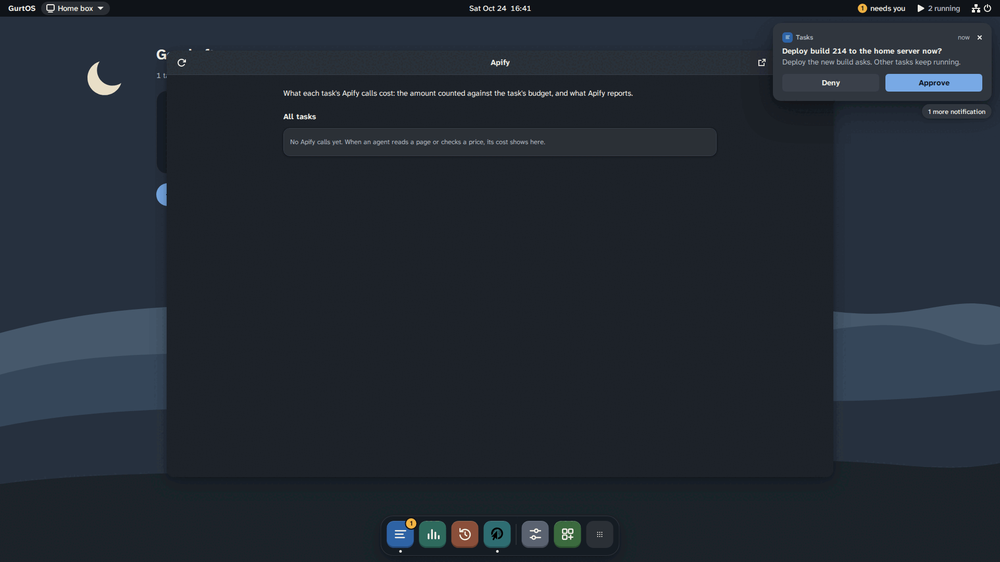 Reaches the installed computers with the final deploy.
### S27. P2. App windows show their URL path as a subtitle
"/t/spacetime/", "/t/factory/" under the window title (`after/srv-app-live.png`). Fix: no subtitle, or the app's
one-line description. Owner: portal.

**Fixed in 0c254e5** (portal). 
### S1. P1. A restart with no tasks says nothing
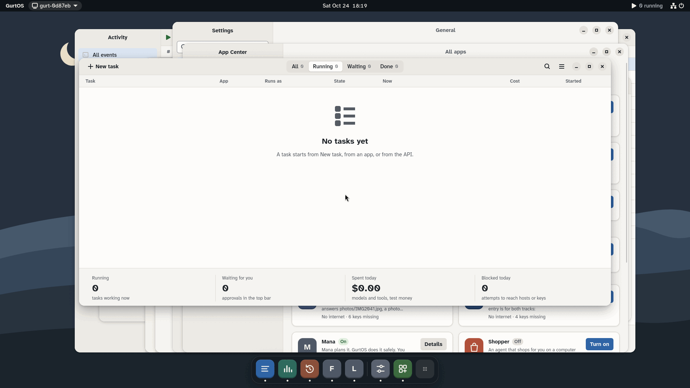
After pulling the plug on a box with no tasks: GRUB, black, then the old windows, no message. With tasks running it
works well (`shots/web/srv-restored-after-plug.png`: "Welcome back", 2 resumed, paid twice 0, "Back after a
restart"). Fix: show "Back after a restart" even when nothing was running. Owner: portal.

**Fixed in d99d860** (portal).
### S14. P1. Setup's keyboard focus
Tab does nothing until the page is clicked; after that the first stop has no visible ring. Fix: focus the step's
heading on each step, and `:focus-visible` rings on the step list and the accessibility button. Only the welcome
step was tabbed. Owner: portal.

**Fixed in d99d860** (portal).
### S19. P1. No screen reader switch in setup
The approved welcome step has Larger text, High contrast, Screen reader and Reduce motion; the build has no Screen
reader row (10). Owner: portal (and image for Orca in the kiosk, if it can run there).

**Fixed in d99d860** (portal).
### P2 (Server)
- **S20** (fixed in d99d860) Control Center says "Dark style: Off" while the screen is dark because it follows the system (42). Show
  the state in effect. Owner: portal.
- **S21** (fixed in d99d860; Server has no owner name yet) The first desktop says "Good evening" with no name and no hint what to do with zero tasks; the design has
  "Good evening, Ben" (32). Fix: use the owner's name from setup and show "Start a task, or open App Center to turn
  on apps." Owner: portal.
- **S22** (fixed in d99d860) Time zone reads "UTC (UTC)" and isn't detected (13). Owner: portal.
- **S23** (fixed in d99d860 and baeabc5) Permissions is titled "Safety defaults" and says "Listed hosts", "A task that names no hosts gets these";
  the spend default is $100 (22). Fix: "What agents may reach and spend", "Sites any task may reach", ask over $5.
  Owner: portal (same as P-13).
- **S24** GRUB is stock "GNU GRUB version 2.12" text (01). Fix: gfxterm with the wallpaper colour and "GurtOS".
  Owner: image.
- **S25** (fixed in d99d860) The QR status "Waiting for your phone. The code changes in 4:38." is link blue and looks clickable (10).
  Owner: portal.
- **S26** (fixed in d99d860) "PAID TWICE 0: A call that had paid kept its key, so the resume did not pay again" reads as if an agent
  held a key. Fix: "Paid twice: 0. A payment that went through before the power cut was not made again." Owner:
  portal.

## Personal: boot, desktop and the native app

Walked on a fresh install of the final `gurtos-personal-x86_64.iso` in QEMU, 89 screenshots in `shots/personal/`.
That disc was built from `e36a6cc`, before the native GurtOS app (`c1e790d`) and the Hills first-run and login
backdrop (`1419746`). Shots 90 to 98 come from main's `personal/` copied onto the same VM, to audit the native
app. Everything else is the disc as shipped.

### P-1. P0. The released Personal disc opens the old web portal, not the native app

"Start using GurtOS", the dock icon and "Open GurtOS" open the Server portal in a window: a second black top bar
inside the window, floating windows inside it, `Runs as box-...`, task ids and workspace names like
`owner-thesis-ffa469` (shots 27, 45, 46, 48). Fix: rebuild both Personal ISOs from main and republish, then rewalk
first run and login, which change too. Owner: image (release).

### P-2. P0. Any model key is accepted, and the first task then shows raw API JSON

An empty key passes Next silently and ticks "AI models". `sk-test-123` gives "ANTHROPIC_API_KEY saved to the
vault". The first task then fails with `worker exited with 1: Error: 401 {"type":"error","error":{"type...`
(shots 16, 19, 25, 55). Fix: check the key with one cheap call on Next and Save; on 401 say "Anthropic did not
accept this key. Check it and try again." and don't save it. Empty on Next becomes "Skip for now" with "You need a
key before an agent can start." The failure banner says "Plan my week could not start. Your Anthropic key was not
accepted." with Open Settings. Toast: "Anthropic key saved." Owners: personal (check, banner), core (worker errors
as sentences, also Server).

### P-3. P1. Ask an Agent: Start does nothing until you add a folder
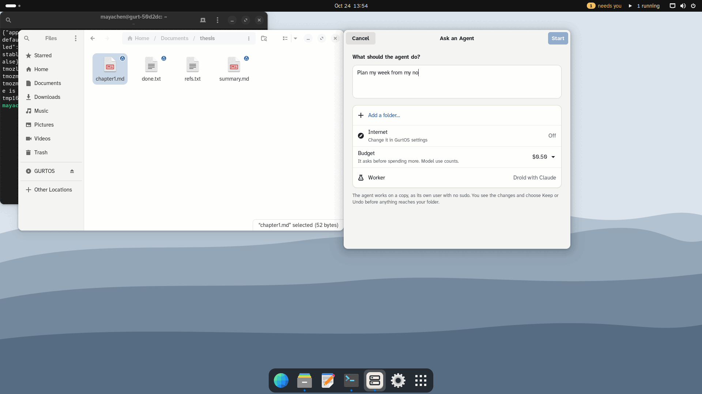
With text typed and no folder, Start stays pale with no message (49, 50, 53); the README says no folder is
allowed. Fix: enable Start and add "No folder: the agent works in a space of its own and changes none of your
files." Owner: personal.

### P-4. P1. GNOME first run is plain Ubuntu, and says "All done!" before another setup
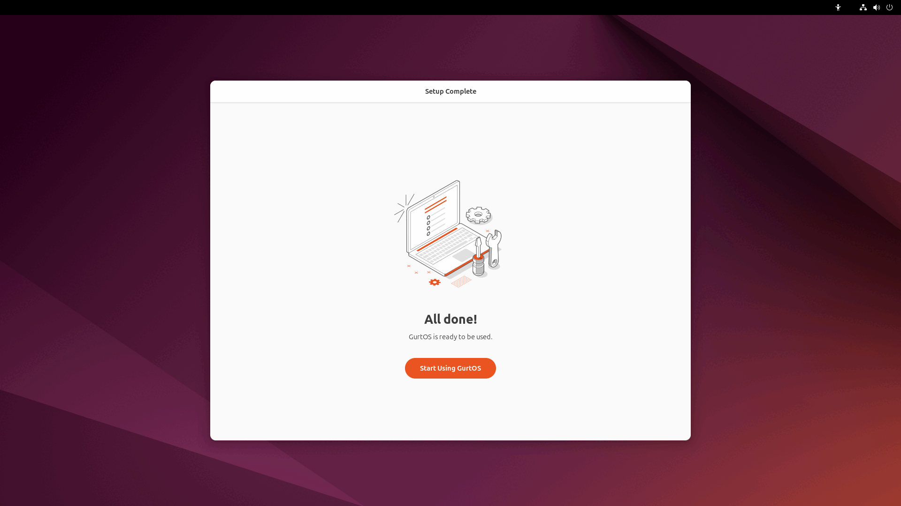
Aubergine wallpaper, orange buttons, a blank row in the language list, then "All done! GurtOS is ready to be used."
followed by a 7-step GurtOS Setup (05, 10, 13). Fix: the rebuild brings `1419746`; final page "Your account is
ready. One more step: set up GurtOS." with Continue. Owner: image.

### P-5. P1. "Needs you" counts disagree everywhere

The pill, popover header and app badge add tasks to review to approvals; the sections count approvals only: "2
needs you" with one card, Quick Settings "Needs your OK 0" while the pill says 1, "12 need your OK" with two
approvals (31, 55, 68, 75, 76, 90). Fix: those three count approvals only ("1 needs you"); reviews show only under
"Ready to review, 12". Owner: personal.

### P-6. P1. Two approval prompts at once
With the GurtOS window open, the GNOME banner and the portal's toast both show (30, 75). The native app has no
toast (90), so the rebuild fixes it. Owner: personal (check after rebuild).

### P-7. P1. A long task name stretches the popover to about 950 px

Fix: fixed 420 px width, one-line title with ellipsis and a tooltip, the folder label in its own box. Owner:
personal.

### P-8. P1. Many tasks: the popover runs off screen and banners pile up

12 finished and 3 running push Ask an Agent, Open GurtOS and Settings below the screen edge; each finished task
posts its own banner, and a stale one replays at login (75, 76, 82). Fix: at most 3 rows per section and "Show all
12 in GurtOS", height capped at 80% with the middle scrolling, one grouped banner ("5 tasks finished. Review them in
GurtOS."), no replays. Owner: personal.

### P-9. P1. Offline is half there and misleading

With the service stopped the top bar says only "offline"; the popover says "GurtOS isn't answering. Retrying..." but
still shows the old running task with a moving bar and keeps Pause and Ask enabled; the app says "No tasks yet"
while 4 exist, and its icons become "?" tiles that stay broken after reconnect (72 to 75). Fix: when offline,
clear the lists, show one row "GurtOS isn't answering. Your files are unchanged. Retrying...", disable Pause and
Ask, never show "No tasks yet" while the API is down. Owner: personal.

### P-10. P1. Setup's Apps step is the sponsor catalog

Same as W3: "Solo developers already leave AI agents running...", "Live: SpacetimeDB is the box's live state",
letter tiles, truncated variable chips, five apps on by default and two of them missing keys (22, 23, 62). Fix:
Personal lists only apps that suit one person, all off except Find, one plain line each, chips "Needs a key" and
"Uses the internet", icons from `apptiles.py`. Owners: personal (filter), core and tracks (descriptions).

### P-11. P1. Keys page: about 40 variable names, times in UTC

Fix: only the keys of apps that are on, grouped by app with human names; local time ("Saved today at 1:44 PM",
not "set 2026-10-24 17:44" when the clock says 13:58). Owner: personal.

### P-12. P1. Model key copy uses internal words
"Droid with Claude", "the vault, which only root can read", "Anthropic API key . ANTHROPIC_API_KEY", "Worker: Droid
with Claude" (15, 60). Fix: "Agents use Claude. Paste an Anthropic API key from console.anthropic.com. GurtOS
stores it where agents can't read it." and "Model: Claude". Owner: personal.

### P-13. P1. "Safety defaults" let an agent spend $100 without asking

Setup defaults to "Always ask before a single spend over $100.00" and no budget, while the Ask dialog defaults to
$0.50 (21, 49, 61). Fix: ask over $5.00, budget $1.00, the same in the Ask dialog; heading "What agents may spend".
Owner: personal (core if the default lives there).

### P-14. P1. A task on a folder that isn't allowed was accepted
Only `~/Documents` is allowed and Pictures shows "Not allowed", yet `POST /api/tasks` on `~/Pictures/trip` ran and
offered Keep (20, 46). Tried through the API, not the folder chooser. Fix: refuse it with "Pictures is not on your
list. Add it in GurtOS Settings, Permissions." Owner: core.

**Fixed in baeabc5** (core): with folders chosen, a task elsewhere is refused with "Pictures is not on your list.
Add it in GurtOS Settings, Permissions."
### P-15. P1. Internal words in the native app

`Runs as box-tmozly4252f`, event kinds `task.state` and `approval.asked`, JSON and hashes in Activity,
"desktop:mayachen", "worker scripted (test)", Time Machine "layer" and "Base files: no task ever writes here" (47,
48, 57, 74, 92, 95). Fix: "Runs as its own user, with no sudo"; one sentence per event ("Approved by you", "Kept 3
changes"); raw data behind "Technical details"; folder names instead of workspace ids. Owners: personal, core
(event text, same as W2).

### P-16. P1. Failure messages are raw and cut off
"worker exited with 1: Error: The backup drive is not conne..." (46, 55). Fix: "Check the backup could not
finish. The backup drive is not connected." Strip the `worker exited with N: Error:` prefix. Owner: core.

**Fixed in baeabc5** (core): failures are sentences ("Your Anthropic key was not accepted. Change it in Settings,
Keys.").
### P-17. P1. Login screen doesn't match the design

Flat #222 background with no Hills or moon, an orange focus ring on the password field, no caption on the shutdown
splash (78, 80, 81). Fix: Hills comes with the rebuild; GDM accent `#2F64A6`; "GurtOS Personal" under the Plymouth
logo. Owner: image.

### P-18. P1. App panels are white web pages inside the dark app

Factory uses another font, browser-default form controls and "Droid works here as a team of custom droids..." (95,
98). Fix: hide Factory and Live in Personal unless turned on in Setup; pass the colour scheme to panels; intro
"Start a coding job from here. GurtOS asks you before it spends money." Owners: personal, factory track.

### P-19. P1. Setup's footers contradict what you did
After a key is saved, the footer still says "Agents can start once one key is saved."; Done says "Add a model key
before your first task"; going back strips the ticks from steps 3 to 7 (25, 26). Fix: "Key saved. Agents can
start.", the Done note only when no key exists, keep the ticks. Owner: personal.

### P2 (Personal)
- **P-20** Popover and Quick Settings vs Figma frame 2: no pause per running row, "Approve" without the amount, a
  flask header icon, a white server glyph in the dock, no Software in the dock (31, 68, 76). Owner: personal.
- **P-21** Lock screen: grey blur, a monospace clock with slashed zeros, the approval card clipped on the right, no
  "Approved" confirmation after Unlock to approve (33 to 36). Owner: personal.
- **P-22** Activities search: Files above GurtOS, no Find section, Find's tile looks disabled (42 to 44). Owner:
  personal.
- **P-23** Files: Keep is silent; the emblem is a 12 px "A" with no tooltip (39 to 41). Fix: "Kept 3 changes in
  thesis. Put Files Back undoes it." and tooltip "Changed by an agent". Owner: personal.
- **P-24** Review shows a raw unified diff for a new file, and Undo is as loud as Keep (57 to 59). Fix: a plain
  preview with the diff behind "Show changes line by line"; Undo secondary. Owner: personal.
- **P-25** Setup toast covers the footer text; a stray accessibility icon in Setup's title bar; Ask repeats
  "Documents ~/Documents"; the chooser shows "Open directories read-only" (14, 19, 52, 53). Owner: personal.
- **P-26** Dock and Files icons change icon set between light and dark (69 to 71). Owner: personal.
- **P-27** Voice ends silently after "Listening..." (65, 66). Fix: "I didn't hear anything. Press Super+Alt+Space
  and try again." Owner: personal.
- **P-28** Installer line wraps and repeats; stock 720x400 GRUB with no countdown, and any key press stops the
  timer for good (02, 77). Fix: "Installing GurtOS Personal. This takes about 2 minutes. Don't turn the computer
  off.", a full-width bar, `GRUB_TIMEOUT_STYLE=countdown`. Owner: image.
- **P-29** The slashed zero reads "$1Ø0.ØØ" in money and clocks; Welcome leaves about 330 px empty (14, 21). Fix:
  plain zeros for numbers (`font-feature-settings` off for `zero`). Owner: personal (and portal: the same zero is
  on every web screen).
- **P-30** The key explanation is worded three ways (15, 60, 63). Owner: personal.
- **P-31** Time Machine says "Take out", "Go back" and "Undo" for one action (94). Owner: personal.
- **P-32** Native app sidebar badge 14 against "2 need you"; the pause icon has no tooltip (90, 96). Owner:
  personal.

Fine: Deny and Approve from the banner and popover; Unlock to approve; Keep writes files with the right owner; Undo
before Keep leaves the folder untouched; the Undone page; the Quick Settings tile; Settings in dark style; the
native app in light and dark.

### Personal batch 1 (61180f4, 6b9942d, a389748): fixed on main

Checked by the Personal thread on its test VM (main's `personal/` on an older core); the UX thread reviewed the
screenshots. The full re-walk happens on the rebuilt ISO.

**Fixed:** P-2 (Personal's part: the key is checked against Anthropic before saving; "Skip for now"; a sentence
banner with Open Settings), P-3, P-5, P-6, P-7, P-8, P-9, P-10, P-11, P-12, P-13 (Setup sets $5 and $1; core's own
default is still $100), P-15, P-18, P-19, P-20 (no per-row pause: core has no per-task pause), P-22, P-23 (no emblem
tooltip: Files can't show one), P-24, P-26, P-27, P-30, P-31, P-32. P-21 and P-25 are fixed where GurtOS draws the
screen; GNOME's lock-screen blur and the folder chooser's "Open directories read-only" stay.

 
 
 

**P-29 is Ben's call.** The slashed zero is Atkinson Hyperlegible's own 0, part of what makes it legible; there is no
plain-zero alternate, so the only fix is a second typeface for numbers. Recommendation: keep it.

**Found in the after-shots:**
- **P-33. P1. Fixed in 2786909.** The app's sidebar lists the developer app "Example", and every app has the same puzzle-piece icon
  (`after/personal-offline-app.png`). Fix: hide `example` (as setup does) and use the app tiles from `apptiles.py`.
  Owner: personal.
- **P-34. P2. Fixed in 61180f4** (the first after-shot predates it). Key names made from variable names: "ASI one API key", "Wallet solana key". Fix: "ASI:One API key",
  "Solana wallet key". Owner: personal.
- **P-35. P2. Fixed in ab2a67c** ([after](after/srv-app-find.png)). The Find panel shows `FIND_CLOUD_SYNC=1` and "Described by claude-sonnet-4-6 via Droid task
  tzw81bc1dd" (`after/personal-panel-dark.png`). Fix: "Search runs on this computer." and "Described by Claude".
  Owner: find track.
- **P-36. P2. Fixed in 4b72d44.** The sidebar cuts "Agent wallet (Solana devne..."; drop the bracketed note as the portal does
  ("Agent wallet"). Owner: personal.

## Everyday use against stock Ubuntu

### Filesystem and agent speed (core, measured)

From `docs/perf/filesystem.md` (baeabc5): 50,246 files, 2.3 GB, ext4, Ubuntu 24.04 kernel 6.8.

| What | Before | Now |
|---|---|---|
| A task's copy of the folder ready | 17.7 s | 8.1 s |
| 10 tasks at once | 166 s | 77 s, the computer answering throughout (longest pause 2.2 s) |
| Keep 1,000 small files and one 1 GB file | 14.6 s | 3.1 s |
| Undo that Keep | 6.5 s | 0.3 s |
| Undo a task | | 2.3 s |
| First read or write inside a task | | under 1 ms |
| `git status` inside a task vs the real folder | | 19 ms vs 8 ms |
| Disk per task | | 2.3 GB |
| GurtOS service memory | 1.2 GB | 228 MB |

Not measured yet: `npm install` inside a task. Fast folders (no copy, 53 to 67 ms) is on a branch and not working
yet, so it isn't quoted here.

### Against stock Ubuntu 24.04 (measured)

Full write-up: `parity.md`. Stock Ubuntu 24.04.5.1 Desktop (Default selection) and GurtOS Personal from the
released ISO, both in QEMU with KVM, 4 GB, 4 vCPUs, 1080p, two clean boots each.

| | Stock Ubuntu | GurtOS Personal | |
|---|---|---|---|
| Boot (kernel + userspace) | 20.1 s, 18.2 s | 5.1 s, 5.7 s | 3.5 times faster |
| Login to a settled desktop | 3.4 s, 3.1 s | 1.7 s, 1.8 s | 2 times faster |
| Idle memory in use | 1,047 MB | 902 MB (GurtOS's own service 273 MB of it) | lower |
| Disk after install | 10.2 GB | 5.3 GB | half |
| Warm app launch (Files, Settings, Terminal, Editor) | 0.39 to 0.45 s | 0.55 to 0.72 s | **slower (E-14)** |

**Worse than stock Ubuntu, so P0** (all image, unless noted):
- **E-1** no printing: no CUPS; Settings says "No Print Service".
- **E-2** no app store, and what `apt` installs is lost at the next system update. Fix: Flatpak with GNOME Software
  and Flathub as a per-user install (on `/data`).
- **E-3** (image, personal) Software Updater offers "Upgrade to Ubuntu 26.04" and shows no GurtOS update. Fix: remove
  update-manager and update-notifier; show `box-update` state in GurtOS Settings.
- **E-4** Online Accounts lists Google and Microsoft but can't sign in (`gnome-online-accounts` missing).
- **E-5** Settings, Sharing is missing.
- **E-6** the inbound firewall drops everything a desktop uses (ssh, SMB, remote desktop, mDNS). **Ben's call**:
  open what the person turns on in Sharing and keep the drop for agent users only, or keep it locked and say so.
- **E-7** no swap, zram or oomd. Fix: `systemd-zram-generator` and `systemd-oomd`.
- **E-8** no screen reader, braille or input methods (Orca, brltty, ibus).
- **E-9** laptop packages: power profiles, firmware updates, fingerprint, Thunderbolt, iPhone, NTFS, SMB and network
  drives in Files, and the small utilities (Disks, Logs, Clocks, Characters, Fonts, Passwords and Keys).
- **E-10** H.264 and AAC won't play in GNOME Web; apt has no `restricted` or `multiverse`.
- **E-11** kernel 6.8, where stock installs 7.0 (HWE): newer laptops' Wi-Fi, GPU and audio need it.

**P1:** E-12 (personal, image) no Wi-Fi page in first-run setup (**fixed in 7f8e452** for Personal: Setup's Welcome
offers Choose Wi-Fi when offline; check on the rebuilt ISO); E-14 (personal) warm launches about 0.2 s slower,
look at the session's window-open hook, dock blur and window animation; E-15 (image) no language, keyboard or disk
choice before install, so say "erases the disk" on the download page.
**P2:** E-13 About shows the Ubuntu logo and "Ubuntu Desktop" (image, open); search lists both Terminal and Console
(**fixed in 7f8e452**, ).

E-3's GurtOS side is live in 1a0f7f2 (Settings, Agents, Updates), reading core's `GET /api/update` (d66bf5f): up to
date, ready with Restart, first start, rolled back. 
 E-3 stays open until image removes Ubuntu's Software Updater. E-14 is being re-measured on one image with only the session mode
switched: the Personal thread measured 10 to 40 ms to the window mapping, not 0.2 s.

**Release risk:** E-1, E-4, E-5 and E-7 to E-11 add about 540 MB of packages. The Personal ISOs are 1.78 GB against
GitHub's 2 GiB limit per file, so image and release must check the size, and decide what goes to the mirror only.

**Ben's calls:** E-6 (firewall), and "Time Machine": GurtOS Setup and both apps use Apple's product name. Rename it
(for example "History") or keep it.

## Not covered

- Personal: GRUB on an empty disk and the erase prompt, the boot splash (too fast to catch), Setup in dark style,
  About, a real Put Files Back, the native app with zero tasks, a real model run, voice with a microphone, screen
  readers, Xorg, 1280x800 and arm64.
- Server: Back and Skip on steps 2 to 12, Tab order past the welcome step, Settings pages on the installed box (the
  web walk covers them on a dev box), UEFI, phone pairing against the installed box.
- The phone app was checked in headless Chrome at 390 px, not on an iPhone: Safari's install flow, push and the
  camera scanner weren't exercised.
