# GurtOS apps for iPhone, Apple Watch, Mac and Android

The GurtOS companion as installable apps. They show what your agents are doing, ask for your OK, and undo a task.
They call the same API as the web app, with a pairing token of their own. They need a GurtOS computer to talk to.
The web app (app.gurtos.com) stays the option that needs no install.

## What is available today

| | What it is | Where it comes from |
|---|---|---|
| iPhone | Native SwiftUI app, iOS 26 | TestFlight, internal testing only (build 1, 0.1.0). There is no public download and no App Store listing. Build it yourself (below) |
| Apple Watch | Native watchOS 26 app, inside the iPhone app | Installs with the iPhone app |
| Mac | Menu bar app with a Share extension, macOS 26 | `gurtos-mac-0.1.0.dmg` on the [v0.1.0-preview release](https://github.com/benz16107/calhacks13/releases/tag/v0.1.0-preview), signed with a Developer ID and notarized |
| Android | The web app as a Trusted Web Activity APK | `gurtos-android-0.1.0.apk` on the same release. It was tried in an Android 15 emulator, not yet on a phone |
| Windows | No app. Install app.gurtos.com from Edge | The gurtos.com Download page |

None of these is on a store. The Android APK and the Mac DMG are sideloaded.

## What needs the relay

The relay (`relay/`, [docs/self-host.md](../docs/self-host.md)) gives a computer a public address, forwards push
notifications, and lets a phone and a computer find each other. **The hosted relay at box.gurtos.com is offline as
of October 29, 2026.** Until it is back, run your own and point the computer and the apps at it, or stay on the home
network.

| | Home network, no relay | Needs a relay |
|---|---|---|
| Pair the iPhone or the Mac | Yes. Scan the QR code on the computer's screen with the app, or type its address and code | Pair from anywhere, and "Pair over the internet" while a new computer is in setup |
| Read tasks, approve, deny, undo, kill switch | Yes, while the phone is on the same network as the computer | From anywhere, through the computer's `https://<name>.<relay>` address |
| Notifications on iPhone and Apple Watch | No. Requests show while the app is open | Yes. The computer sends them through the relay's gateway to Apple. The computer needs Reach this computer from anywhere on |
| Notifications on the Mac | Yes. The Mac app makes them from its live connection to the computer | Not needed |
| Quick Start (set up a new computer from one you own) | No | Yes |
| Android app | No. See below | Yes |

On the home network the app talks to the computer's own address, `http://<its IP>:7700`, in plain HTTP. Anyone on that
Wi-Fi can read the traffic, so pair only on a network you trust. The apps allow plain HTTP only for the home
network (an IP address or a `.local` name); any other name has to be `https`. With remote access on, the computer has its own `https` address
and its certificate, and the relay cannot read what passes through.

A home address is the computer's IP address. If the router gives it a new one, the app says it can't reach it: pair
again, or give the computer a fixed address in the router.

When the relay or the computer does not answer, the apps say so in one sentence and stop waiting: "Couldn't reach the
GurtOS relay (box.gurtos.com). It may be offline. You can still pair on the same Wi-Fi as the computer." No screen
waits on a spinner for a relay that is down.

## iPhone

| Pairing | Home (Server) | A request | A task |
|---|---|---|---|
| 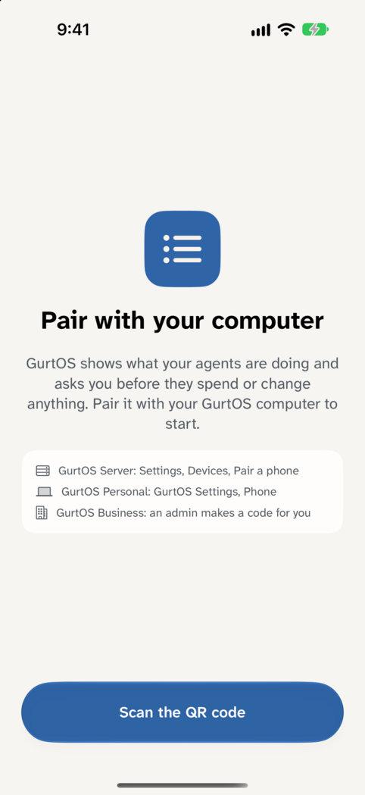 | 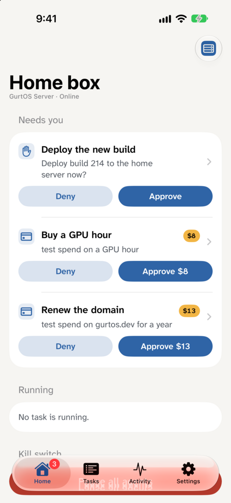 | 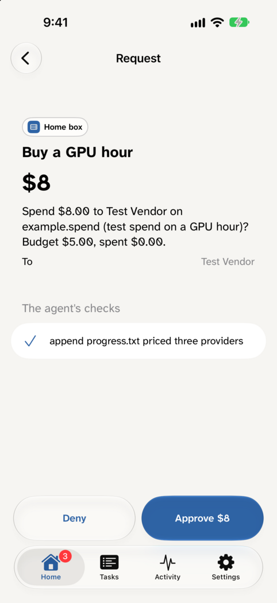 | 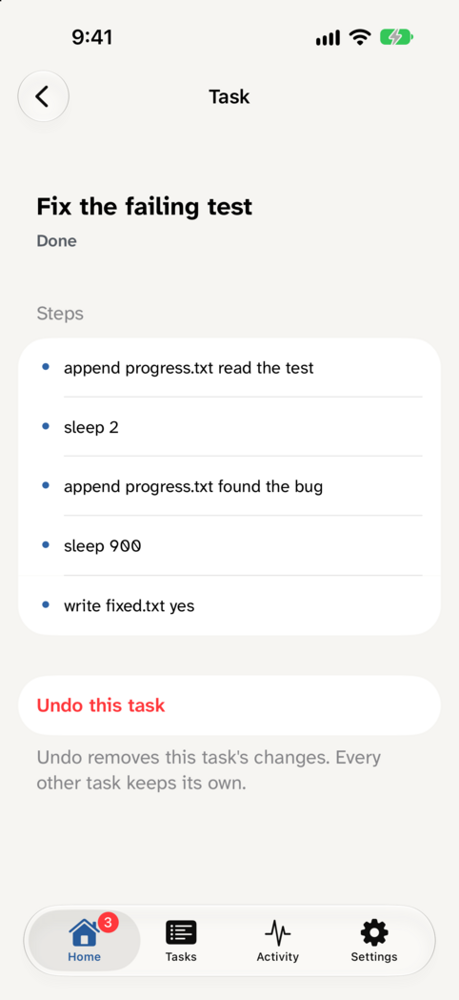 |

| Dark | Business, signed in as Rosa | Rosa's request | The notification and its buttons |
|---|---|---|---|
| 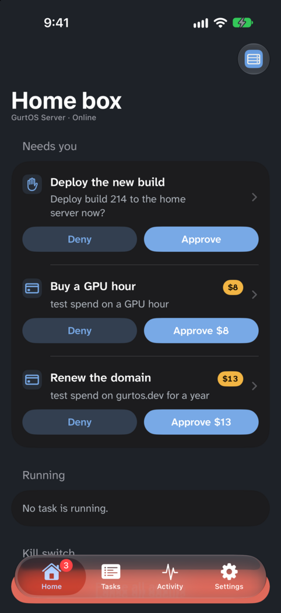 | 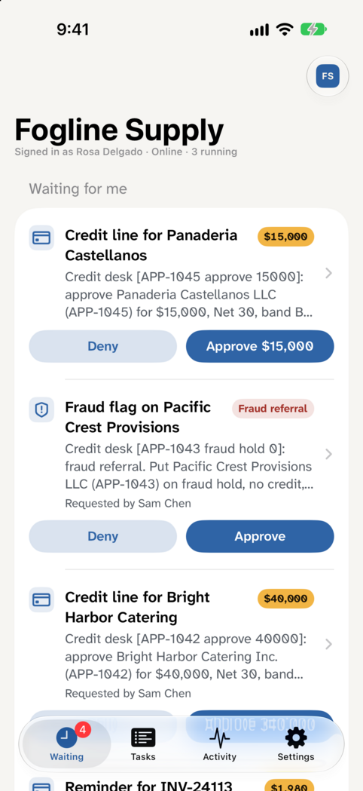 | 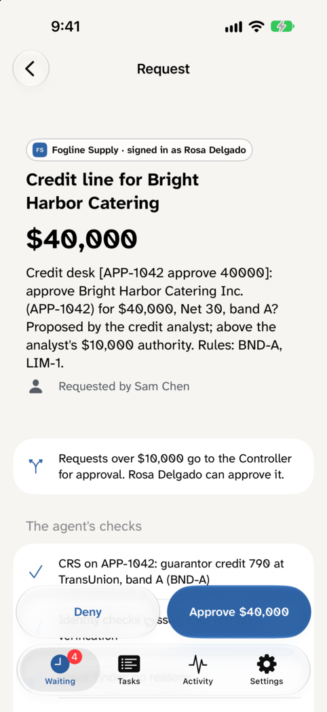 | 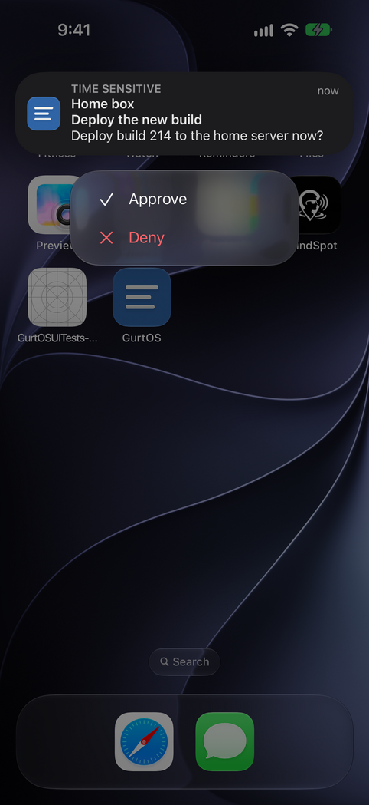 |

- **Pair** with the QR code on the computer's screen (scan it in the app, which uses VisionKit), or type its address and
  code. The code can have spaces or a dash in it. The QR code is one of these links, and the app reads all of them:
  - `http://<ip>:7700/pair#<code>`, the computer's own page on the home network, when remote access is off.
  - `https://<name>.box.gurtos.com/pair#<code>` or `https://app.gurtos.com/pair?box=<name>.box.gurtos.com#<code>`, when remote access is on.
  - `https://app.gurtos.com/pair#code=…&rv=…&lan=…&n=…`, while a new computer is in setup and the relay answers. The app
    offers "Same Wi-Fi? Pair on this network" and "Pair over the internet".

  The iPhone's Camera app opens the `app.gurtos.com` links in the app. It opens the home-network link in Safari, so
  scan that one inside the app. The app shows the address it is about to pair with, and says when it is not encrypted.
- **Quick Start**: scanning a new computer's Quick Start code (`app.gurtos.com/quickstart#rv=…&pk=…&s=…&n=…`) picks
  a computer this phone owns, shows what it would send (the question, a four-word check phrase to compare, and the
  keys as toggles), and sends only after Face ID. The new computer seals an owner pairing code to a one-time key this
  phone made (X25519, HKDF-SHA256, AES-256-GCM, as core/quickstart.ts), and the phone pairs with it. It goes through
  the relay.
- **Computers**: the title menu and the tile at the top right switch between paired computers (Computers, Add a
  computer), like switching accounts. Every computer keeps its own token, edition and, on Business, the person you are.
- **Homes per edition**: Needs you, Running and the kill switch on Server; Ready for you with Keep changes and Undo
  on Personal; Waiting for me first on Business, with the rule that routed each request and who asked. The kill
  switch shows only when the computer says this phone has the owner's controls (`owner` in `GET /api/me`) or, on
  Business, an admin's.
- **Approve and Deny** sit right in each row. Anything that spends money asks for Face ID first (the device passcode if
  Face ID is off or locked out), and the answer tells the computer how it was checked, which it keeps as reported by
  the device ("<phone> (Face ID, reported)"). A purchase made through the optional Shopper app needs a passkey on the
  computer's own approval page, which the iPhone opens in an in-app browser.
- **Tasks** show their steps live (the computer's log stream), what was blocked, Undo with its confirmation, and Keep.
- **Activity** is the action log in plain words. **Settings** has the computer, its notifications status, the list of
  computers and Forget.
- **Notifications** are end to end encrypted. The app makes its own push keys, and the computer encrypts each push for
  them as for the web app (RFC 8291). The relay sends Apple only the ciphertext. The notification service
  extension decrypts it, checks the computer's signature with the key this phone gave that computer alone, then shows
  the computer's name and the question. Approve and Deny work from the notification when nothing is spent (not even a
  fraction of a cent) and no Business rule routed it; otherwise the button is "Approve with Face ID" and opens the
  request. When the relay or the computer's remote access is off, Settings says notifications are off for that
  computer, and a test notification explains why it did not go.
- **Widget**: "2 need you · 3 running" on the Lock Screen and Home Screen. It shows counts only.
- Light and dark, Dynamic Type (Atkinson Hyperlegible Next scales with the text size, and Approve and Deny stack
  at the accessibility sizes), VoiceOver labels on every control. Liquid Glass comes from the system tab bar, toolbars
  and the floating Approve and Deny buttons.
- Tokens and push keys live in the keychain, in one shared access group for the app, its notification extension, its
  widgets and the Watch. Nothing secret is in UserDefaults.

Not built: a Live Activity. A pending request has no progress to follow, and keeping one correct with the app closed
needs push-to-update through the relay. The widget and the notification cover the same need.

## Apple Watch

| What waits | $8, approvable on the wrist | $42, only on the iPhone | Watch face complications |
|---|---|---|---|
| 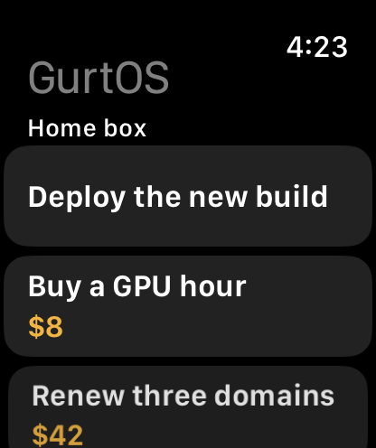 | 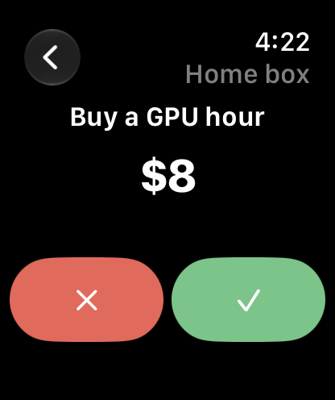 | 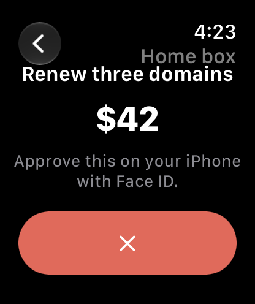 | 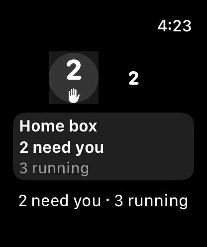 |

- The iPhone's notifications, with their Approve and Deny buttons, appear on the Watch through the same
  notification categories.
- The Watch app lists what waits. On one request's page, double tap approves (`handGestureShortcut(.primaryAction)`).
  The list sets no double-tap action, because the HIG reserves double tap there for scrolling.
- **The safety rule is the computer's.** The iPhone asks each computer for a separate Watch token
  (`POST /api/devices/self/watch`). With that token the computer approves only when the Watch says it is on the wrist
  and unlocked (watchOS's wrist-detection check), up to Settings `watchLimitCents` ($25 by default), and never for a
  Business request or a Shopper purchase. So a Watch can approve any small request outside those two. Anything else
  returns a 403 with `needs: "iphone"`, and the request keeps waiting for Face ID on the phone. Deny always works.
  Revoking the iPhone, or removing its person on Business, revokes its Watch. The wrist check is what the Watch
  reports, not proof: the computer records it as "Demo Watch (on the wrist, reported)". The Watch app itself also
  leaves fraud referrals to the iPhone; the computer has no fraud flag to check.
- Complications and Smart Stack: circular, corner, rectangular and inline, with counts only, because the Always-On
  display is visible to others. The complication picture above is drawn by the app's debug gallery: the simulator
  can't put a complication on a watch face from a script.

## Mac

| The menu | Ask (⌥⌘G from anywhere) | Pair |
|---|---|---|
| 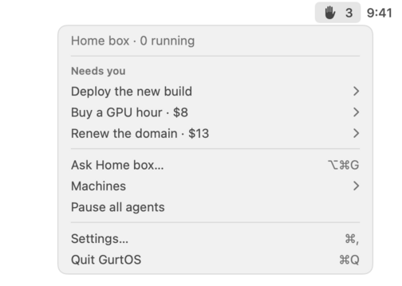 | 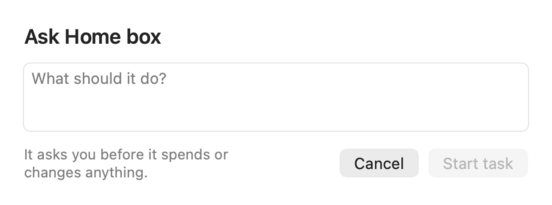 | 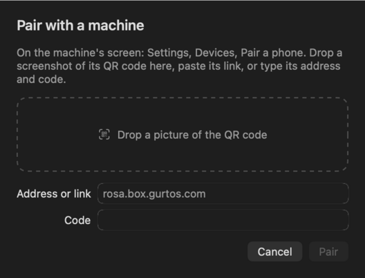 |

- A menu bar extra (a menu, not a popover, as the HIG asks) with the count that needs you, each request with
  Approve (Touch ID when money moves) and Deny, what runs, Computers, the kill switch, Settings and Quit. Settings
  can hide it from the menu bar. Opening the app again shows Settings, so it is never lost.
- ⌥⌘G anywhere opens "Ask your computer" for a new task. Carbon hot keys need no Accessibility permission.
- New requests become Mac notifications, made on the Mac from the live log. Nothing goes through a push service, so
  they work without a relay.
- Pairing: drop a screenshot of the QR code, paste its link, or type the address and code. The home-network link
  needs no relay. macOS may ask once to let GurtOS find devices on your local network.
- **Send to GurtOS** in the Share menu sends the chosen files (up to 8, 5 MB in all), text or link to a new task.
  The computer puts files in a new workspace of their own that it names (`POST /api/tasks {files}`), never an owner's
  folder or an existing workspace, so the task's copy holds only them; the log keeps names and sizes.
- A passkey purchase from the optional Shopper app is approved on the iPhone. The Mac does not open that page, because
  its address carries this Mac's token and would stay in the browser's history.
- The menu picture is drawn by the app's `--render-shots` mode from the same model: macOS blocks screen capture
  over ssh. The Ask and Pair pictures are the real views.
- There is no auto-update. Download a new DMG for a new version.

## Android

The web app as a Trusted Web Activity (Bubblewrap): full screen, the GurtOS icon and colours, and web push through
Chrome, so notifications need no Google console and no FCM project. `native/android` is the generated project, and
`twa-manifest.json` is its source.

The app opens `https://app.gurtos.com` and nothing else, so everything that needs the relay applies to it. The web
app cannot call a computer's plain-HTTP home address from an `https` page. Without the relay, scan the QR code with
the phone's Camera instead: it opens the computer's own page in the browser, which pairs the browser, not the app. For
a home network, use the iPhone or Mac app, or that page in the browser. The app opens without a browser bar because
`app.gurtos.com/.well-known/assetlinks.json` names its signing key.

## Build the apps yourself

### Apple

One Xcode project from `native/apple/project.yml` (XcodeGen). Every target shares `GurtKit` (the API, pairing,
the computers list in a shared keychain group, push decryption) and `Shared/` (the look and the answers). You need a
Mac with Xcode 27 and `brew install xcodegen`.

```
cd native/apple/GurtKit && swift test                  # GurtKit's tests: RFC 8291 vector, a computer-made push, pairing links, a relay that is down
cd native/apple && xcodegen generate
xcodebuild -project GurtOS.xcodeproj -scheme GurtOS -destination 'generic/platform=iOS Simulator' CODE_SIGNING_ALLOWED=NO build   # iPhone, Watch, widgets
xcodebuild -project GurtOS.xcodeproj -scheme GurtOSMac -destination 'platform=macOS' CODE_SIGNING_ALLOWED=NO build                 # Mac and its Share extension
```

These build without signing and without an Apple account. To run on a device you need your own Apple developer
account, and these changes, because our team and bundle ids are in the project:

- `native/apple/project.yml`: `DEVELOPMENT_TEAM`, and every `PRODUCT_BUNDLE_IDENTIFIER` (and `WKCompanionAppBundleIdentifier`).
- `native/apple/GurtKit/Sources/GurtKit/Keychain.swift`: `Keychain.group` has our team id in front of
  `com.benzhou.gurtos.shared`. Use `<your team id>.<your bundle id prefix>.shared`, as in the targets' `keychain-access-groups`.
- Push: your own APNs key on the relay, and your bundle ids in `APNS_TOPICS` in `relay/server.ts`.

`native/apple/scripts/` holds the maintainers' release scripts (`build.sh upload` for TestFlight, `build.sh dmg` for the
notarized DMG, `devid*.py`, `testflight.py`). They need our App Store Connect key and Developer ID certificate, which are
not in git, so they will not run for anyone else. `scripts/shots.sh` and `scripts/watch-shots.sh` take the screenshots
above against a test computer, and `UITests/NotificationTests` receives a push the computer's own code encrypted
(`scripts/push.ts`) and opens its buttons. `simctl push` skips service extensions, so debug builds run the same decrypt
code (`Shared/PushContent.swift`) on that payload.

### Android

```
cd native/android
BUBBLEWRAP_KEYSTORE_PASSWORD=... BUBBLEWRAP_KEY_PASSWORD=... npx @bubblewrap/cli build --skipPwaValidation
```

This needs the Android SDK, JDK 17 or newer, and your own signing key at `signing/gurtos.keystore` with the alias
`gurtos`. The release key is not in git. A build with your own key opens with a browser bar until your site's
`assetlinks.json` lists that key's SHA-256.

## Point the apps at your own relay

This works for the Apple apps and Android today, with a rebuild. The computer needs the same relay (`BOX_RELAY` and
`BOX_APP`, or Settings, Remote access), and the relay needs the push and web app pieces from
[docs/self-host.md](../docs/self-host.md).

- **iPhone, Watch and Mac**: set `GURTOS_RELAY` (for example `https://box.example.com`) and `GURTOS_APP_HOST` (for
  example `app.example.com`) at the top of `native/apple/project.yml`, then rebuild. The build writes them into each
  app's Info.plist, where `GurtKit/Sources/GurtKit/Config.swift` reads them, and into the iPhone app's associated
  domain. Host the association file from `relay/app/.well-known/apple-app-site-association` on your app host with your
  team and bundle id. The apps then accept pairing and Quick Start links from your app host and boxes named under your
  relay, and send APNs endpoints to your relay.
- **Android**: in `native/android/twa-manifest.json` change `host`, `iconUrl`, `maskableIconUrl`, `webManifestUrl`,
  `fullScopeUrl` and `packageId` if you want your own, then run `npx @bubblewrap/cli update` and build. Bubblewrap
  regenerates `app/build.gradle`, the manifest and `res/values/strings.xml` from that file, so it is the one place to
  edit. Publish `/.well-known/assetlinks.json` on your app host with your key's SHA-256.

There is no setting inside a built app. A computer that uses another relay needs apps built for it.

## The demo step

`native/demo.ts` runs in `./demo` (core/demo.ts loads it as "native apps: every call the apps make"; run only it with
`DEMO_ONLY="native apps" ./demo`). It makes every call the apps make, as a paired iPhone off the computer: pair with a
code (also one typed with a dash and capitals, and the home-network `boxUrl` form), read every home, the owner flag in
`GET /api/me` and the kill switch refusing a phone that is not the owner's, approve with Face ID recorded, the second
answer losing, Undo, the log stream, an APNs push subscription, the Watch token and its limits ($8 approved on the
wrist, $40 refused and still waiting, the iPhone approving it, Deny always allowed), and Forget revoking the phone
and its Watch. core/demo.ts has its own checks for the Watch rules (device kinds, the token, the limit, 0 meaning deny
only, the rate limit, revocation). The VM has no Swift, so the apps' own tests run on a Mac (`swift test` above).

## Limits

- TestFlight is internal only. There is no App Store submission and no external beta review, and nothing here
  promises either.
- The Mac app has no TestFlight build: that would need a second App Store Connect record. The DMG is the Mac
  download.
- The hosted relay is offline, so native push does not reach a phone today. Until a relay runs again, the iPhone app is
  live while it is open, and the Mac app notifies from its live connection.
- The Watch shows what its iPhone last saw, and can deny through it, when a computer runs a core without Watch tokens.
- An answer an app cannot read, from a computer on a very different version, shows as "That address didn't answer like a
  GurtOS computer, or it runs a different version."
