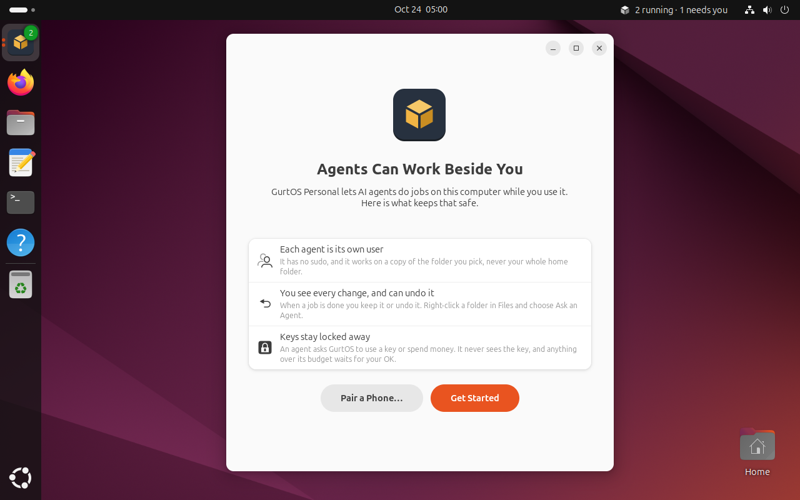
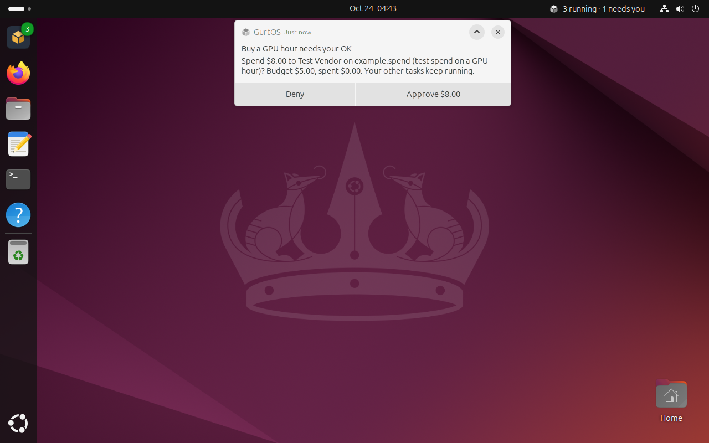
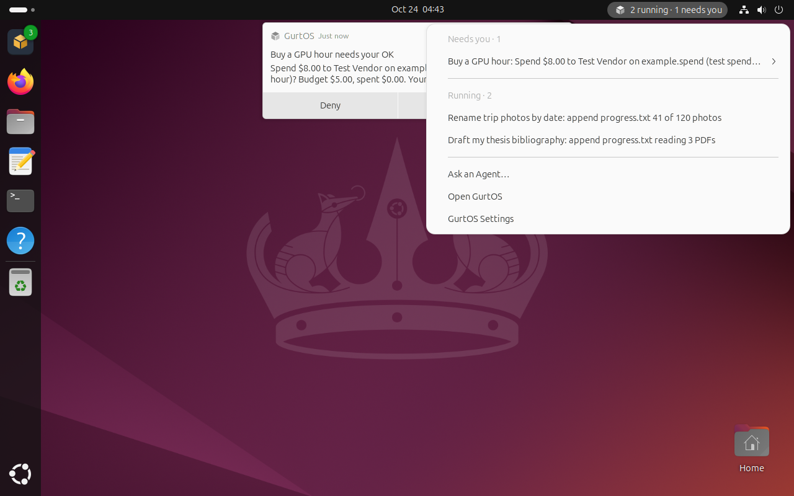
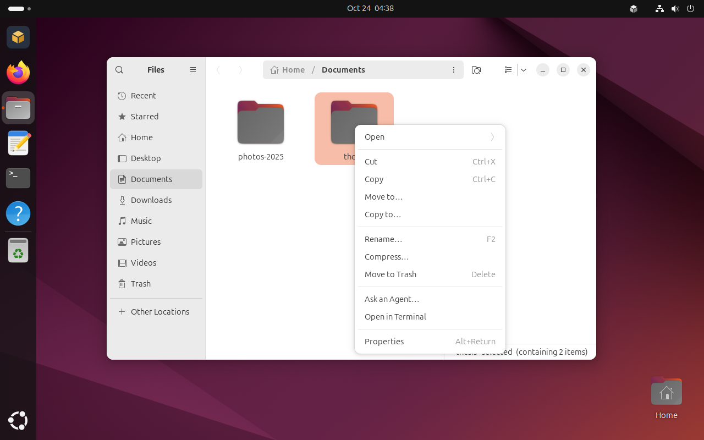
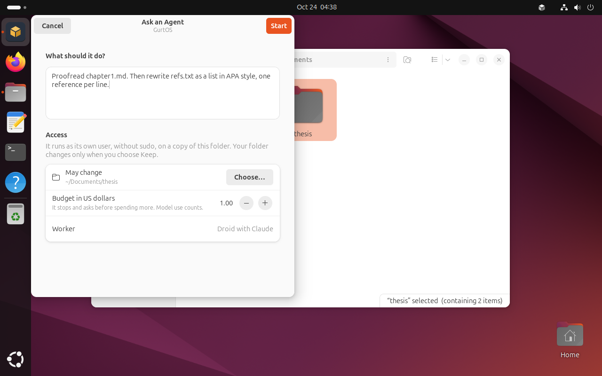
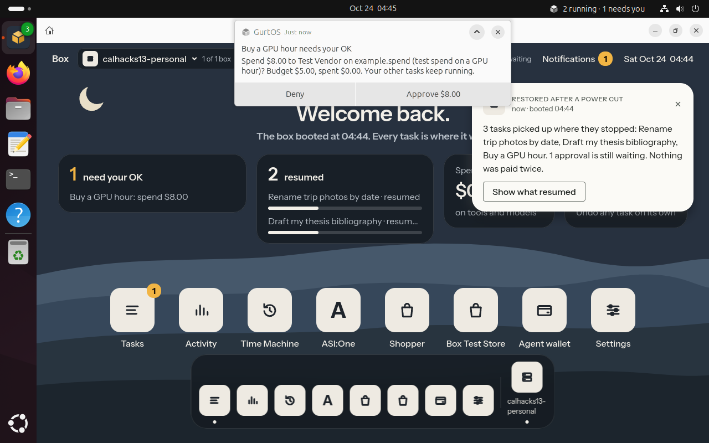
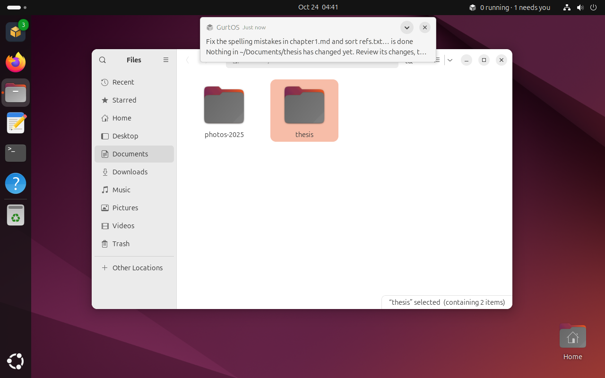
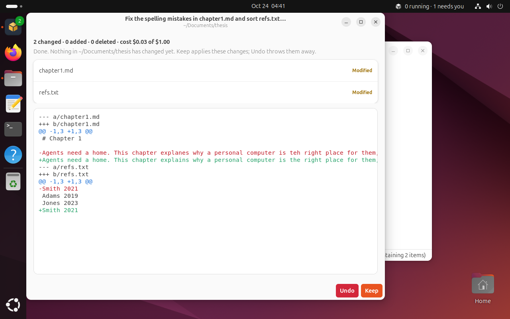
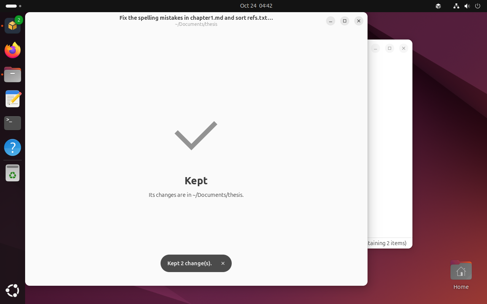
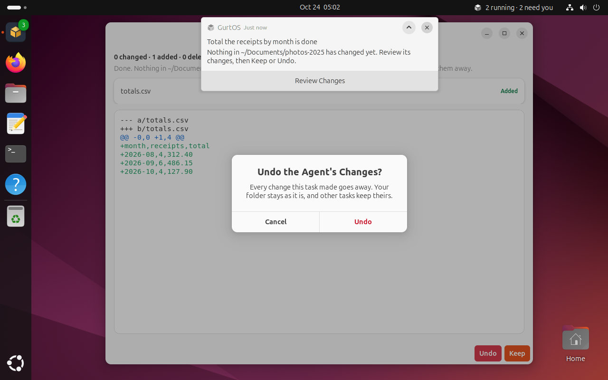

# GurtOS Personal: the desktop layer

GurtOS Personal is the OS on your own laptop. You use Ubuntu's GNOME desktop as usual, with your own account and
sudo. Agents work beside you as their own users without sudo, on copies of your folders, and nothing in your folders
changes until you choose Keep. This folder is the GNOME side of that: five small pieces that talk to the box's API on
`127.0.0.1:7700`. The box itself (tasks, the vault, the action log, Keep and Undo) is `core/`.

Tested on Ubuntu 24.04 with GNOME 46 on a Vultr VM, driven over ssh with xdotool. Screenshots are from that VM.

## What it adds

| Piece | What it does | File |
|---|---|---|
| Approvals as notifications | Each approval becomes a GNOME notification with Deny and Approve (Approve names the amount). Clicking the body opens the task in GurtOS. An answer from anywhere else (phone, portal, the top bar) withdraws it | `box-desktop.py` |
| Top-bar indicator | The GurtOS cube with "2 running · 1 needs you". Its menu lists what needs you (with Approve and Deny), what runs, Ask an Agent, Open GurtOS and Settings | `box-desktop.py` |
| The GurtOS app | The portal in its own window (WebKitGTK), first in the dock | `box-ui.py app` |
| Ask an Agent in Files | Right-click a folder. A dialog asks what to do and a budget, and starts a Droid task on a copy of that folder | `files/box-nautilus.py`, `box-ui.py ask` |
| Keep or Undo | When the task is done, a notification opens a review: every changed file, the diff, the cost. Keep writes the changes into your folder; Undo throws them away | `box-ui.py review` |
| Welcome | Once per account, after GNOME's own first-login setup: what agents can and cannot do, and an optional phone pairing | `box-ui.py welcome` |













A real Droid task (Claude Sonnet, 3 cents) fixed the spelling in `~/Documents/thesis/chapter1.md` and sorted
`refs.txt`. The folder stayed as it was until Keep:









## Install

On Ubuntu 24.04 with the box installed:

```
sudo core/install.sh && sudo personal/install.sh [owner]
```

`install.sh` installs GNOME if it is missing (`ubuntu-desktop-minimal`) and the libraries the layer uses (GTK 4,
libadwaita, WebKitGTK 6, AyatanaAppIndicator, nautilus-python). It copies this folder to `/opt/box/personal`, adds the
desktop entry, icons, the Files extension, the welcome's autostart entry, the user service (enabled for every
account), and a schema override that puts GurtOS first in the dock for new accounts. It sets `BOX_OWNER` on the box
service to the owner you name, or to the first human in the `sudo` group. It is safe to run again.

**For `image/build personal`:** run `personal/install.sh` in the image's root after the box's own install steps. It
only installs files and packages and never starts anything, so it works in a chroot (the AppArmor profile then loads
at first boot). Two things the image must do itself: boot to GDM and the GNOME session instead of the Server's kiosk
(`box-kiosk.service`, `box-screen.service`), and set the owner once the first account exists, by running
`personal/install.sh <user>` again or writing `BOX_OWNER` into `/etc/systemd/system/box.service.d/personal.conf`.

## How it works

- **The service** (`box-desktop.service`, a systemd user unit in the graphical session) reads the action log once
  (`GET /api/log`) and then follows it live (`GET /api/log/stream`). Events only mean "something changed": it then
  reads `GET /api/tasks` and `GET /api/approvals?state=pending`, and `plan()` in `boxapi.py` decides which
  notifications to post and which to withdraw. So a replayed or missed event cannot leave a stale notification.
  It posts and answers notifications over D-Bus (`org.freedesktop.Notifications`) and answers approvals with
  `POST /api/approvals/<id> {approved, by: "desktop:<user>"}`, so the log records who said yes.
- **Approvals use the critical urgency**, so the banner stays on screen until you answer. The task has stopped and
  is waiting for you. Reviews of finished work use the normal urgency.
- **The indicator is an AppIndicator, not a Shell extension.** Ubuntu 24.04 ships and enables AppIndicator support,
  so the indicator is a few lines in the service that already holds the task and approval state. A Shell extension
  would need its own connection to the box, has to be enabled per account, and breaks when GNOME changes its
  extension API (GNOME 45 moved extensions to ES modules). A crash in the service also cannot take down the shell.
- **The windows** are one GTK 4 and libadwaita application (`dev.box.Box`), so a second launch from Files, the dock
  or a notification opens its window in the same process. GNOME's HIG patterns throughout: header bars, boxed
  lists, Cancel first and Start as the suggested action, Undo in the destructive style with a confirmation.
- **Ask an Agent** sends `POST /api/tasks {title, prompt, folder, budgetCents, source: "files"}`. The core links the
  folder and runs the task as its own user on an overlay copy. Keep is `POST /api/tasks/<id>/keep`, which returns
  `{kept}` or `{conflicts}` (you changed the same file meanwhile; nothing is written). Undo is
  `POST /api/tasks/<id>/undo`. The core logs a Keep as a `task.step` with `data.keep: "applied"`, which is how the
  desktop knows a task needs no more review.
- **Python, not TypeScript.** GNOME's own bindings (PyGObject) ship with Ubuntu's desktop, so the layer needs no
  build step and no npm packages. The box itself stays TypeScript.
- **WebKitGTK and AppArmor.** Ubuntu 24.04 lets only programs with an AppArmor profile create the user namespace
  WebKit's sandbox needs. `files/apparmor-box-ui` gives the GurtOS app the same kind of profile Ubuntu gives Epiphany
  and Geary, so the web sandbox stays on. That is why launchers run `box-ui.py` directly and not through `python3`.

## The demo step

`personal/demo.ts` runs `selftest.py` headless against the demo box, because the test VMs have no desktop. It runs
the layer's own code: the calls the service, the indicator and the dialogs make, and `plan()`'s choices. It checks
that a task stopping for an OK becomes a notification and is counted in the top bar, that Approve lets it finish and
withdraws the notification, that a denial on the phone withdraws it too, and that a folder task leaves the folder
untouched until Keep, asks for a review, and Keep writes both changes. About 3 seconds, no model, no money.

```
BOX_URL=http://127.0.0.1:7700 /usr/bin/python3 personal/selftest.py   # on any box, prints one JSON line per check
```

## The test machine

A Vultr VM made for this edition: instance `55e7912b-aa38-4f8d-9caa-cd9633e744eb`, label `calhacks13-personal`,
`vc2-4c-8gb` in San Jose, `140.82.51.9`, about $0.055 an hour. **Delete it after Sunday, Oct 25:**

```
curl -X DELETE -H "Authorization: Bearer $VULTR_API_KEY" https://api.vultr.com/v2/instances/55e7912b-aa38-4f8d-9caa-cd9633e744eb
```

(from linuxbox: the key is in `~/.config/calhacks13/env`, and Vultr only accepts linuxbox's address).

It runs Ubuntu 24.04, GNOME, the box and this layer, with a test owner `ana` (sudo; password in `/root/ana-password`)
logged in by GDM. The session is Xorg so xdotool and screenshots work; nothing in the layer depends on X11.
`ssh personalbox` from linuxbox reaches it as root. `personal/vm.sh` drives it:

```
personal/vm.sh setup          # once: the test owner, automatic login, Xorg
personal/vm.sh install        # ship this checkout and install the box and this layer
personal/vm.sh as <command>   # run a command in ana's session, e.g. xdotool or box-ui.py
personal/vm.sh shot <name>    # screenshot into personal/screenshots/<name>.png
```

## Not built yet

- **One folder per task.** The core takes one `folder`, so Files offers Ask an Agent for one folder at a time.
- **Undo after Keep.** The core saves before-images under `BOX_HOME/timemachine/<id>` but has no route to restore
  them, so a kept task shows "Kept" without an Undo.
- **May read, the Internet switch and Pause All Agents** from the Figma frames: the core has no API for them yet.
- **Pairing from the welcome** opens GurtOS Settings, but on `127.0.0.1` the portal does not know an address a phone
  can reach, so it shows the code without a QR.
- **Known core bug, reported:** after Keep, kept files belong to the task's deleted uid and are world-writable
  (`-rw-rw-rw- 39999`). The core thread has the details; the desktop side needs no change for the fix.
