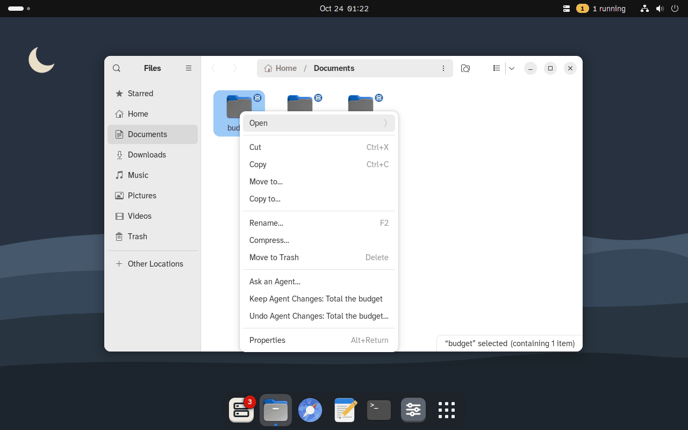

# GurtOS Personal: GurtOS built into the desktop

GurtOS Personal is the OS on your own laptop, the way elementary OS and Pop!_OS are: Ubuntu 24.04 underneath (kernel,
drivers, packages, updates), and GurtOS on top as part of the desktop, not an app beside it. You use it as a normal
computer, with your own account and sudo. Agents work beside you as their own users without sudo, on copies of your
folders, and nothing in your folders changes until you choose Keep. This folder is that desktop side. It talks to the
box's API on `127.0.0.1:7700`; the box itself (tasks, the vault, the action log, Keep and Undo) is `core/`.

Tested on a cloud VM: installed onto plain Ubuntu 24.04 with GNOME 46, and as a fresh install of the GurtOS Personal
ISO walked as a new person, on Wayland (Ubuntu's default) and Xorg.

## What it adds

| Piece | What it does | Where |
|---|---|---|
| The GurtOS session | Its own GNOME session and Shell mode, like Ubuntu's own: it loads the GurtOS Shell extension, Ubuntu's dock, AppIndicator support and tiling. GDM starts it by default, on Wayland or Xorg. An extension a session mode loads cannot be switched off by accident | `theme/session/`, `theme/install.sh` |
| The top bar | The GurtOS item: the amber count of what needs you and "1 running". Its popover: Needs your OK with Deny and Approve on each, Ready to review, Running, then Ask an Agent, Open GurtOS, GurtOS Settings | `shell/gurtos@gurtos.dev/` |
| Quick Settings | An Agents tile: on means agents may interrupt you, off is quiet hours. Its menu: Quiet hours, Pause all agents (once the core has it), GurtOS Settings | `shell/gurtos@gurtos.dev/` |
| Approvals as Shell notifications | Deny and Approve (Approve names the amount); clicking the body opens the task; answered anywhere else, it goes away; in quiet hours it waits in the list without a banner. GNOME shows no actions on the lock screen, so while locked one notice says how many wait: "Unlock to approve or deny" | `shell/gurtos@gurtos.dev/` |
| Activities search | Type in the overview: agent tasks by title, and /find's files, photos and task history. A result opens in the GurtOS app | `search-provider.py` |
| Files | Ask an Agent… on one folder or up to ten. The "changed by an agent" emblem on a folder whose agent changes wait for review or were kept. On that folder: Keep Agent Changes, Undo Agent Changes… (the review asks first), Put Files Back… | `files/box-nautilus.py` |
| GurtOS Settings | A native libadwaita app (its own icon in the dock): General, Agents & Models, Permissions, Folders, Accounts & Keys, Apps, Devices, Updates, Privacy & Logs, About ("Based on Ubuntu 24.04 LTS") | `settingswin.py` |
| GurtOS Setup | At the owner's first login, after GNOME's own setup: Welcome, AI models, Folders, Permissions, Apps, Pair a phone, Done | `setupwin.py` |
| The GurtOS app | Tasks, Activity and Time Machine: the portal in its own window, first in the dock | `box-ui.py app` |
| Keep or Undo | The review: what changed, the diff, and Keep these changes? | `box-ui.py review` |
| The look | Wallpaper, the dock as a floating bottom bar, the GurtOS font, a GurtOS icon theme over Yaru (no Ubuntu logo in the dock), GTK accents for new accounts, the GDM logo, a Plymouth splash. Ubuntu's welcome tour, Pro notices and update nags are hidden in the GurtOS session | `theme/` |





## Waiting on Figma's theme

Everything below is wired; the files are placeholders that the theme replaces without code changes.

| Hook | File today | What Figma's theme provides |
|---|---|---|
| GNOME Shell theme | the extension's `stylesheet.css` (styles the top-bar item, badge, popover); `theme/session/gurtos.json` points at Yaru's Shell theme | a `gnome-shell-theme.gresource`; change `themeResourceName` in `gurtos.json` |
| GTK and libadwaita accents | `theme/gtk/gtk4.css`, `gtk3.css` (accent only), imported by new accounts' `~/.config/gtk-4.0/gtk.css` | the full colour set |
| Icons | `theme/icons/GurtOS` inherits Yaru-blue; replaces the dock's Ubuntu-logo Show Apps icon | GurtOS's icon set, in the same folder |
| Cursor, fonts | dconf `cursor-theme='Yaru'`; Atkinson Hyperlegible Next and Mono | a cursor theme, if any |
| Wallpaper | `theme/backgrounds/gurtos-night.svg` (the portal's night hills) | final wallpapers, light and dark |
| Logos | `theme/gurtos-logo.svg`, `gurtos-logo-gdm.png`, `plymouth/gurtos/logo.png`, rendered from the box glyph and the wordmark | the logo and wordmark |
| GDM | `theme/dconf/db/gdm.d/01-gurtos` (logo, font) | a login background if wanted |
| Plymouth | `theme/plymouth/gurtos/` (logo on the night colours) | the boot screen (Figma `Box / Boot`) |

**The design.** These windows follow the GurtOS system (`docs/figma/system.md`) and the Personal frames in
`docs/figma/os-v2/personal/`, built from libadwaita's own widgets so they sit among GNOME apps. The system's colour
tokens in light and dark become libadwaita's named colours (`gurtos.css`, `gurtos-dark.css`); the type is Atkinson
Hyperlegible Next and Mono (bundled in `fonts/`, SIL OFL); app icons are the system's glyphs on coloured tiles
(`apptiles.py`, the same paths the portal draws). GNOME's own surfaces (the top bar, notification banners, menus,
Files) stay GNOME's, with GurtOS content: notification titles use GNOME's header capitalization, as the system says.

## GurtOS Setup and the redesign (Oct 24)

Walked on the GurtOS Personal VM as the owner, on Wayland. Each step changes the box as it goes: settings with
`PATCH /api/settings`, keys with the write-only `PUT /api/vault/<NAME>`, apps with `/api/apps/<id>/enable|disable`,
each step with `POST /api/setup/step`, then `POST /api/setup/finish`. It opens by itself at login for the owner only,
after GNOME's own setup, until the box says setup is done, and resumes at the first step not yet taken.

| Step | What it does | Checked |
|---|---|---|
| Welcome | What keeps agents safe on this computer | Opened by itself at login |
| AI models | One model key, write-only: `ANTHROPIC_API_KEY` (your own Anthropic key is enough) or `FACTORY_API_KEY`. A saved key shows as saved, never its value | The VM's key was detected without being shown |
| Folders | The owner's usual folders, each May change or Not allowed (`agentFolders`), plus Add a folder | Documents and Projects saved; a folder outside is refused (self-test) |
| Permissions | Internet for new tasks, the spend that always asks, the default budget, quiet hours | $5.00 saved; quiet hours mute approval banners (self-test) |
| Apps | Optional. Every app with its icon, the sites it reaches and its keys (amber only when an app that is on misses one); a switch turns it on or off; clicking an app with a missing key opens a sheet to add it | `APIFY_TOKEN` saved: listed by name and time, the chip turned grey; ASI:One turned off and on again in the box |
| Pair a phone | QR and code when the box has an address a phone can reach; otherwise it says so and offers Skip | No address on Personal yet, so Skip |
| Done | Four cards: Ask an Agent, the top bar, Keep or Undo, Time Machine. Start using GurtOS finishes and opens the app | `done: true`, six steps recorded |


The rest of the layer in the new system:


## A fresh install, as a new person (Oct 24)

The GurtOS Personal ISO (`image/build personal`, debug build `20261024-0542-ada8208`) attached to the cloud VM as a
custom ISO, installed on its wiped disk, and walked by hand as a new person, Maya Chen, on Wayland:

| Step | Result |
|---|---|
| Install from the ISO and restart | Passed. Booted GurtOS Personal 2026.10.24 from its own disk, box healthy, no owner yet, empty vault |
| GNOME's first-boot setup (language, keyboard, time zone, About You, password) | Passed. The account `mayachen` is in `sudo`; `box-owner.service` set `BOX_OWNER=mayachen` within a second |
| First login | Passed. Ubuntu's welcome, then the GurtOS welcome; GurtOS first in the dock, the indicator in the top bar |
| Ask an Agent on `~/Documents/thesis` in Files | Passed. With the empty vault the task failed at once and the desktop said so ("the vault has no FACTORY_API_KEY"); after the key was added, a real Droid task finished in about a minute for 3 cents |
| The review notification and the diff | Passed. The folder was untouched until Keep |
| Keep | Passed. Both files changed, and kept their owner and mode: `chapter1.md` 1000:1000 664, the private `refs.txt` 1000:1000 640 |
| Undo Keep | Passed. Old content back, same owner and modes |
| Undo before Keep | Passed. The folder never changed |
| An approval as a notification, Approve | Passed. The log says `desktop:mayachen` |
| The GurtOS app from the dock, the indicator menu | Passed |
| Log out, restart, log in again | Passed. No second welcome; the service and indicator come back |


Found and passed on: apport's Python hook fails on `ID=gurtos`; GNOME's setup renames the computer to the user name;
apps show Adwaita icons instead of Yaru; setup's first page shows Ubuntu's logo (image thread). A fresh install has
an empty vault with nothing in the first run to fill it, and Personal has no `BOX_URL`, so phone pairing cannot work
yet (core thread). The portal greets the owner as "Ben" (portal thread).

## Install

On Ubuntu 24.04 with the box installed:

```
sudo core/install.sh && sudo personal/install.sh [owner]
```

`install.sh` installs GNOME if it is missing (`ubuntu-desktop-minimal`) and what the layer uses (GTK 4, libadwaita,
WebKitGTK 6, nautilus-python, Ubuntu's AppIndicator extension, `dconf-cli`, `librsvg2-common`). It copies this folder
to `/opt/box/personal` and installs the apps, icons, fonts, the Files extension, the search provider and GurtOS Setup's
autostart entry. Then `theme/install.sh` installs the GurtOS session, its Shell mode and extension, the dconf defaults
(`/etc/dconf/profile/user` and `gdm`, `/etc/dconf/db/gurtos.d`, `gdm.d`, then `dconf update`), wallpaper, icon theme,
GTK accents in `/etc/skel`, logos and the Plymouth theme, makes the GurtOS session GDM's default
(`DefaultSession=gurtos.desktop`) and moves existing accounts from Ubuntu's session to it. It sets `BOX_OWNER` on the
box service to the owner you name, or to the first human in the `sudo` group. It is safe to run again.

**For `image/build personal`:** run `personal/install.sh` in the image's root after the box's own install steps. It
only installs files and packages and never starts anything, so it works in a chroot (the AppArmor profile then loads
at first boot). What the image adds itself:
- Packages: `plymouth` and `plymouth-label` (the splash; `install.sh` sets the GurtOS theme only when Plymouth is
  there) and `splash` on the kernel command line; `qrencode` for pairing QR codes.
- `DefaultSession=gurtos.desktop` in its own `/etc/gdm3/custom.conf` (install.sh adds it when missing).
- `/etc/issue` from `theme/issue`; `os-release` with `LOGO=gurtos-logo` (the icon is installed).
- Optional: drop Ubuntu's sessions from `/usr/share/{wayland-sessions,xsessions}/ubuntu*.desktop`, so the login
  screen offers only GurtOS.
- Rebuild the initramfs after install.sh, for the Plymouth theme.

## How it works

- **The Shell extension** (`shell/gurtos@gurtos.dev/`, GNOME Shell 46, ES modules) follows the action log over
  Server-Sent Events (`GET /api/log/stream`). Events only mean "something changed": it then reads tasks, pending
  approvals and settings, and `plan()` in `logic.js` decides which notifications to post and withdraw, so a replayed
  or missed event cannot leave a stale one. It answers with `POST /api/approvals/<id> {approved, by: "desktop:<user>"}`.
  It shows nothing for an account that is not the box's owner. `logic.js` has no GNOME imports, so the demo step runs
  the same code under Node.
- **Why a session, not a user extension.** GNOME loads the extensions a session mode lists (as Ubuntu does for its
  dock), and the Extensions app cannot turn those off. The session's desktop names are `GurtOS;ubuntu;GNOME`, so
  Ubuntu's own defaults still apply where GurtOS sets none, and its `XDG_CONFIG_DIRS` puts `/etc/xdg/gurtos` first,
  which is how Ubuntu's welcome tour and nags are hidden there without touching Ubuntu's files. The extension is also
  in the default `enabled-extensions`, because only listed extensions keep running on the lock screen.
- **Defaults, not locks.** `theme/dconf/db/gurtos.d/00-gurtos` sets wallpaper, fonts, icons, the dock and favourites
  as defaults people can change. Nothing is locked: the part that must not be turned off (the extension) is held by
  the session mode instead.
- **GurtOS Settings and Setup share their pages** (`setupwin.py`), so they never disagree. Settings applies each
  change at once; Setup records each step.
- **Python for the apps, JavaScript only where GNOME requires it.** PyGObject ships with Ubuntu's desktop, so the
  apps, the search provider and the Files extension need no build step. The Shell extension must be JavaScript.
- **WebKitGTK and AppArmor.** Ubuntu 24.04 lets only programs with an AppArmor profile create the user namespace
  WebKit's sandbox needs. `files/apparmor-box-ui` gives the GurtOS app the same kind of profile Ubuntu gives Epiphany
  and Geary. That is why launchers run `box-ui.py` directly and not through `python3`.

## The demo step

`personal/demo.ts` runs `selftest.py` headless against the demo box, because the test VMs have no desktop. It runs
the layer's own code: the calls the service, the indicator and the dialogs make, and `plan()`'s choices. It checks
that a task stopping for an OK becomes a notification and is counted in the top bar, that Approve lets it finish and
withdraws the notification, that a denial on the phone withdraws it too, and that a folder task leaves the folder
untouched until Keep, asks for a review, Keep writes both changes with the owner's uid, gid and mode, and Undo Keep
puts them back. For GurtOS Setup it checks that a step is recorded, that folders chosen in Setup limit Ask an agent
(two of them make one task, a folder outside is refused), that the spend limit and quiet hours are saved and quiet
hours mute banners, that a key saved in Setup is listed by name and never shown, and that every app is listed with
its access. It puts the box's settings back afterwards. About 4 seconds, no model, no money.

```
BOX_URL=http://127.0.0.1:7700 /usr/bin/python3 personal/selftest.py   # on any box, prints one JSON line per check
```

## The test machine

A cloud VM made for this edition (4 vCPU, 8 GB). Its address and how to delete it are kept outside the repo.

Since Oct 24 it runs a fresh install of the GurtOS Personal debug ISO, owned by `mayachen`, on Wayland (debug builds
have sshd for root). `personal/vm.sh` drives it, with `PERSONAL_VM` set to its ssh host; `wl.py` gives it a virtual
tablet and keyboard through `/dev/uinput`, so it works on Wayland and even in GDM's first-boot setup, where xdotool
and GNOME's remote-desktop input do not:

```
PERSONAL_USER=mayachen personal/vm.sh layer         # replace /opt/box/personal on the installed system, restart the layer
PERSONAL_USER=mayachen personal/vm.sh wl click X Y  # also: wl type TEXT, wl key Return
PERSONAL_USER=mayachen personal/vm.sh shot <name>   # screenshot into personal/screenshots/<name>.png
personal/vm.sh install                              # the older path: the box and this layer onto plain Ubuntu
```

To reinstall from a new ISO: serve it from the build VM, add it with `POST /v2/iso {url}`, wipe the disk
(`wipefs -af /dev/vda`) and `POST /v2/instances/<id>/iso/attach`. The account allows two custom ISOs. Detach and
delete it afterwards.

## Not built yet

- **One folder per task.** The core takes one `folder`, so Files offers Ask an Agent for one folder at a time.
- **May read, the Internet switch and Pause All Agents** from the Figma frames: the core has no API for them yet.
- **Pairing a phone** on Personal: the box has no address a phone can reach yet, so Setup's phone step says so and
  offers Skip until `GET /api/boxes` reports one. The QR path (with `qrencode`) is written but not walked.
- **From the Personal frames, waiting on the core:** "May read" for a folder (the core has one kind of grant, may
  change), "May also read" in Ask an Agent, Pause all agents in the top-bar menu, and a per-task internet choice (the
  dialog shows what Settings gives a new task). The amber count in the top bar is plain text, because an AppIndicator
  label cannot be coloured.
