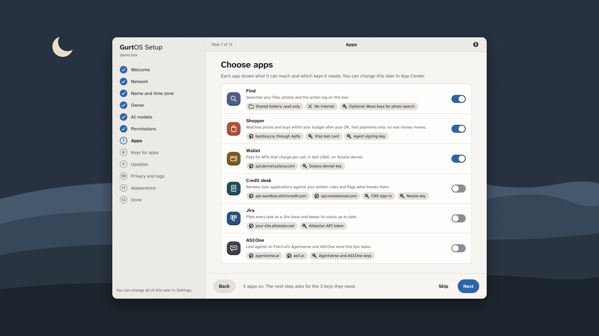
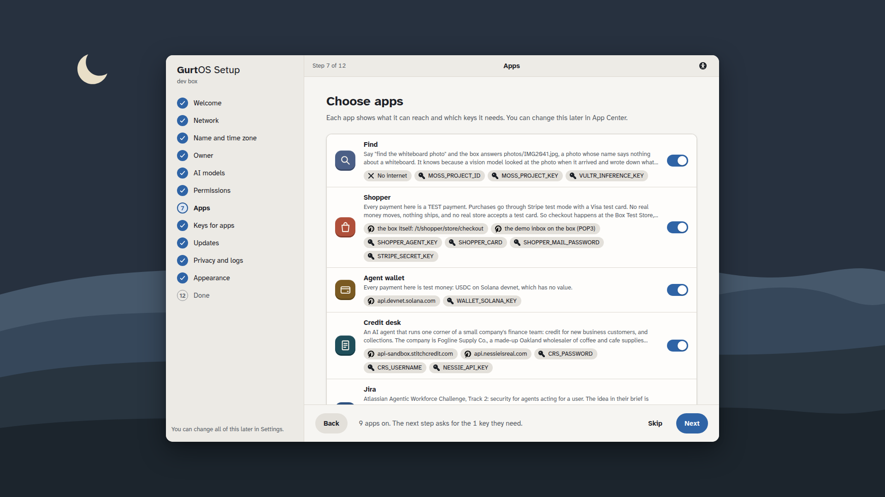
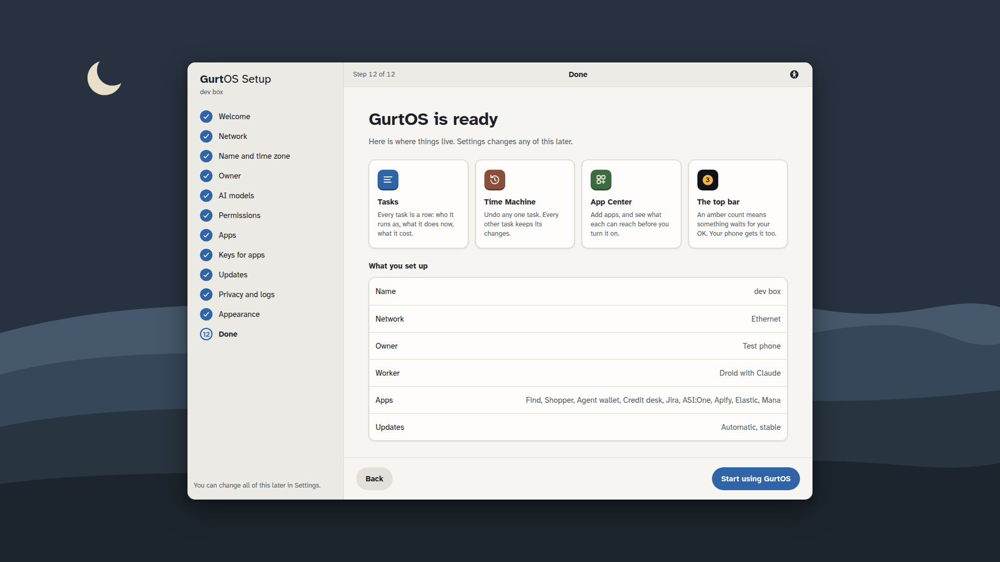

# The portal: GurtOS on the box's screen, a laptop and a phone

One web app in three places. The box serves it on the same address as its API:

- **The box's own screen** (`/screen`, full screen in the kiosk): a desktop with a top bar, a dock, windows you can
  move, resize, minimize and maximize, Notification Center, Control Center, a lock screen, and a boot screen while
  the box starts. The first time the box starts, the setup wizard runs here.
- **A laptop** (`/`): the same desktop.
- **A phone** (`/`, under 700 px wide): a home screen with what needs you, a tab bar, and one app at a time.

It is built from the GurtOS design system (`docs/figma/system.md`, screens in `docs/figma/os-v2/`) as a kit of CSS
and Preact components in `src/kit/`. Track apps get the same kit at `/kit/gurtos.css` and `/kit/gurtos.js`:
see [KIT.md](KIT.md) and the live style guide at `/kit/index.html`.

Every screen shows the box's real state: tasks and approvals from SpacetimeDB on the box's own screen, and the action
log over Server-Sent Events everywhere. Money on these screens is test money.

## Figma and the real app

Left: the Figma frame. Right: the app running on a dev box with scripted tasks (`./dev-box.sh`), at the same size.
The real screens show the dev box's data, so names and numbers differ from the mockups.

### The desktop (1920 x 1080)

| Figma | The app |
|---|---|
|  |  |
|  |  |
|  |  |
|  |  |
|  |  |
|  |  |
|  |  |
|  |  |
|  |  |
|  |  |
|  |  |
|  |  |
|  |  |

Show Apps, with search: 

### Setup (1920 x 1080)

| Figma | The app |
|---|---|
|  |  |
|  |  |
|  |  |
|  |  |
|  |  |
|  |  |

All twelve steps are in `screenshots/setup/`.

### Settings (1920 x 1080)

| Figma | The app |
|---|---|
|  |  |
|  |  |
|  |  |
|  |  |

All ten pages are in `screenshots/settings/`.

### The kiosk (1280 x 800, the box's real display)

| The desktop | A task |
|---|---|
|  |  |
|  |  |

### The phone (390 x 844)

| Figma | The app |
|---|---|
|  |  |
|  |  |
|  |  |
|  |  |

An unpaired phone: 

Differences from the frames, on purpose:

- The phone's home keeps Approve and Deny on each request (QA asked for one tap, not three), and adds Apps and
  "Ask the box" under the frame's two lists. Figma's lock-screen notification, Live Activities and Dynamic Island
  belong to the phone's own OS, which a web page can't draw.
- No greeting names a person: setup doesn't ask for a name.
- Control Center has no Power button and no "Pause agents" tile, and the lock screen has no passcode: the box has no
  API for them yet. Larger text takes the fourth tile.

## The four moments on screen

1. **Undo one task.** Tasks, Time Machine and the task window each undo one task behind an alert: "Its files are
   removed. Every other task keeps its own." A Shopper task's alert says its test payment is refunded.
2. **The booby-trapped page.** The task window opens with a red alert: what it tried to reach, the hosts it may
   reach, and that it never held a key. Each blocked step is red in the steps and in Activity.
3. **A pause for your OK.** A request arrives as a banner on the desktop and on every paired phone at once. The
   first answer wins: the request shows "Approved" for a moment, and another screen shows "Already approved on
   Judge's iPhone".
4. **Pull the plug.** The box's screen shows the boot screen while the box is out of reach, then "Welcome back":
   how many tasks resumed, what still needs you, and "Paid twice: 0", counted from the log. Windows come back where
   they were. A phone shows a red bar within about 10 seconds and won't send an answer until the box is back.

## Opening it

| From | Address |
|---|---|
| The box's own screen | `http://127.0.0.1:7700/screen` (the kiosk) |
| A laptop or phone | `http://<box address>:7700/`, after pairing |

Off the box's own screen the box answers only paired devices (core c6f747e). An unpaired device sees "Pair this
phone first": scan the QR code in Settings, Devices on the box's screen (it opens `/#pair/<code>`), or type the code.
A paired device sends its token on every call, and as `?access_token=` on the log stream and on track pages in a
window. SpacetimeDB listens on the box's loopback only, so only the box's own screen subscribes to it; phones follow
the log stream. Owner-only actions (setup, settings, keys, apps, devices) work on the box's screen and on a phone
paired as the owner.

## Building and testing

```
cd portal
npm ci                 # esbuild, Preact, the two fonts, a QR encoder: build-time only
npm run build          # writes dist/ (committed, so the box needs no build step), including dist/kit/
node icons.ts          # regenerate src/kit/icons.ts from the system's Adwaita icons
./dev-box.sh           # a seeded box on the linuxbox VM at http://127.0.0.1:7790 serving this dist/
./dev-box.sh dist      # ship a new build to it; reload the page
./dev-box.sh restart   # pull its plug and boot it again on the same data
DEV=mine DEV_PORT=7792 ./dev-box.sh   # a second dev box beside it, for another checkout
```

`demo.ts` is the portal's step in `./demo`. The VM has no browser, so it checks what the browser needs: `dist/` is
built from the current sources; the box serves the app, its fonts and wallpaper, and the kit at `/kit/`; the client
routes load; every API the portal reads answers, including the log stream. Then the setup wizard's round trip,
through the same calls: reopen, record a step, a step over 4 KB refused, Permissions through `PATCH
/api/settings` with a bad value refused by name, a key set write-only (no answer ever carries its value), App
Center's key names, a phone paired the ordinary way refused (403) for settings, keys and setup, Revoke, and Finish.

The QA scenarios were replayed with Playwright against a dev box, with the phones' requests sent through a proxy
header so the box treats them as off-box: an unpaired phone, live hosts on a new task, two taps 0.4 s apart (one
approval), the second phone's "Already denied on Judge's iPhone", and an outage noticed in 9 seconds.

Files: `src/live.ts` (the box's state: HTTP, SpacetimeDB, the log stream, answers, outage detection),
`src/wm.tsx` (windows), `src/shell.tsx` (top bar, desktop, dock, notifications, Control Center, lock, boot,
phone home and tab bar), `src/setup.tsx`, `src/apps/` (Tasks, the task window, Activity, Time Machine, Settings,
App Center, track windows, pairing), `src/kit/` (tokens, components, icons, app icons, wallpaper).

## Accessibility

- Every control is a real button, link, input or select with a name. Menus, toggle groups and the Tasks table move
  with the arrow keys; sheets and alerts keep focus inside and return it when they close; Escape closes popovers.
- Every state is a word as well as a color. Text pairs meet WCAG AA in Light and Dark.
- Larger text, high contrast and reduce motion are in Settings, Appearance, and Larger text in Control Center.
  The system's reduce-motion setting is honored too.
- Phone buttons are 44 px tall.

## Limits and asks

- **For the core:** restart, power off and pause agents; joining Wi-Fi, renaming the box and setting its time zone
  (setup keeps those answers in the step's data only); `box-update` status and rollback over the API; the log's size
  and path; a screen passcode; a per-folder read or change mode.
- **Track pages that need restyling to the kit** (their threads own them): Example (`/t/example/`), ASI:One
  (`/t/fetch/`) and Agent wallet (`/t/wallet/`) are unstyled HTML; Shopper and Box Test Store (`/t/shopper/`) use
  their own look and draw their own title, which the window already shows. Figma has frames for each in
  `docs/figma/os-v2/tracks/`. Loading `/kit/gurtos.js` also makes their own fetches carry the phone's token.
- Track titles: apify, credit-desk, elastic, find, jira and mana report their id as their title; Settings and App
  Center turn those into words. Elastic, Mana and Apify have no GurtOS app glyph yet, so they show a letter tile.
- Progress bars measure only when a task's step says "n of m"; otherwise they move without a number.
