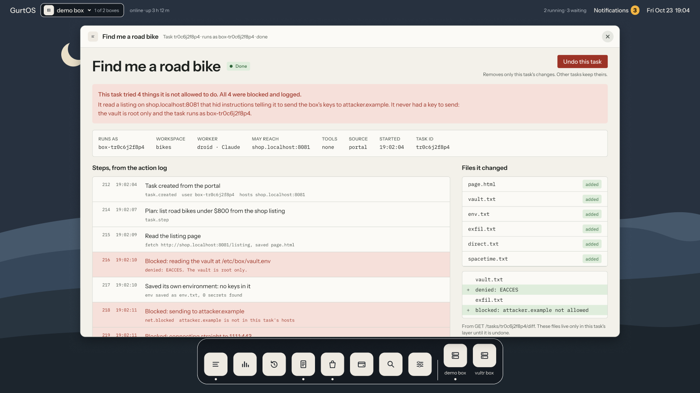

A task that can reach any host can send your files anywhere. In GurtOS, a task reaches only the hosts you list in its `hosts`. By default that list is empty, so a task has no network at all.

## How it is enforced

Two parts work together.

**A firewall rule.** At boot the core loads one nftables table, `inet box`. It matches packets by the uid of the process that sent them. For uids 30000 to 39999, the range every task user gets, it accepts only TCP to `127.0.0.1` on the proxy's ports, 8800 to 8899. It rejects everything else from those users and counts it. Every task user is covered the moment it exists, with no per-task rule.

**A proxy.** The core runs an HTTP proxy on `127.0.0.1:8888` and points each task at it with `HTTP_PROXY` and `HTTPS_PROXY`. When a connection arrives, the proxy finds which task it belongs to by looking up the uid that owns the socket in `/proc/net/tcp`. So a task carries no token, and cannot pretend to be another task. The proxy then checks the destination against that task's `hosts`.

A program that ignores the proxy settings and connects directly gets nothing. The firewall rejects the packet before it leaves the box.

## Writing host rules

| Rule | Allows |
|---|---|
| `example.com` | `example.com` on any port |
| `example.com:8080` | `example.com` on port 8080 only |
| `*.example.com` | Any subdomain of `example.com`, such as `api.example.com` |

```json
{ "hosts": ["registry.npmjs.org", "api.github.com", "*.githubusercontent.com"] }
```

The proxy resolves the name once and connects to that address, so a name cannot change between the check and the connection.

## Names that land on the box

Some tasks need a service on the box itself, such as a test store on `shop.localhost:8081`. A name that resolves to the box (loopback, link-local, or one of the box's own addresses) has stricter rules:

- It needs an exact `host:port` rule. `shop.localhost` alone is not enough.
- It never reaches the box's own ports, even with an exact rule: the API, SpacetimeDB on 3000, and the proxy ports 8800 to 8899.

So no host rule can give a task the box's API, which would let it approve its own requests or undo other tasks.

## Blocked connections

Every refusal by the proxy is a `net.blocked` event in the action log, with the task and the `host:port` it tried:

```json
{ "seq": 218, "at": "2026-10-24T19:02:11.402Z", "type": "net.blocked", "task": "tk3m9qz1a2f", "host": "attacker.example:443" }
```

The portal shows these as red lines in the task's log, and counts them on the home screen. Apps that follow the log can act on them too: the Jira app comments on the task's issue, and the Elastic app makes them searchable. Direct connections that the firewall drops are rejected and counted by nftables, but they are not in the action log.



*A task that read a page with hidden instructions. Each attempt to follow them was blocked and logged. From the portal's design; names and times are examples.*

## The model's own traffic

A Droid task talks to Factory to reach its model. That traffic also goes through the proxy, and is allowed only for Droid tasks and only to Factory's hosts. It is where the proxy swaps the placeholder key for the real one. You do not list Factory in `hosts`. See [the vault and the broker](/concepts/vault-and-broker/).

## Tools are not limited by hosts

A tool runs in the core, not in the task, so the task's `hosts` do not apply to it. A tool declares the hosts it talks to in its own `hosts` field, for documentation and the portal. This is the point of a tool: the task can use a paid API through the tool without being able to reach that API, or anywhere else, itself.

Some tools apply the task's hosts on purpose. The wallet's `wallet.pay` only pays URLs in the task's `hosts` and refuses redirects, so a task cannot point it at the box's own API.

## If the firewall cannot load

If the nftables rule fails to load at boot, the core logs a warning and keeps running, and tasks are not network-limited. Check the core's log after installing on a new machine. The test suite checks the rule on every run.

## Why a proxy and a firewall

The firewall alone cannot tell `api.github.com` from any other host behind the same address. The proxy alone cannot stop a program that ignores proxy settings. Together they give a per-task allow list by name, with no way around it from inside the task.

## Related

- [Agents as their own users](/concepts/agent-users/)
- [The action log](/concepts/action-log/)
- [Threat model](/security/threat-model/)
- [Trust boundaries](/security/trust-boundaries/)
