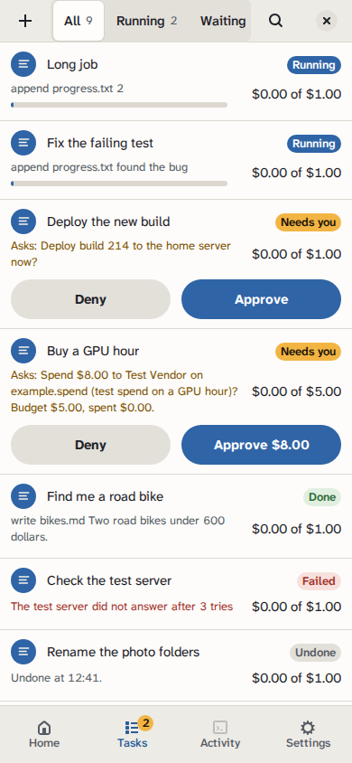

import ApprovalFlow from '../../../../assets/diagrams/approval-flow.svg';

Some things an agent should not decide alone: spending more than you planned, deploying, deleting. In GurtOS, a task can stop and ask, and spending over budget, or above the box's threshold, always stops and asks. The request reaches the portal and your phone live. The task waits. Every other task keeps going.

## Two ways a task asks

**A budget pause.** Every task has a budget in US cents, `budgetCents`, which is 0 unless you set it. Tools declare what each call costs with `cost(input)`. Before the broker runs a paid call, it adds the call's cost to what the task has spent and to what its other calls in flight have reserved. If the total is over the budget, it asks first:

```text
Spend $3.00 to Test Vendor on example.spend (test spend on coffee)? Budget $1.00, spent $0.00.
```

**A threshold pause.** The box's settings hold `approvalThresholdCents`, $100 by default. A single paid call above it always asks, even when it fits inside the task's budget:

```text
Spend $150.00 to Test Vendor on example.spend (test spend on a camera)? Spends above $100.00 always ask.
```

A task that names no budget gets the setting `defaultBudgetCents`, which is 0 unless the owner changes it. Only the owner changes settings, with `PATCH /api/settings` from the box's own screen or an owner-paired phone.

**An explicit ask.** A worker can ask any yes or no question with `POST /ask` on its broker. Droid does this through the `box_ask` tool, and its own clarifying questions become approvals too. An app's tool can also refuse to act and tell the agent to ask, as the credit desk does for decisions above an analyst's authority.

<figure class="diagram">
  <ApprovalFlow />
  <figcaption>A call over budget, or an explicit ask, pauses only that task. The first answer from any device resolves it, and the call runs once.</figcaption>
</figure>

## What happens while it waits

1. The core writes an `approval.asked` event to the log. The approval has an id, the question, the amount in cents, and for payments the payee and purpose.
2. The task's state becomes `waiting`.
3. The core mirrors the approval into SpacetimeDB for the box's own screen, and the event reaches paired phones and connected apps through the log stream. All of them see it at once.
4. The broker holds the worker's request open for up to 150 seconds (`BOX_APPROVAL_WAIT_MS`).
5. If no answer arrives in that time, the broker returns `{pending: true}` with "call again to check". The worker, or Droid, calls again and keeps waiting. So a task can wait hours for an OK, past any client timeout.

The wait limit exists because Droid gives up on a tool call after about three minutes. A shorter wait, repeated, keeps the call alive.



*The portal on a phone, from a test box running scripted tasks. Amounts are test money.*

## Answering

The box's own screen and every paired device can answer:

- `POST /api/approvals/<id> {approved}` on the box's API. From the box's own machine, `by` in the body names who answered. From anywhere else the request must carry a paired device's token, and the core names the device, whatever `by` says.
- The `answer` reducer in SpacetimeDB, `answer({id, approved, by})`. SpacetimeDB listens on `127.0.0.1`, and the reducer works only from a connection the box has vouched for: its own screen, or a paired phone that registered its connection. The answer is logged under that vouched name.
- Apps that drive the box: the Jira panel's Approve and Deny buttons, and cards in an ASI:One chat.

The box's own screen answers through SpacetimeDB when it is connected, and through the HTTP API when it is not. It names itself `box screen`.

**The first answer wins.** Later answers to the same approval change nothing. The core writes `approval.answered` with who answered (`portal`, `phone`, `jira:<name>`, `asi1`, or a paired phone's name), wakes the waiting call, and moves the task back to `running` once nothing else of it is pending.

A paired phone answers over the HTTP API with its device token as `Authorization: Bearer <token>`. The core records the phone's name as `by`. An answer from off the box with no token, or an unknown or revoked one, gets `401` and changes nothing. See [approve from your phone](/docs/guides/approve-from-your-phone/).

If approved, the paid call runs and its cost is counted. If denied, the call returns "not approved" and nothing is spent. The agent decides what to do next.

## One approval per action

An approval's id is the task id plus a key. For a budget pause, the key is built from the tool name and a hash of its arguments. For an ask, the worker supplies it. This has three effects:

- The same call retried, for example by Droid after its timeout, finds the same approval instead of making a second one.
- An answer to any copy of the request resolves the one approval.
- The approved call runs once and is charged once.

## Closed at the end

When a task reaches `done`, `failed` or `undone`, the core closes any approval still pending for it, as denied. Nothing lingers in your inbox for a task that has stopped.

## Budgets and parallel calls

Droid can make several tool calls at once. Before a paid call runs, the broker reserves its cost. A second call that arrives at the same moment sees the reservation. So two payments fired together cannot both slip under the budget. When a call finishes, its reservation is replaced by its real cost in the log.

## Choosing a budget

A budget is a threshold for asking, not a hard cap. Spending above it is possible, but only with your OK, one call at a time. Set it to what you would spend without wanting to be asked. A budget of 0 means every paid call asks. The box-wide `approvalThresholdCents` sits above every budget: no single call over it runs without an OK.

The budget check runs only before a paid tool call, so a task that only uses the model never pauses for budget. Model cost still counts as spent, so it uses up budget that later paid calls check against. See [cost](/docs/concepts/cost/).

## Related

- [Approve from your phone](/docs/guides/approve-from-your-phone/)
- [Cost](/docs/concepts/cost/)
- [Live updates](/docs/reference/live-updates/)
- [The broker](/docs/reference/broker/)
