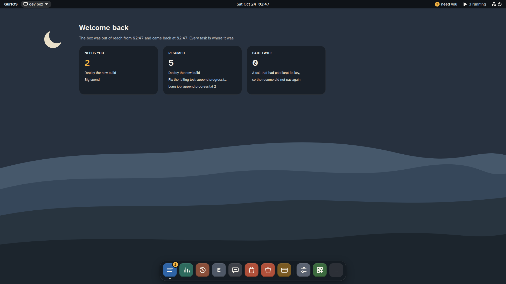

A box is meant to run unattended. Power cuts, kernel panics and restarts will happen while agents are working. When a GurtOS machine comes back, every task that was queued, running or waiting carries on from where it was. No step runs twice, none is skipped, and pending approvals are still pending.

## What happens at boot

`box.service` starts at boot and restarts within a second if it ever exits. When the core starts:

1. **It reads the log.** It drops a half-written last line if there is one, then rebuilds every task and approval by replaying events in order. See [the action log](/docs/concepts/action-log/).
2. **It loads the firewall rule and starts the proxy**, so task users are network-limited before any of them runs.
3. **It loads every app** and rebuilds each workspace's view from its done layers.
4. **It resumes tasks.** For each task that was `queued`, `running` or `waiting`, it stops any leftover processes of that task's user, remounts the task's copy of the workspace over the same layers it started with, opens its broker and starts its worker again.
5. **It starts serving** the API, then app triggers, then reconnects to SpacetimeDB and refills the live tables.

`GET /api/health` reports when the core started (`startedAt`) and which tasks it resumed (`resumed`). The portal uses
them to show a notice after a restart that lists the tasks that picked up where they stopped.

A task that was waiting for an OK stays waiting. Its approval is still in your inbox, and you can answer it from the portal or phone as if nothing happened.

*After a power cut, from a test box running scripted tasks.*

## Why nothing runs twice

Resuming is only safe if work already done is not done again. GurtOS uses three mechanisms.

**Files are already there.** A task's changes live in its own layer on disk, `BOX_HOME/tasks/<id>/upper`. Before the core logs a worker's step, it flushes that layer to disk. So when the log says a step is done, its files survived too. The resumed worker sees them in its copy.

**Steps tell the worker where it was.** The worker asks its broker for `GET /task`, which returns the task and every step it already logged. A worker uses this to pick up its place:

- Droid saves its session id in its first step. On resume, the worker reopens that session and tells Droid: "The box restarted while you were working on this. Check what is already done in the files, then finish."
- The scripted test worker records a line number with each step and continues from the next line.

**Tool calls are keyed.** Every tool call carries a key that stays the same across a restart. If the log already has a result for that key, the broker returns it without running the tool. If the call was cut off before its result was logged, it runs again with the same key, and the tool passes that key to its API as an idempotency key. A payment API that saw the first attempt returns the same charge instead of making a second.

Some apps add their own guard. The wallet writes a durable mark before it pays. If the box loses power in the middle of a payment, the resumed call refuses to pay again rather than guess, and you check the payment on the network's explorer.

## What the test suite checks

The test suite acts out a power cut on every run. It starts a long task and a task waiting for an OK, then kills the core and every task process at once, unmounts every overlay, and writes half a line to the end of the log. Then it starts the core again and checks:

- The box came back and picked up the long task.
- The long task finished with every step done exactly once, in order.
- The waiting task was still waiting, with its approval still pending in SpacetimeDB.
- Approving it after the restart let it finish.
- Earlier work survived: a task done before the cut kept its changes, and a task undone before the cut stayed undone.

See [the test suite](/docs/reference/test-suite/).

## On an ISO install

Everything the core needs to resume lives on the data partition: the log, workspaces, task layers, the vault and SpacetimeDB's data. A whole-system update copies the task users into the new system, so a task resumed after an update keeps its uid. See [system updates](/docs/concepts/system-updates/).

*The boot screen while the box restarts, from a test box running scripted tasks.*

## Limits

- A task resumes, but the model call it was in the middle of does not. Droid redoes its current turn from the files and the session.
- A tool call cut off mid-way runs again. That is safe only for tools that pass `ctx.key` to their API or keep their own durable mark, as the payment tools (`wallet.pay`, `shopper.buy`) do. A read-only tool, such as a price check, runs again, which is harmless.
- A system that hangs without crashing does not restart by itself. A hardware watchdog would cover that, and is not set up.
- Model cost for a turn cut off by the power cut may not be counted.

## Related

- [The action log](/docs/concepts/action-log/)
- [Tasks](/docs/concepts/tasks/)
- [The vault and the broker](/docs/concepts/vault-and-broker/)
- [System updates](/docs/concepts/system-updates/)
