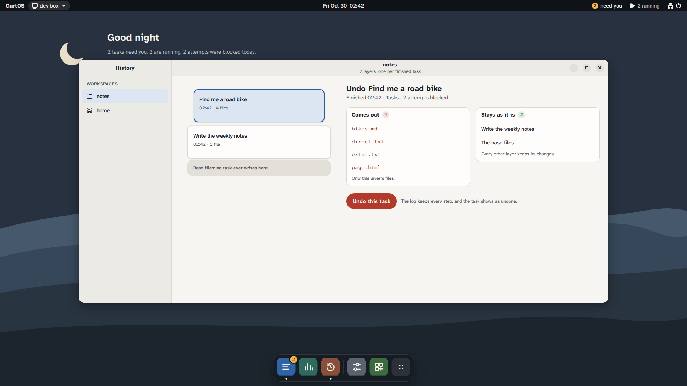

import Layers from '../../../../assets/diagrams/layers.svg';

A workspace is a folder of files that tasks work on, such as a git repository or a folder of receipts. GurtOS never lets a task write to it directly. Each task gets its own copy, and its changes become a layer. That is what makes undo exact.

## Workspaces

Workspaces live in `BOX_HOME/workspaces/<name>`. The `home` workspace always exists and is the default. Apps make their own with `box.workspace(name, fromDir)`, empty or as a copy of a folder. A name may use letters, digits, `.`, `_` and `-`.

The files you put in a workspace are its base. Only root can reach the base directly, and no task ever writes to it.

## Layers

GurtOS builds every copy with overlayfs, the Linux file system that stacks folders on top of each other:

- The **base** is at the bottom.
- Each **done** task's changes sit on top of it as a layer, newest on top.
- A **running** task sees the base plus the layers that were done when it started. Its own changes go into a new, empty folder on top, its upper layer.

When a task finishes, its upper layer joins the stack. The workspace's **view**, in `BOX_HOME/views/<name>`, is a read-only overlay of the base and every done layer. The view is what "the workspace now" means.

<figure class="diagram">
  <Layers />
  <figcaption>A workspace's base files stay at the bottom, unwritten. Done tasks stack on top, newest first. Undo takes one layer out of the stack.</figcaption>
</figure>

A deleted file is a layer entry too. overlayfs records it as a whiteout, a marker that hides the file below. So a task that deletes a file leaves the base untouched, and undoing that task brings the file back.

## Undo

Undo takes one task's layer out of the stack and rebuilds the view. Nothing else changes:

- The base files are never written, so there is nothing to restore.
- Every other done task keeps its layer, so its changes stay.
- If the task is still running or waiting, the core stops its processes first, and denies any approval it was waiting on.

Undo is `POST /api/tasks/<id>/undo`. The portal's Undo button and History both call it. The task's state becomes `undone`, which is final, and the log records when. It does not record who asked for the undo.

Once no running task still reads the undone layer, the core deletes it from disk. An undone task's diff is empty, because its changes are gone.

*History, from a test box running scripted tasks.*

### What undo does not do

Undo removes file changes. It cannot recall what a task already sent out of the box: a payment, an email, a message to an API. Those calls are in the log so you can follow up. Some apps reverse their own effects when a task is undone. For example, undoing a purchase from the shopping agent refunds its order, which is a test order in the preview. See [undo a task](/docs/guides/undo-a-task/).

### Layers built on other layers

A task that started after task A sees A's changes, and may change them again. If you later undo A, the later task's layer stays in the stack. Its changes to A's files still apply on top, but files only A created are gone. Read the diff before you undo a task that later tasks built on.

## Why overlayfs

Other ways to undo an agent have gaps. Git only covers files in a repository, and only if the agent commits. Snapshots of the whole disk roll back every task at once. Copying the folder per task costs disk and time.

overlayfs is in the kernel, costs nothing until a task writes, and records each task's changes in its own folder. The diff of a task is a walk of that one folder. Undo is a remount.

## Limits

- A workspace stacks up to 499 finished tasks, and the tasks running on it count too, because each becomes a layer. Past that, a new task there is refused with a message that says to undo finished tasks you no longer need, or to use another workspace. Squashing old layers into the base is not built yet.
- The diff API shows at most 200,000 bytes of unified diff. The list of changed paths is always complete.
- A failed task's changes stay in its own layer and never join the workspace. You can read them, but no later task sees them.

## On the Personal edition

:::note[Preview]
On Personal, a task can work on your own folders: `folder` or `folders` on `POST /api/tasks`. Such a workspace does not stack layers. Each task gets a fresh copy of the real folder when it starts and runs on a layer over that copy, so your folder is untouched while the task runs. When the task is done, **Keep** (`POST /api/tasks/<id>/keep`) writes its changes into the real folder. Each file is replaced in one step and keeps its owner and mode. Keep is all or nothing: it refuses if you changed the same files since the task started, and if one file cannot be written it puts back the ones it already wrote. **Undo** discards the changes. Undo of a task you already kept also takes its changes out of your folder, or changes nothing if you edited a kept file since. **Undo Keep** (`POST /api/tasks/<id>/unkeep`) puts back what a Keep changed. Keep, Undo Keep and the undo of a kept task are for the owner. Each task's copy of your folder stays on disk until the task is undone, even after Keep. In GNOME, **Ask an Agent** in Files and a review window do the same. See [give an agent a folder](/docs/guides/keep-or-undo/).
:::

## Related

- [Undo a task](/docs/guides/undo-a-task/)
- [Tasks](/docs/concepts/tasks/)
- [Files and paths](/docs/reference/files-and-paths/)
- [Resume after power loss](/docs/concepts/resume-after-power-loss/)
