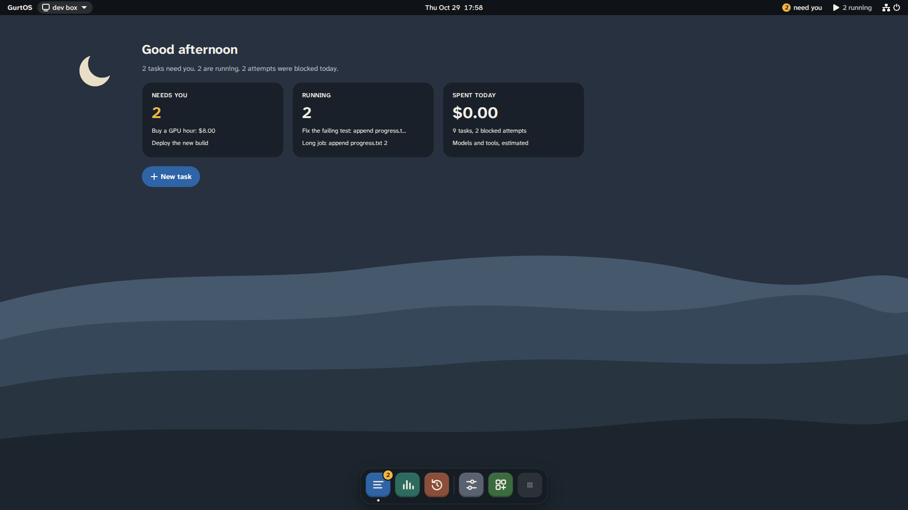

The first time a box starts from its disk, it sets itself up. You do not log in. The screen then runs a setup wizard.
This page explains what happens, what the screen shows, and how to pair phones.

:::note[Which release this page describes]
This page describes the current source. The v0.1.0-preview ISO has a longer wizard (it adds Remote access, Apps, Keys
for apps, Privacy and logs, and Appearance). The next release is cut from the current source.
:::

## What first boot sets up

`box-firstboot.service` runs before the GurtOS service at every start. It creates only what is missing, so a system
update keeps everything it made. Both files live in `/etc/box` on the data partition:

| File | What it is |
|---|---|
| `identity.key`, `identity.pub` | The box's own ed25519 key pair |
| `vault.env` | The vault, empty, readable by root only |

The box's id is the first 6 hex digits of the SHA-256 of its public key. The box takes `gurt-<id>` as its hostname,
for example `gurt-bf07fe`, and the service uses it as the box's id and name, so no two boxes share one.

Then the GurtOS service starts. It creates its state folder `/var/lib/box`, makes the `home` workspace, loads its
firewall rule, starts its network proxy, loads the apps that are on, and listens on port 7700. A new box has only the
model app on. On the GurtOS images the service listens on every address, behind the firewall below. SpacetimeDB
starts beside it on `127.0.0.1:3000`.

`box-droid.service` downloads Factory's Droid CLI, the agent worker (about 300 MB), once the network is up. It never
holds up the boot or the screen, and it tries again until it works. A task that uses Droid waits in the queue until
Droid is there. Its state is in `/run/box-os/droid` (`state=`, `message=` and `at=`).

The OS image also loads an inbound firewall. It drops everything that comes in except replies to the box's own
connections, ping and DHCP, plus the box's API on port 7700 from private networks only. Port 7701 is open to
private networks too, and the box listens there only while **Set up from another computer** is open in setup. SpacetimeDB is never reachable from
the network. Debug builds also allow SSH.

Last, `box-confirm.service` waits for the box to report healthy. On a fresh install this confirms the running
system. After an update, it decides whether to keep the new system. See [System updates](/docs/concepts/system-updates/).

## What the screen shows

The box has no desktop and no login prompt. Every text console is switched off. The screen runs one full-screen
browser window as an unprivileged `kiosk` user. It shows the portal's box screen, served by the box itself at
`http://127.0.0.1:7700/screen`: the home screen with widgets for requests and running tasks, the app grid, and
banners when a task needs you. You can approve, deny and undo from the screen with a keyboard and mouse or a touch
screen.

*The box's screen, from a test box running scripted tasks. Money is test money.*

After a power cut, the screen lists the tasks that picked up where they stopped.

## Setup and your keys

Until setup is done, the screen shows the setup wizard instead of the desktop. It has eight steps:

| Step | What it asks |
|---|---|
| **Welcome** | Language, keyboard and accessibility options. A panel beside it shows a QR code to set up from your phone, and a button to set up from another computer. |
| **Network** | Shows the wired connection and whether it reaches the internet. GurtOS Server has no Wi-Fi, so plug in a cable. |
| **Name and time zone** | The computer's name (1 to 40 letters, digits, spaces, apostrophes and hyphens), its time zone, and whether to set the time automatically. |
| **Owner** | **Pair my phone** (a QR code and a code to check) or **Only this screen**, for a computer with no phone nearby. |
| **Model key** | One Anthropic or Factory API key. **Skip for now** is allowed, but no task can run until a key is added. |
| **Permissions** | The internet a new task gets, the spend that always asks (the default is over $5), the budget of a task that names none (the default is $1), and quiet hours. |
| **Updates** | How whole-system updates work: system A is running, system B is the spare. |
| **Done** | A short tour, and a summary of what you set. **Start using GurtOS** opens the desktop. |

There is no step for apps or their keys. Apps are optional and off until you turn them on in App Center. Appearance,
Privacy and Remote access are in **Settings** only.

GurtOS needs exactly one model key: an **Anthropic API key** from
[console.anthropic.com](https://console.anthropic.com), or a **Factory API key** from
[app.factory.ai](https://app.factory.ai). Keys go straight into the vault, and no screen shows them again. Change them
later in **Settings**, **Accounts & Keys**. See [Add a secret to the vault](/docs/guides/add-a-secret/).

On a cloud instance, run setup in the provider's web console, which shows the box's screen. The firewall keeps the
API and the setup port away from the public internet, so setting up from another computer works only over a private
network such as Tailscale.

## Pair a phone

Pairing gives a phone, or a laptop's browser, its own device token. From anywhere but the box itself, the API
answers only requests that carry a paired device's token. When a phone answers a request, the action log records
which phone it was, and you can remove one phone without affecting the others.

In outline:

1. Put the phone on the same private network as the box: your home network, or a VPN such as Tailscale. GurtOS
   Server listens on every address, sets its own phone address (`BOX_URL`) at each start, and its firewall lets the
   API in from private networks only, never from the public internet.
2. On the box's own screen, open **Settings**, **Devices**. It shows a one-time code that works for 5 minutes, and a
   QR code. Turn on **It is the owner's phone** if this phone may change settings and keys. Setup's **Owner** step
   does the same for your first phone.
3. Scan the QR code with the phone, or open `http://<box address>:7700/pair#<code>` on it. The QR code opens the box's
   own pairing page on your home network, so the phone must be on the same network as the box. With remote access on,
   the QR code opens the web app through the box's https address instead. Check the code matches, name the phone and
   pair it.

[Approve from your phone](/docs/guides/approve-from-your-phone/) has the full steps, including pairing a phone as the
owner.

## Next

[Your first task](/docs/get-started/first-task/).

## Related

- [Install GurtOS Server](/docs/get-started/install-server/)
- [Approve from your phone](/docs/guides/approve-from-your-phone/)
- [Files and paths](/docs/reference/files-and-paths/)
- [Trust boundaries](/docs/security/trust-boundaries/)
