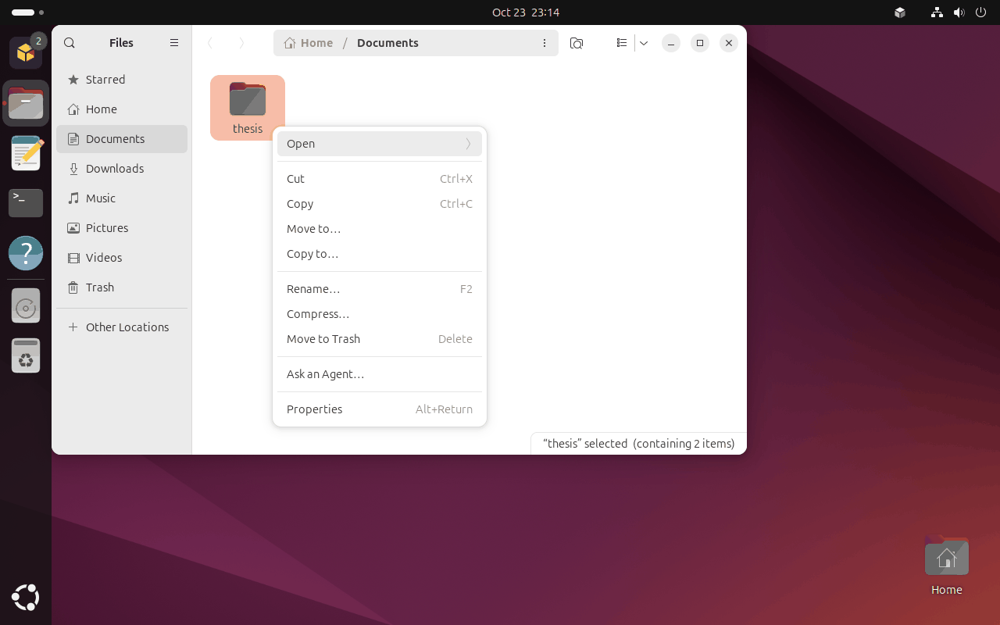
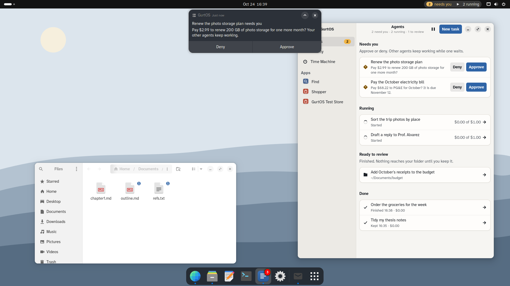
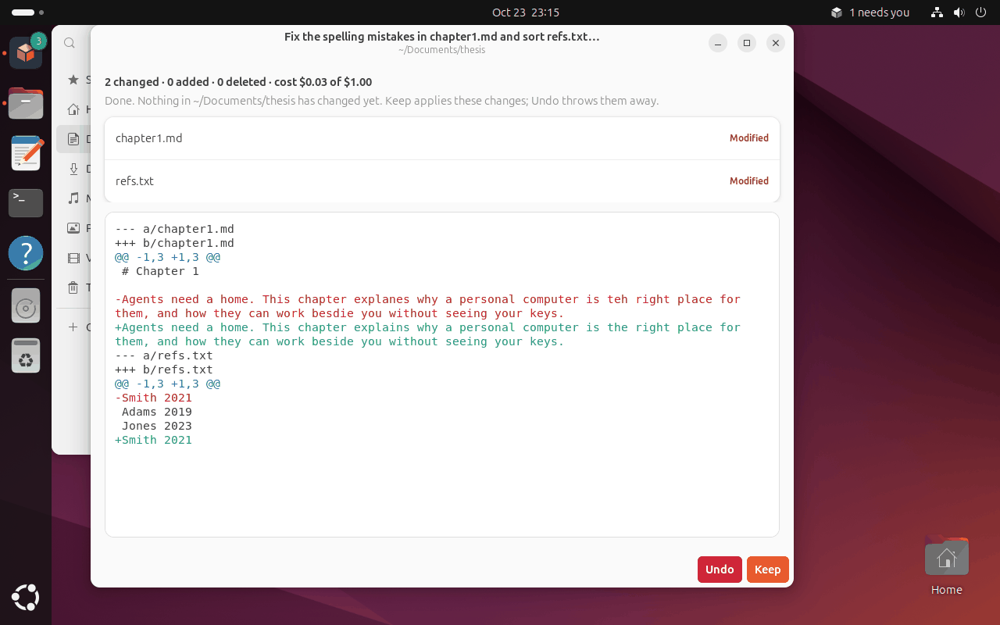

GurtOS Personal is GurtOS on your own laptop or desktop. You use it as a normal computer, with Ubuntu's GNOME desktop
and your own account with `sudo`. Agents work beside you as separate users without `sudo`, on copies of your
folders, and nothing in your folders changes until you choose **Keep**.

It installs from its own ISO, like [GurtOS Server](/docs/get-started/install-server/), and updates the same way: the
whole system at once, with an automatic rollback if the new system is not healthy.

:::caution[Preview]
GurtOS Personal installs and runs, and has been walked end to end on a fresh install. Pairing a phone still needs the
box's address set by hand. See [What is not finished](#what-is-not-finished).
:::

## Requirements

| | Minimum | Recommended |
|---|---|---|
| CPU | x86_64 | 4 cores |
| Memory | 4 GB | 8 GB or more. The desktop needs room, and each task may use up to 2 GB. |
| Disk | 32 GB | 48 GB. The two system slots take 24 GB. |
| Firmware | BIOS or UEFI, with **Secure Boot off** | |

The arm64 image builds natively and was boot-tested in a VM on a Mac.

:::danger
The installer takes the whole disk. Dual boot with another operating system is not supported. A disk with anything
on it is erased only after you type `erase` on the screen, but back up first.
:::

## Get the ISO

Download `gurtos-personal-x86_64.iso` (Intel or AMD), or `gurtos-personal-arm64.iso` (Apple silicon in UTM or Parallels), from the [Download](/download/) page and check its checksum.

Or build it from the [source](https://github.com/benz16107/calhacks13) on an Ubuntu 24.04 build machine where you
have root:

```sh
BUILD_SHELL='ssh my-build-vm' image/build personal          # gurtos-personal-x86_64.iso
BUILD_SHELL='ssh my-build-vm' image/build personal arm64    # gurtos-personal-arm64.iso
```

The build leaves `gurtos-personal-<arch>.iso` and its update file `gurtos-personal-<arch>.sqfs` (with `.sha256` and
`.sig`) in `/var/lib/box-image/out/` on the build machine. With `BOX_SSH_KEY` it makes a debug build named with
`-debug`.

## Install

1. Write the ISO to a USB stick, or attach it to a virtual machine, and start from it. The steps are the same as for
   [GurtOS Server](/docs/get-started/install-server/#install-on-a-real-machine): Secure Boot off, then start from the disc.
2. The disc's menu says GurtOS Personal and waits 5 seconds, then installs. On a disk with data, type `erase` when
   asked.
3. The machine restarts into GNOME's own first-boot setup: language, keyboard, time zone, your name and a password.
   The account it makes is an administrator, so it is in the `sudo` group.
4. Within a second of that account existing, GurtOS makes it the box's **owner**. Only the owner can hand folders
   to agents, keep their changes and change settings.
5. Log in. After Ubuntu's welcome, the GurtOS welcome explains what agents can and cannot do. GurtOS is first in the
   dock, and its indicator is in the top bar.

## Add your model key

Agents need one model key: an **Anthropic API key** from [console.anthropic.com](https://console.anthropic.com), or a
**Factory API key** from [app.factory.ai](https://app.factory.ai). Open the GurtOS app from the dock, then
**Settings**, **Accounts & Keys**, paste the key and choose **Save to vault**. The key never shows on screen again,
and agents never see it. Every app, such as Jira or the wallet, is optional and stays off until you add its keys.

If you start a task before adding a key, it fails at once and a notification says the vault has no model key.

## Use it

Right-click a folder in Files and choose **Ask an Agent**. Describe the job and set a budget. The agent works on a
copy of the folder as its own user.



*Ask an Agent in Files, on a fresh GurtOS Personal install.*

Requests for your OK arrive as GNOME notifications with **Deny** and **Approve**. The log records your answer as
`desktop:<your user name>`.



*An approval as a notification. The spend is test money.*

When the task is done, a review window shows every changed file and the diff. **Keep** writes the changes into your
folder; **Undo** throws them away. Your folder is untouched until you choose.



*The review after a task fixed spelling in a thesis chapter.*

See [Give an agent a folder, then keep or undo](/docs/guides/keep-or-undo/) for the details, including undoing a Keep.

## What updates keep

GurtOS Personal updates the whole system, like Server, and rolls back by itself if the new system is not healthy.
See [System updates](/docs/concepts/system-updates/).

An update keeps your files, your account and its `sudo` membership, other people's accounts, Wi-Fi and network
connections, Bluetooth pairings, time zone, language, the computer's name and login settings.

Software you install yourself with `apt`, and other changes outside your home folder and those settings, are gone
after the next system update, because the update replaces the whole system. Ubuntu's Software Updater is still
installed and can update the running system, but the next GurtOS update replaces that too.

## What is not finished

- **Phones.** The box listens on `127.0.0.1` and has no address set for phones, so pairing a phone needs
  `BOX_LISTEN` and `BOX_URL` set by hand. See [Approve from your phone](/docs/guides/approve-from-your-phone/).
- **Testing.** Personal x86_64 installs, comes up healthy and survives a power cut in a virtual machine. The arm64 image was boot-tested in a VM on a Mac. Neither has run on a real laptop.

## Related

- [Give an agent a folder, then keep or undo](/docs/guides/keep-or-undo/)
- [Editions](/docs/introduction/editions/)
- [Agents as their own users](/docs/concepts/agent-users/)
- [Roadmap](/docs/project/roadmap/)
