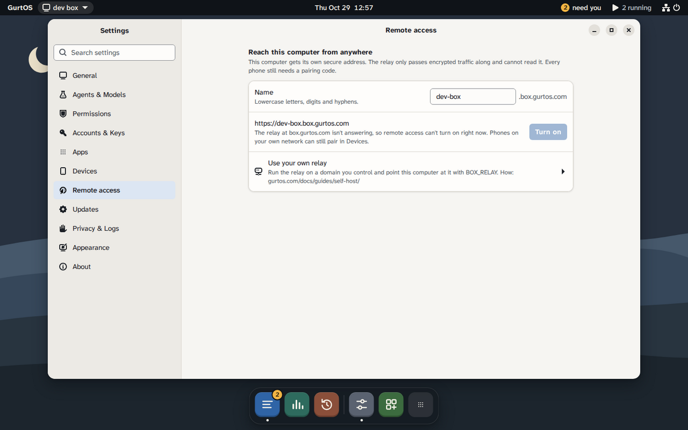

A box answers on its own network: a phone on the same Wi-Fi can pair with it and approve its requests (see
[Approve from your phone](/docs/guides/approve-from-your-phone/)). To reach it from somewhere else, pick one of two
ways.

| Compare | A private network | A relay you run |
|---|---|---|
| What it is | Tailscale, WireGuard or another VPN that the phone and the box's network share | Your own copy of the GurtOS relay, on a small server with a public address |
| The box's address | Its address on that network, over plain HTTP inside the VPN's encryption | `https://<name>.<your relay's domain>`, with its own certificate |
| Push notifications | No. A request shows when the app is open on the phone | Yes, through the relay's push gateway |
| Setup | A few minutes | A server, a domain and about an hour. See [Run your own relay](/docs/guides/self-host/) |

A private network is the simple choice and needs nothing from GurtOS. A relay adds an https address and push
notifications.

:::note[Preview]
GurtOS's own hosted relay at `box.gurtos.com` is not running during the preview. Until it is, Remote access in
Settings says the relay is not answering and links to the self-host guide. Your box keeps working on its own network.
:::



## Over a private network

Every request from off the box still needs a paired device's token. A private network only gives the phone a route.

### GurtOS Server

GurtOS Server listens on every address, and its firewall lets port 7700 in from private networks only, including
Tailscale's `100.64.0.0/10`. It has no shell for you to install a VPN on, so put the VPN on another machine on the
same network:

1. On a computer that stays on at home, install Tailscale and make it a
   [subnet router](https://tailscale.com/kb/1019/subnets) for your home network, for example `192.0.2.0/24`.
2. Approve the route in the Tailscale admin console, and install Tailscale on your phone with the same account.
3. Pair the phone as on the home network. The pairing QR code opens the box's own address, such as
   `http://192.0.2.10:7700`, which the phone now reaches from anywhere through the subnet router.

### GurtOS Personal and the Ubuntu install

You have sudo on these, so you can put the box itself on the private network:

1. Install Tailscale on the computer and on your phone, and sign in to both with the same account.
2. On GurtOS Personal the box already listens on every address and allows Tailscale's addresses. On the Ubuntu
   install, set `BOX_LISTEN` and `BOX_URL` to the computer's Tailscale address: see step 2 of
   [Approve from your phone](/docs/guides/approve-from-your-phone/#steps).
3. Show a pairing code on the computer, then open `http://<Tailscale address>:7700/pair#<code>` on the phone.
   On GurtOS Personal the QR code holds the computer's home address, so type the Tailscale one instead when you are
   away.

## Through a relay you run

A relay gives the box an address such as `https://rosa.box.example.com` with no port forwarding on your router, and
forwards push notifications to phones. It is off until the owner turns it on.

### How it works

- The box opens **one outbound tunnel** to the relay. Nothing is forwarded to your box from the internet.
- The box gets **its own Let's Encrypt certificate** for `<name>.<relay domain>`. TLS ends on the box, so the relay
  passes encrypted bytes it cannot read. See [what the relay can and cannot see](/docs/security/model/#12-remote-access-through-the-relay).
- A request through that address looks like any other off-box request: it needs a **paired device's token**. The
  address makes your box reachable. It does not let anyone in.

### Before you start

- A relay. Set one up with [Run your own relay, push gateway and web app](/docs/guides/self-host/).
- You are the box's owner: use the box's own screen, or a phone paired as the owner.
- Outbound TCP port 7000 open from the box, as well as 80 and 443. A network that allows only 80 and 443 out blocks
  the tunnel.

### Point the box at your relay

While remote access is off, open **Settings**, **Remote access** on the box's screen or an owner's phone, type your
relay's address under **Relay** and choose **Save**. Or, from the box itself or with an owner device's token:

```sh
curl -s -X PUT http://127.0.0.1:7700/api/remote/relay \
  -H 'content-type: application/json' -d '{"url": "https://box.example.com"}'
```

The box checks that the address is https, is a public host name and resolves to a public address, then saves it.
`{"url": null}` goes back to the default. `GET /api/remote/relay` shows the relay in use. Setting `BOX_RELAY` in the
box's service does the same; see [Run your own relay](/docs/guides/self-host/#3-point-boxes-at-the-relay).

### Turn it on

1. On the box's own screen, open **Settings**, then **Remote access**. On GurtOS Personal, open GurtOS Settings and
   find **Reach this computer from anywhere**.
2. Choose a name. Names are lowercase letters, digits and hyphens, 3 to 30 characters, with no hyphen at the start,
   the end or doubled. The relay reserves some names and tells you if a name is taken.
3. Choose **Turn on**. The state goes from **Getting a certificate** to **Connected** in up to a minute.

The box's address is now `https://<name>.<relay domain>`. Phones paired from now on use this address.

To turn it off, choose **Turn off** in the same place. The box releases its name and closes the tunnel. Turning it
off and on again also issues a new relay secret.

### The web app and notifications

Every box serves the GurtOS web app at its own address. With a relay, the box's pairing QR codes open the web app
named by `BOX_APP` (default `https://app.gurtos.com`) with the box's https address in the link. The app at
`app.gurtos.com` only connects to `box.gurtos.com` addresses, so with your own relay, host your own copy of the web
app and set `BOX_APP` to it. [Run your own relay](/docs/guides/self-host/#4-build-and-host-the-web-app) says how.
GurtOS Server has no shell to set `BOX_APP`: open `https://<name>.<relay domain>/pair#<code>` on the phone instead,
which works but cannot turn on push notifications yet.

Each phone still needs a pairing code from the box's screen. Then turn on notifications in the app: **Settings**,
**Devices**, **Turn on notifications**. On an iPhone, add the web app to the Home Screen first (Share, Add to Home
Screen), because iOS allows web push only there, and pair from the Home Screen app.

When a task asks for your OK, the box pushes it to the phones that should answer: phones paired as the owner, or on
GurtOS Business, the people the approval's policy routes to. Quiet hours (Settings) hold pushes back; the request
still waits in the inbox. The box encrypts each push for the phone before it leaves, so the relay forwards bytes it
cannot read.

### Check it worked

- **Settings**, **Remote access** shows **Connected** and your address.
- `https://<name>.<relay domain>/api/health` answers `{"ok":true,...}` from any network.
- On a phone, **Settings**, **Devices**, **Turn on notifications**, then **Send a test**. A test notification arrives.

### Limits

- Names are first come, first served, with no account behind them: the box's secret is all that holds a name. A name
  nobody has connected with for 30 days is free again.
- New certificates come from Let's Encrypt, which allows 50 a week for one registered domain. Turning remote access
  off keeps the box's certificate, so turning the same name back on reuses it.
- Each box's tunnel is limited to 4 MB/s, and a box may send 600 pushes an hour.
- A box on a network that blocks outbound port 7000 cannot connect.
- The relay is one machine. If it is down, the box is reachable on its own network only.

## Related

- [Run your own relay, push gateway and web app](/docs/guides/self-host/)
- [Approve from your phone](/docs/guides/approve-from-your-phone/)
- [Security model](/docs/security/model/)
- [Threat model](/docs/security/threat-model/)
- [HTTP API](/docs/reference/http-api/)
