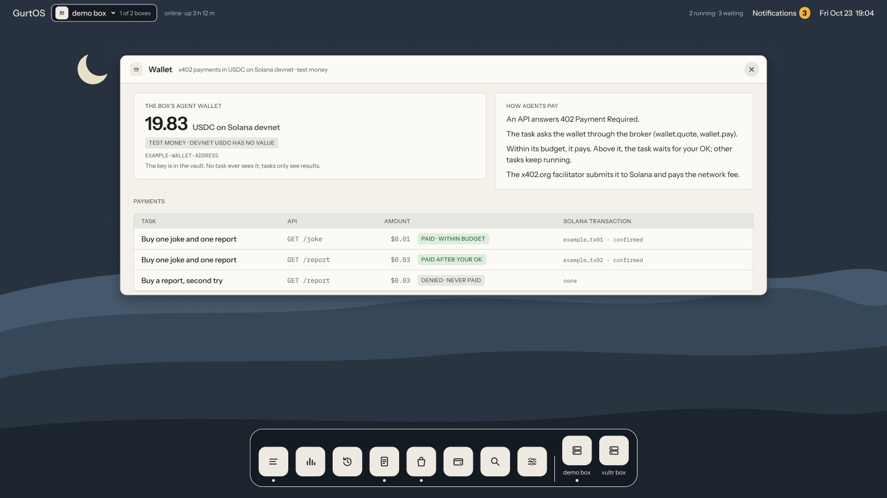

Some APIs answer `402 Payment Required` and ask to be paid per call with [x402](https://www.x402.org). The wallet app lets a task pay them. The box holds the wallet's key in its vault, a payment that fits the task's budget goes through, and one above it waits for your OK. In this guide you set up a test wallet, fund it, and run a task that buys from a paid API.

:::caution[Test money only]
The wallet pays only in USDC on Solana devnet, a test network where tokens have no value. The code refuses every other network and asset. Mainnet is not supported.
:::

## Before you start

- A box installed on Ubuntu, with a root shell. See [Install on Ubuntu](/get-started/install-on-ubuntu/).
- `FACTORY_API_KEY` in the vault, for a Droid task. See [Add a secret](/guides/add-a-secret/).
- Optional: a Coinbase Developer Platform (CDP) Secret API key, if you want payments settled by Coinbase's facilitator.

## Steps

1. **Make a wallet.** On the box, from `/opt/box`, where the install put the source and its packages. This adds the
   wallet's key to the vault and prints the address to fund:

   ```sh
   cd /opt/box
   node --experimental-strip-types tracks/wallet/keygen.ts | sudo sh -c 'cat >> /etc/box/vault.env; chmod 600 /etc/box/vault.env'
   ```

   ```text
   address to fund with devnet USDC: <your wallet address>
   ```

   The vault gets one line, `WALLET_SOLANA_KEY=...`. Restart the box service.

2. **Fund it with test money.** Open Circle's faucet at `faucet.circle.com`, keep **USDC**, set **Network** to **Solana Devnet**, paste the address, and send. The faucet gives 20 devnet USDC per address every 2 hours. The wallet needs no SOL, because the facilitator pays the network fees.

3. **Optional: add CDP keys.** In the CDP Portal, create a Secret API key and add it to the vault:

   ```ini
   CDP_API_KEY_ID=your-key-id
   CDP_API_KEY_SECRET=your-key-secret
   ```

   These belong to the test API in the next step, the seller. No box tool declares them, so no task can reach them. Without them, the test API settles through the public x402.org test facilitator, and everything else works the same.

4. **Start a paid test API.** The wallet app includes one. `GET /joke` costs $0.01 and `GET /report` costs $0.03, in test money.

   ```sh
   cd /opt/box
   sudo node --experimental-strip-types tracks/wallet/seller.ts &
   ```

   It listens on `127.0.0.1:4021`. It runs as root only so it can read the CDP keys from the vault.

5. **Start a task that may pay.** Give it the two wallet tools, the API's host, and a budget of 2 cents:

   ```sh
   curl -s http://127.0.0.1:7700/api/tasks -H 'content-type: application/json' -d '{
     "title": "Buy a joke (devnet test money)",
     "tools": ["wallet.quote", "wallet.pay"],
     "hosts": ["api.localhost:4021"],
     "budgetCents": 2,
     "prompt": "http://api.localhost:4021/joke is a paid API. Buy one joke with the box wallet and write it to joke.md."
   }'
   ```

   The agent calls `wallet.quote` to read the price, then `wallet.pay` with that exact amount.

6. **Answer the pause, if one comes.** A payment above what is left of the budget waits for your OK:

   ```text
   Spend $0.03 on wallet.pay? Budget $0.02, spent $0.01.
   ```

   Approve or deny it in the portal, on a phone, or with `POST /api/approvals/<id>`. Denied means nothing is paid. Other tasks keep running while this one waits.

## Check it worked

- The wallet's page shows its address and devnet balance:

  ```sh
  curl -s http://127.0.0.1:7700/t/wallet/
  ```

- The task's log has a quote step, a step like "Paid $0.01 in Solana devnet USDC (test money) to `<payee>`", and a `tool.result` with `cents`. The task's `costCents` includes the payment.
- Each payment links to the Solana Explorer on devnet.



*The Wallet app, from the portal's design. Balances and payments are examples.*

## How the wallet stays safe

- **The key stays in the box service.** Only `wallet.pay` reads `WALLET_SOLANA_KEY`, inside the box's own process. A task gets results only.
- **Budget, then you.** Each payment counts toward the task's budget. The box reserves it before the call runs, so two payments at once cannot both slip under the limit.
- **Exactly the agreed price.** `wallet.pay` names the amount the budget check and you saw. If the API asks for anything else, it pays nothing.
- **Only the task's hosts.** The wallet reaches only hosts in the task's `hosts`, by the same rule as the task's network, and refuses redirects. A task cannot point it at the box's own API.
- **Never twice.** Before paying, the wallet writes a durable mark for that call. If the box loses power mid-payment, the resumed call refuses to pay again.
- **One dollar at most** per single payment, the x402 client's default.

## Use it from your own agent

The wallet app includes a skill, `tracks/wallet/skill/x402-wallet/SKILL.md`, that teaches an agent in a task to quote, pay the exact price, wait when over budget, and never look for a key. Copy the folder into a workspace as `.factory/skills/x402-wallet/` for Droid.

## Limits

- Devnet only. Mainnet would need a different network and asset in the code, real USDC, and a review.
- `GET` only. APIs that want a `POST` body are not supported.
- The approval question names the tool and amount, not the payee or URL. The quote step right before it in the task's log does.
- After a power cut in the middle of a payment, the call fails rather than checking the chain. Check the wallet on the explorer.
- The box holds the wallet's key itself. Keeping it with Coinbase as a CDP wallet is not built.
- API responses are cut at 20 KB.

## Related

- [Approvals and budgets](/concepts/approvals-and-budgets/)
- [The vault and the broker](/concepts/vault-and-broker/)
- [Cost](/concepts/cost/)
- [Set up the shopping agent](/guides/shopping-agent/)
