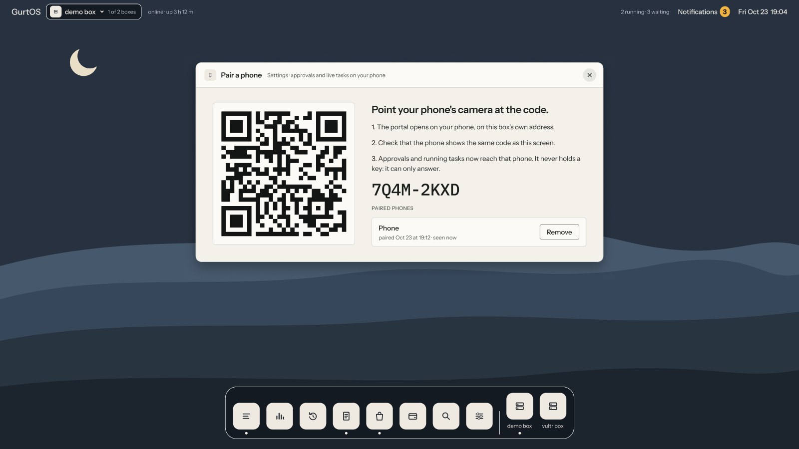
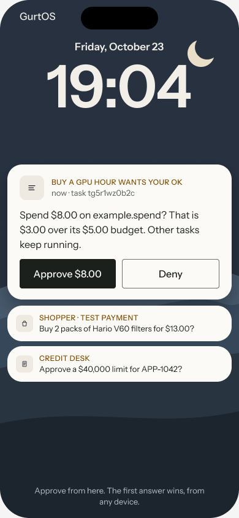

When a task asks for your OK, the request waits until someone answers. In this guide you give a phone a route to the
box, pair it, and approve a request from it. Each phone gets its own device token, so the action log records which
phone said yes, and you can remove one phone without touching the others.

From anywhere but the box's own machine, the API answers only requests that carry a paired device's token. Without
one it answers `401` and nothing is read, started, approved or undone. A laptop's browser at the box's address needs
pairing too, the same way as a phone.

:::note[Preview]
Pairing and answering work from a phone's browser. GurtOS Server from the ISO opens its API to your private network
and shows a pairing QR code by itself. On the Ubuntu install and on GurtOS Personal you set the address by hand.
Phones get no push notifications: a request shows when the portal is open on the phone.
:::

## Before you start

- A running box. See [Install GurtOS Server](/get-started/install-server/) or [Install on Ubuntu](/get-started/install-on-ubuntu/).
- A phone with a browser, on the same private network as the box (your home network, or a VPN such as Tailscale).
- On the Ubuntu install or GurtOS Personal, a shell on the box, to change its listen address.

## On GurtOS Server from the ISO

GurtOS Server does steps 1 and 2 for you. At each start it listens on every address and sets `BOX_URL` to its own
address, and its firewall lets port 7700 in only from private networks: `10.0.0.0/8`, `172.16.0.0/12`,
`192.168.0.0/16`, Tailscale's `100.64.0.0/10` and link-local addresses. Never from the public internet. Go to
step 3.

A cloud instance with only a public address is therefore out of reach from your phone. Put the box and the phone on
a private network such as Tailscale, or use the provider's console.

## Steps

1. **Give the phone a route to the box** (Ubuntu install or GurtOS Personal). The box's API listens on `127.0.0.1`
   only. Pick one way in:

   - A private network or VPN that the phone and the box are both on, such as WireGuard or Tailscale. Then set the
     box to listen on its address there (step 2).
   - A reverse proxy you run on the box that serves HTTPS and forwards to `127.0.0.1:7700`. Requests through it
     carry forwarding headers, so the box treats them as remote and asks for a token, even though they arrive on
     loopback.

2. **Set the listen address and the box's own address** if you chose a private network. Add both to the box's
   service and restart it:

   ```sh
   sudo systemctl edit box.service
   ```

   ```ini
   [Service]
   Environment=BOX_LISTEN=192.0.2.10
   Environment=BOX_URL=http://192.0.2.10:7700
   ```

   ```sh
   sudo systemctl restart box.service
   ```

   Use the box's own address on that network. `0.0.0.0` listens on every interface, including networks you may not
   trust. `BOX_URL` is the address the phone will use; with it, the pairing code comes with a QR code that opens on
   the phone.

3. **Show a pairing code.** On the box's own screen, open **Settings**. It shows a one-time code that works for
   5 minutes, and a QR code when `BOX_URL` is set. Only the box itself, or a phone paired as the owner, can make a
   pairing code.

   

   *Pairing in Settings, from the portal's design. The code and phone are examples.*

4. **Pair the phone.** Scan the QR code with the phone's camera, or open `http://192.0.2.10:7700/#pair/<code>` on
   it. Check that the phone shows the same code as the box's screen, give the phone a name under
   **Name this phone**, and tap **Pair this phone**. The phone keeps its device token in the browser's storage.

5. **Approve a request.** When a task asks for an OK, the phone shows it with **Approve** and **Deny**. The first
   answer wins, from any device. The phone sends its device token with the answer, so the log records the phone's
   name. Anything else the phone puts in the answer's `by` field is ignored.

   

   *An approval on a phone, from the portal's design. Amounts are examples.*

### Pair with the API

Steps 3 and 4 also work from a shell on the box, for example over SSH:

```sh
curl -s -X POST http://127.0.0.1:7700/api/pair/start
```

```json
{"code":"3f9a1c2e","url":"http://192.0.2.10:7700/pair#3f9a1c2e","expiresAt":"2026-10-24T07:05:00.000Z","box":{"id":"gurt-bf07fe","name":"gurt-bf07fe"}}
```

Open `http://192.0.2.10:7700/#pair/3f9a1c2e` on the phone. A program can redeem the code itself with
`POST /api/pair {"code": "3f9a1c2e", "name": "Kitchen tablet"}`, which returns the device token once. It then sends
`Authorization: Bearer <token>` with every request, or `?access_token=<token>` for the log stream, because a
browser's `EventSource` cannot set headers.

### Pair a phone as the owner

A normal paired phone can read, start tasks and answer approvals. Some actions belong to the owner only: making
pairing codes, listing and removing devices, setup, settings, the vault, turning apps on and off, and on GurtOS
Personal, handing out folders and Keep. Those need the box's own screen, or a phone paired as the owner.

To pair one, ask for an owner code from the box itself:

```sh
curl -s -X POST http://127.0.0.1:7700/api/pair/start \
  -H 'content-type: application/json' -d '{"owner": true}'
```

Redeem it on the phone as in step 4. The portal's Settings does not offer owner pairing yet.

## Check it worked

List paired devices on the box:

```sh
curl -s http://127.0.0.1:7700/api/devices
```

You see one entry per phone, with its `id`, `name` and `pairedAt`, and `owner: true` for an owner device. Tokens are never
listed. After you approve something from the phone, the task's log has an `approval.answered` event whose `by` is
the phone's name.

## Remove a phone

In **Settings**, choose **Remove** next to the phone. Or use the API:

```sh
curl -s -X DELETE http://127.0.0.1:7700/api/devices/<device-id>
```

That phone's token stops working at once. Its next request gets `401`, and the portal on the phone forgets the
token. Pair it again to get a new one.

## Limits

- On the Ubuntu install and GurtOS Personal, the API listens on `127.0.0.1` until you set `BOX_LISTEN`. GurtOS Server
  from the ISO opens it to private networks only, so a box with only a public address needs a VPN such as Tailscale.
- SpacetimeDB listens on `127.0.0.1` only, because it has no login. A phone follows the box's log stream over the
  API instead. You can open SpacetimeDB to a network with `STDB_LISTEN=<address>` in `/etc/box/stdb.env`, but anyone
  who reaches it can then read every task and answer approvals.
- Phones do not get push notifications. A request shows when the portal is open on the phone.

## Related

- [Approvals and budgets](/concepts/approvals-and-budgets/)
- [HTTP API](/reference/http-api/)
- [Live updates](/reference/live-updates/)
- [Trust boundaries](/security/trust-boundaries/)
