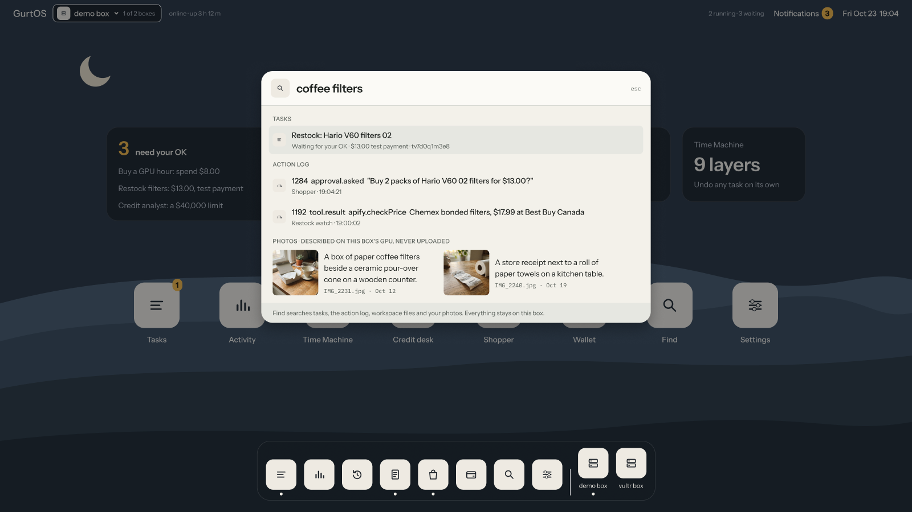

The Find app keeps one index of every photo, text file and finished task on the box. A vision model describes each photo once, when it arrives, so a search for "the whiteboard photo" finds `photos/IMG_2041.jpg`. Agents search the same index through a tool, with no network and no keys of their own. In this guide you connect the index, check which model describes photos, and run a search.

## Before you start

- A box with a root shell and the Find app installed (it ships with GurtOS, in `tracks/find/`).
- A Moss project, with its project id and key, for search by meaning. Without one, search falls back to matching words.
- At least one vision model the box can reach. See step 2.

## Steps

1. **Add the Moss keys to the vault.** See [Add a secret](/guides/add-a-secret/).

   ```ini
   MOSS_PROJECT_ID=your-project-id
   MOSS_PROJECT_KEY=your-project-key
   ```

   Restart the box service. Moss runs inside the box: it embeds documents and answers queries in the box's own memory, so a search never waits on the network. A few seconds after the index changes, it pushes a copy to your Moss project's cloud index. Only text goes there (descriptions, file text and task summaries), never a photo.

2. **Check the vision models.** The box tries each model in order, and the first that answers wins:

   1. A model behind any OpenAI-compatible chat API that you run, such as Ollama on a machine on your network. The photo stays on hardware you control.
   2. A hosted model behind an OpenAI-compatible API, with its key in the vault (for example `VULTR_INFERENCE_KEY`).
   3. Claude, as the backup, through one Droid task. It needs `FACTORY_API_KEY`.

   The list is `MODELS` in `tracks/find/find.ts`: a model name, a base URL, and the name of a vault key if it needs one. The list that ships points at the developers' test machines, so edit it to point at your own model, then [install again](/guides/update-and-roll-back/#update-a-box-installed-on-ubuntu). A model that fails is skipped for 5 minutes, so a dead one costs one timeout, not one per photo.

3. **Add files.** The app makes a `photos` workspace on first start with four test images. Copy your own into any workspace:

   ```sh
   sudo cp ~/Pictures/*.jpg /var/lib/box/workspaces/photos/
   ```

   The box rescans at boot, after every task, and every minute for files copied straight into a workspace.

4. **Search** with the app's route:

   ```sh
   curl -s 'http://127.0.0.1:7700/t/find/search?q=whiteboard%20photo&kind=photo&k=3'
   ```



*Find, from the portal's design. The results are examples.*

:::caution[Planned]
A Find window in the portal is designed, as above, but not built in this release. Search with the route or, from a task, with `find.search`.
:::

## Check it worked

```sh
curl -s http://127.0.0.1:7700/t/find/status
```

It shows how many photos, files and tasks are indexed, and the models in the order the box tries them. Each search result says which index answered (`moss`, or `words` without Moss) and, for a photo, which model described it.

## What gets indexed

- **Photos** (`.jpg`, `.jpeg`, `.png`, `.webp`, `.gif`) in every workspace: the model's description.
- **Text files** up to 200 KB in every workspace: the path and the first 2,000 characters.
- **Tasks**, when they finish, fail or are undone: the title, the state, and Droid's final message or the prompt.

The app reads each workspace as it is now: the base files plus every done task's changes. Undo a task and its files leave the index. Folders starting with `.`, `node_modules` and symlinks are skipped, so a task cannot point the index at the vault.

## For agents: `find.search`

A task that lists `find.search` in its tools can call it through its broker:

```json
{ "query": "find the whiteboard photo", "kind": "photo", "topK": 3 }
```

It returns `{ query, index, ms, wallMs, results: [{ kind, workspace, path, task, state, model, score, text }] }`, best first. The task holds no Moss key: the tool runs inside the box service.

## Routes

All under `/t/find/` on the box's API.

| Route | Does |
|---|---|
| `GET /search?q=<words>&kind=photo\|file\|task&k=5` | The same as `find.search` |
| `GET /file?workspace=photos&path=IMG_2041.jpg` | The file a result points at. Only inside a workspace; symlinks are refused |
| `GET /status` | Counts, and the models in order |

Other apps can describe a photo with `box.job('find.describe', { file })`.

## Limits

- Photos go to the model at full size. Large phone photos are slow to describe.
- Only the first 2,000 characters of a text file are indexed.
- A failed Claude backup task is not retried until the box restarts.
- Any task given `find.search` can search every workspace, not only its own.
- Search results are data. A photo with text in it can carry that text into an agent's context, so treat results like any other untrusted input.

## Related

- [Workspaces and layers](/concepts/workspaces-and-layers/)
- [The vault and the broker](/concepts/vault-and-broker/)
- [Apps and slots](/concepts/apps-and-slots/)
- [Included apps](/reference/apps/)
