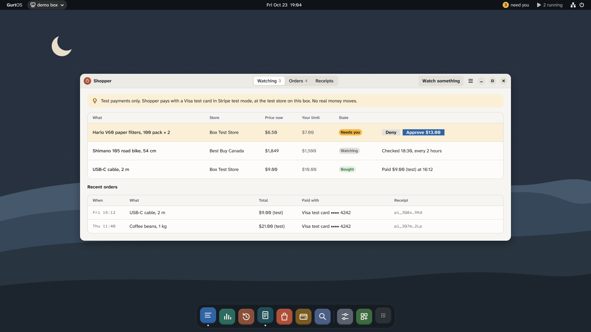

The Shopper app turns shopping into standing instructions. "Get me the coffee filters when they're under $7." The box checks the store on a schedule. When the item is in stock at or under your price, it asks for your OK, and pays only after you approve. It can also read household receipts and propose a reorder. In this guide you set up the app and run one watch from start to purchase.

:::caution[Test payments only]
Every payment here is a test payment: Stripe test mode with Stripe's Visa test card. No real money moves and nothing ships. Checkout happens at the **GurtOS Test Store**, a small store the app runs on the box, because no real store accepts a test card. Where a payment is simulated instead, the app, the log and the order say so.
:::

## Before you start

- A box installed on Ubuntu, with a root shell and a source checkout. See [Install on Ubuntu](/get-started/install-on-ubuntu/).
- `FACTORY_API_KEY` in the vault, so Droid can turn your words into a watch and read receipts.
- Optional: a Stripe account in test mode, for test-mode charges instead of simulated ones.
- Optional: `APIFY_TOKEN` in the vault, for live price checks at Best Buy Canada.

## Steps

1. **Add the app's keys to the vault.** From the checkout, as root:

   ```sh
   sudo tracks/shopper/setup.sh
   ```

   It adds what is missing and leaves existing values alone:

   | Key | Value |
   |---|---|
   | `SHOPPER_CARD` | `pm_card_visa`, Stripe's test PaymentMethod for the Visa test card |
   | `SHOPPER_AGENT_KEY` | A new Ed25519 private key the box signs checkouts with |
   | `SHOPPER_MAIL_PASSWORD` | A new random password for the sample inbox |

2. **Optional: add a Stripe test key.** Add it by hand. The store refuses a live key.

   ```ini
   STRIPE_SECRET_KEY=sk_test_your-test-key
   ```

   Until it is there, payments are simulated and labelled so.

3. **Restart the box service** so it reads the vault.

   ```sh
   sudo systemctl restart box.service
   ```

4. **Open the app.** In the portal, open **Shopper (test payments)**, or browse to `/t/shopper/` on the box. The store is at `/t/shopper/store`. Open it on the box's own screen, or through an SSH tunnel to the box. From another device the box asks every request for a paired device's token, and the app's pages do not send one yet.

5. **Make a watch.** Type what you want in words, or fill in the store, product, price limit and quantity and click **Set up watch**. For example: "Two packs of the V60 paper filters when they're under $7 each." Droid finds the product and sets the rule with the `shopper.watch` tool. It cannot buy anything itself.

   With the API instead:

   ```sh
   curl -s http://127.0.0.1:7700/t/shopper/watches -H 'content-type: application/json' \
     -d '{"store": "test", "product": "HV60-100", "maxCents": 700, "qty": 2}'
   ```

   `HV60-100` is the test store's Hario V60 filters. `store` is `test` for the GurtOS Test Store, or `bestbuy.ca` for a
   live check through Apify, where `product` is a Best Buy SKU or search words.

6. **Wait for the price.** The box checks the store on a schedule. Each check is a task with no network and no secrets, and its result goes into the action log. To try it now, drop the test store's price:

   ```sh
   curl -s http://127.0.0.1:7700/t/shopper/store/admin -H 'content-type: application/json' \
     -d '{"sku": "HV60-100", "priceCents": 650}'
   ```

7. **Approve the purchase.** When the item is in stock at or under your limit, the box starts a purchase task. It asks:

   ```text
   Buy 2 × Hario V60 02 paper filters, 100 count for $13.00? $6.50 each, down from $8.99, under your $7.00 limit. TEST PAYMENT.
   ```

   Tap **Approve** on the phone or in the portal. Only then does `shopper.buy` sign the order and pay the GurtOS Test Store.



*Shopper, from the current design. Every payment is test money.*

## Reorder from receipts

Under **Household reorder** in the app, click **Check the receipts**, or call `POST /t/shopper/reorder`. Droid reads the receipts in the sample inbox with `shopper.receipts`, works out what runs out this week, and proposes one reorder with `shopper.propose`. You approve or deny it the same way.

`shopper.receipts` returns receipts only, and says how many other emails it left behind. The agent never sees the mailbox password or your other mail. `shopper.propose` takes product codes and quantities, and looks up the prices itself, so a confused or hijacked model cannot make up a price.

## Check it worked

- The order shows in the app and at `/t/shopper/store`, marked as a test payment.
- `GET /t/shopper/state` lists watches, pending approvals, recent tasks and orders.
- The purchase task's log has the approval, the checkout and its cost. No secret appears in the log.
- Undo the purchase task. The store refunds its order.

## How a purchase is made safe

- **The model never holds a buy tool or a card.** Only purchase tasks the box starts hold `shopper.buy`, and each one asks you first.
- **Two gates on money.** Your tap, then the task's budget: your limit times the quantity. A purchase above the budget stops and asks again.
- **Signed orders.** The box signs each checkout with an HTTP message signature in the style of Visa's Trusted Agent Protocol (Ed25519, with a nonce and an 8-minute expiry). It also signs a digest of the body. The store refuses unsigned orders, changed orders, replayed signatures, expired signatures and unknown keys. The box publishes its public key at `/t/shopper/keys/box-shopper`.
- **Power cuts don't pay twice.** Each checkout carries the call's stable key as its idempotency key, at the store and at Stripe.
- **Test money only, enforced.** The store refuses a live Stripe key, a simulated charge accepts only Stripe's test cards, and orders above $500 are refused.
- **One proposal and one watch per agent task,** so a looping agent cannot flood your phone.

## Routes

All under `/t/shopper/` on the box's API.

| Route | Does |
|---|---|
| `GET /` | The app |
| `GET /state` | Watches, pending approvals, recent tasks, orders, and which keys the vault has |
| `POST /watches {store, product, maxCents, qty?, when?, everyMinutes?}` | Watch a product |
| `POST /watches/check {id}`, `POST /watches/cancel {id}` | Check now, or stop watching |
| `POST /ask {text}` | Droid turns your words into a watch |
| `POST /reorder` | Droid reads the receipts and proposes a reorder |
| `POST /supplies {url, cents}` | An agent buys a supply from an x402 API within `cents`, through the wallet app |
| `GET /store`, `GET /store/products` | The GurtOS Test Store |
| `POST /store/checkout` | Checkout. A signature and an idempotency key are required |
| `POST /store/admin {sku, priceCents?, inStock?}` | Test controls: change a price or the stock |
| `GET /keys/box-shopper` | The box's public signing key |

## Limits

- A watch closes after one purchase, or when you deny it. Watch again for another.
- The running-low estimate assumes each purchase lasts until the next, whatever the quantity.
- The test store keeps price and stock changes in memory. They reset when the box restarts. Orders are on disk.
- The store remembers used nonces in memory. After a restart, a captured signature could be sent again within its 8 minutes, but its idempotency key still returns the first order instead of charging twice.
- The inbox is a sample mailbox on the box with receipts written for testing. Connecting a real mailbox is not built.
- Best Buy Canada prices are in Canadian dollars, converted at a fixed rate against budgets in US cents.

## Related

- [Let agents pay for APIs](/guides/agent-payments/)
- [Approve from your phone](/guides/approve-from-your-phone/)
- [Undo a task](/guides/undo-a-task/)
- [Approvals and budgets](/concepts/approvals-and-budgets/)
