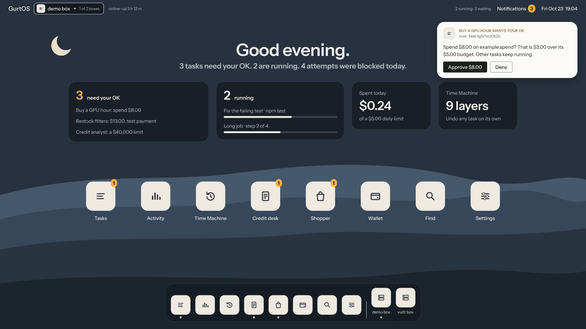

*The home screen, from the portal's design. Names, tasks and amounts are examples.*

## Why GurtOS

An agent that does real work needs real access: your files, the web, your accounts, sometimes your money.
Today that usually means running it as you, on your machine, with your keys in its environment.
One bad web page, or one wrong guess, and it can read your secrets or change files you cannot get back.

GurtOS is a computer built for that work. The operating system keeps each task apart, holds the keys itself,
asks you before money moves, and writes down everything that happens.

## What GurtOS does

- **Undo one task.** Each task's changes are a separate layer on its workspace. Undo removes that layer and
  leaves every other task's work in place. See [Workspaces and layers](/concepts/workspaces-and-layers/).
- **Keep keys out of reach.** Tasks never hold a secret. The vault is readable by root only, and tools that
  need a key run inside the core. See [The vault and the broker](/concepts/vault-and-broker/).
- **Limit the network.** A task can reach only the hosts its spec names. Everything else is refused and logged.
  See [Network policy](/concepts/network-policy/).
- **Pause for your OK.** Spending above a task's budget, or anything a task asks about, waits for your answer
  from the portal or your phone. Other tasks keep running. See [Approvals and budgets](/concepts/approvals-and-budgets/).
- **Record everything.** One append-only action log holds every step, tool call, approval, cost and blocked
  connection. See [The action log](/concepts/action-log/).
- **Survive a power cut.** At boot the box rebuilds every task from the log and resumes what was running.
  See [Resume after power loss](/concepts/resume-after-power-loss/).
- **Update as a whole.** The operating system installs updates into a second system slot and rolls back by
  itself if the new one is not healthy. See [System updates](/concepts/system-updates/).

## Editions

| Edition | For | Status |
|---|---|---|
| [GurtOS Server](/introduction/editions/#gurtos-server) | An always-on box at home or in the cloud, with no human login | Preview |
| [GurtOS Personal](/get-started/install-personal/) | Your own computer, with agents working beside you | Preview, in development |
| [GurtOS Business](/introduction/editions/#gurtos-business) | A company's agents, with roles, routed approvals, audit and a fleet | Planned |

## Find your way

| If you want to | Start with |
|---|---|
| Install GurtOS and run a first task | [Install GurtOS Server](/get-started/install-server/), then [Your first task](/get-started/first-task/) |
| Get a specific job done | [How-to guides](/guides/approve-from-your-phone/) |
| Understand how it works | [Architecture](/concepts/architecture/) |
| Look up an API, a file or a setting | [HTTP API](/reference/http-api/) and the rest of the reference |
| Decide whether it is safe enough for you | [Security model](/security/model/) and [threat model](/security/threat-model/) |

:::note[Early preview]
GurtOS is in early development and has no public releases or source repository yet.
Features that are not built are marked **Planned** on their pages. Features that work but may change are
marked **Preview**. The [roadmap](/project/roadmap/) lists both.
:::
