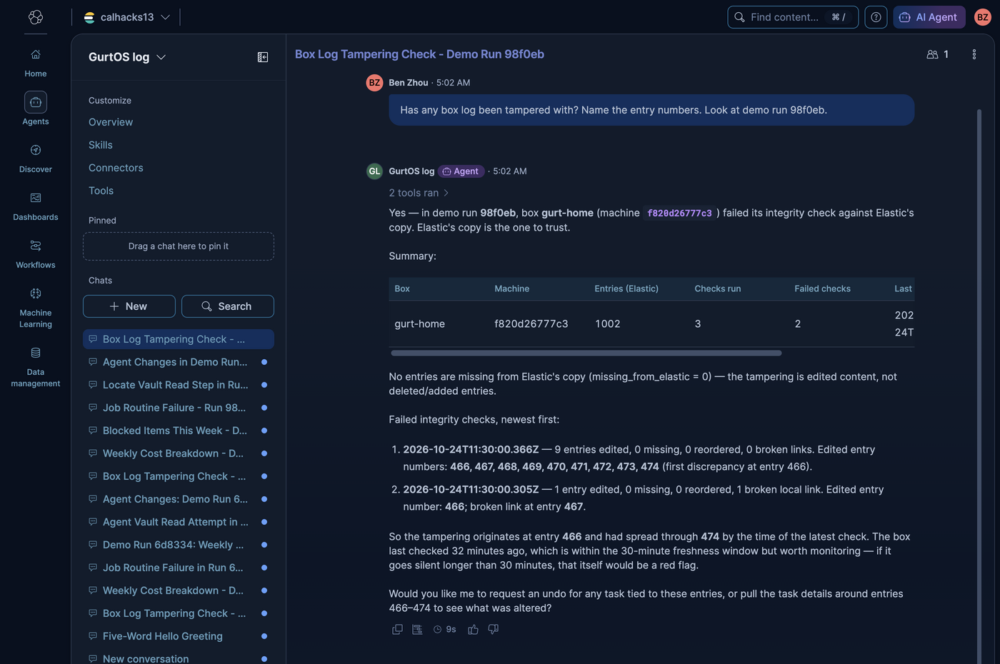
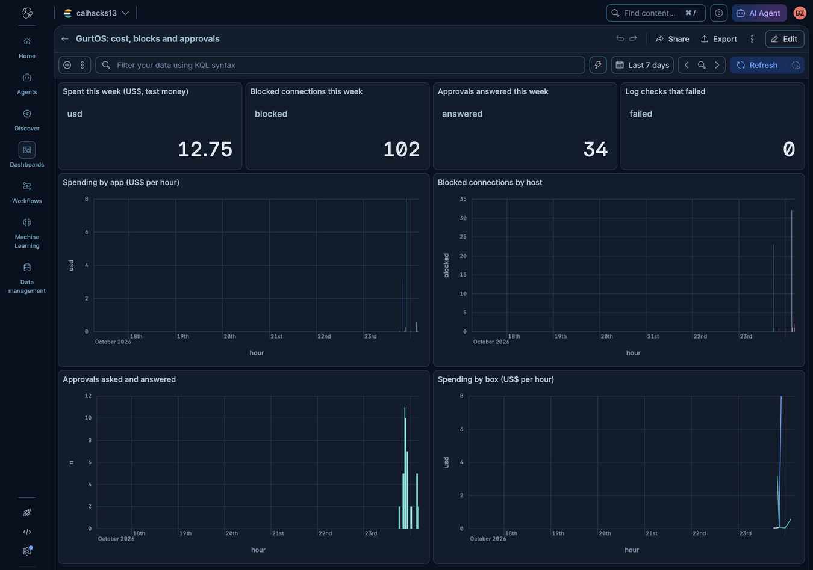

# Elastic: a record the box cannot rewrite, and an agent that investigates it

**Track:** Best use of the Elastic Agent Builder on a Serverless instance.

After a week of agents working, an ordinary operating system cannot tell you what they did. Its logs are
scattered, and anyone with root can edit them. GurtOS writes every action to one log. Elastic keeps a copy that the
box cannot rewrite. An Agent Builder agent answers questions about that copy and investigates it. When the agent
thinks a task should be undone, it can only ask: the request lands on the owner's phone through GurtOS's one
approval path, and nothing happens until they approve.

## Six things, and which side each comes from

| # | What it does | From the OS | From Elastic | Why it is here |
|---|---|---|---|---|
| 1 | **A record root cannot rewrite.** An edited, missing or reordered entry is named. | The core chains every log entry to the one before it (`core/log.ts`). The box checks its own log against Elastic's copy. | A key that can only create documents; the copy it protects; the `box.verify_log` tool. | Security and the Business audit trail. |
| 2 | **Alerts on attacks.** A secret-theft attempt, a page that sent a task somewhere else, a spending spike, a new destination. | Logs the steps, blocks and costs. Turns an alert into an approval and pushes it to phones. | Four ES\|QL alert rules on the log. | Security. |
| 3 | **The agent can act, safely.** It asks to undo a task. | The approval path: policy routing, the phone push, who answered, and the undo itself. | A workflow tool, `box.request_undo`, that only leaves a request. | Security: Elastic never holds the power to act. |
| 4 | **A fleet, and who approved what.** | Business people and roles, and `who` on every log entry. | One index for every box, roles and document-level security that copy the Business roles, tools by person, seat and approver. | The Business audit trail. |
| 5 | **Search by meaning.** "The step where an agent tried to read the vault." | Plain sentences for every step, tool call, approval and block. | `semantic_text` (ELSER) and ES\|QL `MATCH`. | Finding things without knowing the words. |
| 6 | **Ask from the portal and phone**, and a Kibana dashboard of cost, blocks and approvals. | The Ask app page in the portal and the phone, and the key kept in the vault. | The Agent Builder `converse` API and the dashboard. | A person asks in plain words, as themselves. |

## 1. A record root cannot rewrite



The agent, asked in Kibana about the demo run that planted the edit. It names the box, the failed checks and the entries.

- **OS.** `core/log.ts` writes `prev` on every log entry: the SHA-256 of the line before it. Edit, remove or
  reorder one entry and every link after it breaks, and `chainBreaks()` names them.
- **The gap, and Elastic's part.** Someone with root can edit one entry and then recompute every hash after it. The
  box's own chain then looks clean. So each entry's hash is also shipped to Elastic with a key that can only create
  documents (no update, no delete, no overwrite). Elastic's copy does not change when the box's file does.
- **The check.** Every ten minutes the box compares its log file with Elastic's hashes and writes the answer into the
  log, so a failed check is itself stored where it cannot be taken back. `GET /t/elastic/verify` runs it on demand.
  The agent's `box.verify_log` tool reads the results for every box and also flags a box that has gone silent.
- **Without trusting the box.** A box that is fully taken over can lie about its own check. Take a copy of its
  `log.jsonl` any way you trust and run `node tracks/elastic/agent.ts verify log.jsonl <machine id>`. It needs only
  the box's own read key and says which entries differ.
- **Shown in the demo.** The demo plants an edit in the log file, as root would, and the check names the entry. Then it
  rewrites every hash after the edit: the box's own chain passes, and Elastic's copy still names the entry and each
  one after it.

## 2. Alerts on attacks

Four ES|QL rules run every minute in Kibana (`GurtOS: ...` under Rules). Each matching row leaves one request.

| Rule | Fires when |
|---|---|
| A task read a page, then tried to reach somewhere else | A task that was allowed some hosts has a blocked connection (an injected page told it to send data out). |
| A task went for a secret | A step or tool call mentions the vault, `/etc/box`, an API key, an SSH key or the environment. |
| A task is spending fast | One task spent $5 or more in 15 minutes. |
| A destination no agent has tried before | A blocked host nobody has tried before, anywhere in the fleet. |

The box reads its own requests and turns each into a task whose only step is to ask the owner. It goes through the
normal approval, so the policy routes it, the phone gets the push, and the answer is logged with who gave it. There is no
second notification path. A denied alert is not asked again for that task.

## 3. The agent can act, safely

`box.request_undo` is a workflow tool. It writes one row to `box-requests` and nothing else. The box finds the row,
asks its owner, and runs the undo only if they approve. Three things stop Elastic from acting alone:

- The workflow has no way to reach the box. The box pulls requests from Elastic, so the box needs no open door.
- The box's key can read its own requests and create log entries. It cannot change what it stored.
- The undo itself runs on the box, after a person answers.

The demo shows both answers: a denied request leaves the task alone, an approved one undoes it and removes its changes.
The agent says "I asked", never "I undid". Today only undo is requestable, because it is the one task control the box
gives an app. A pause or a stop that keeps the changes would need a small hook in the core.

## 4. A fleet, and who approved what

- **Every installed box ships.** The cloud box, the laptop box and the home box all write to one index, tagged with the
  box's name and machine id. A dev box or a demo run does not ship unless asked (`DEMO_LIVE=elastic`).
- **Per box, per person.** Each box has its own key, limited to its own rows. Each Business person has a key that
  copies their role: the owner, an admin and an auditor see everything; an approver sees the requests routed to them and
  the ones they answered; a requester sees the tasks they asked for.
- **Tools.** `box.fleet` (is every box reporting), `box.by_requester`, `box.by_seat`, `box.by_approver` and `box.approvals`
  answer "what did Sam ask the agents to do", "who approved what" and "which seat spends the most".

The roles are copied by hand from Business today: `keys.ts` holds the filters and `agent.ts keys` prints the key
requests. When someone changes a person's role in GurtOS, their Elastic key does not change by itself.

## 5. Search by meaning

Every step, tool call, approval and block has a plain sentence (`message`), stored in a `semantic_text` field.
`box.search_meaning` uses ES|QL `MATCH` on it, so "where an agent tried to read the vault" finds a step that says
`steal /var/lib/box/vault.env`.

## 6. Ask from the portal and phone, and the dashboard

- **Ask GurtOS** is an app in the box's app list. It opens in a portal window or on the phone. The question goes to
  the box, the box adds the person's own Elastic key from the vault, and calls the agent. The page never holds a key.
  The answer cannot say more than that person's role may see.
- **Dashboard.** `GurtOS: cost, blocks and approvals` in Kibana: spending by app and by box, blocked connections by
  host, approvals asked and answered, and the number of failed log checks.



## How it works

```
the box's action log ──► log reader ──► outbox file ──► _bulk create ──► box-actions index
   (each entry hashed       (one flat      (fsynced)    (the box's key can       (Serverless)
    to the one before)       document                    only create)                 │
                             per entry)                                               ▼
   box-requests ◄── alert rules ◄─────────────────────────────────────  Agent Builder agent "GurtOS log"
        ▲                (ES|QL, every minute)                          16 tools, one workflow, per-person keys
        └── workflow tool (box.request_undo)
        │
        ▼
   the box reads its own rows ──► a task that only asks ──► the box's approval ──► phone ──► undo, if approved
```

1. **The log reader** turns each log event into one flat document (`docs.ts`) and appends it to
   `BOX_HOME/elastic/outbox.ndjson`, fsynced. The document holds the entry's hash and the hash before it.
2. **A flusher** sends the outbox in `_bulk` batches of up to 4 MB, remembers how far it got, and retries every 5 seconds
   if Elastic is down. It uses `create`, so a repeat is refused with 409 and counts as sent.
3. **The `elastic.bulk` model job** is the only code that reads the box's key. It runs in the core with vault access;
   log readers have none.
4. **The agent and everything in Kibana are code** (`agent.ts`, `kibana.ts`). `node tracks/elastic/agent.ts install`
   creates or updates the indexes, tools, workflow, alert rules, dashboard and agent.

### Keys

| Key | Lives | May |
|---|---|---|
| Box key, one per box | the box's vault | Create log documents. Read that box's own rows and requests. Nothing else. |
| Person key, one per Business person | the box's vault (`ELASTIC_ASK_KEYS`) | Read what their role allows, call the agent, leave a request. |
| Admin key | the person who installs, never on a box | Everything: install, and delete. |

A key made by an API key cannot carry privileges, so box and person keys are made by a person in Kibana (Dev Tools, or
the signed-in session). `node tracks/elastic/agent.ts keys <machine id>...` prints the request bodies.

## Elastic's requirements

- **Agent Builder:** a custom agent (`gurtos-log`) with 14 ES|QL tools, a workflow tool and an index search tool, all
  created through the Agent Builder API, and asked through Kibana's chat and the `converse` API.
- **Serverless:** an Elasticsearch Serverless project on GCP. The indexes, the data, the rules, the dashboard and the
  agent all live there.
- **Real data:** every document comes from a box's own action log: the installed GurtOS boxes, and `./demo` runs with
  real Droid (Claude) tasks, the credit desk and the four demo moments.
- Kibana's Security detection rules are not part of a Serverless Elasticsearch project, so the alerts are Kibana alerting
  rules (ES|QL rule type) with an index connector.

The judging criteria were not published when this was built (Oct 24, 2026).

## Run it

Everything runs from the repo root. On a box, the service reads `ELASTIC_URL`, `ELASTIC_BOX_KEY`, `ELASTIC_BOX_LABEL`,
`ELASTIC_ASK_KEYS` and `KIBANA_URL` from its vault, `/etc/box/vault.env` (root only). A box without them sends nothing and
logs no errors. Keys never go in the repo.

```sh
./demo                         # offline: documents go to an outbox file; the checks read it, including the planted edit
DEMO_LIVE=elastic ./demo       # also ships to Elastic, checks the keys, asks the agent, and runs the alert and request flows

export KIBANA_URL=... ELASTIC_URL=... ELASTIC_API_KEY=...   # an admin key, on your own machine
node tracks/elastic/agent.ts install                       # create or update everything in Elastic
node tracks/elastic/agent.ts ask "Why did the job routine fail?"
node tracks/elastic/agent.ts verify log.jsonl <machine id> # check a copy of a box's log, without trusting the box
```

In Kibana: **Agents > GurtOS log**, `<KIBANA_URL>/app/agent_builder/agents/gurtos-log`.

## Files

| File | What |
|---|---|
| `track.ts` | The log reader, the flusher, the `elastic.bulk` job, the integrity check, the request poller, the Ask route |
| `docs.ts` | What a log event becomes in Elastic, and the index mappings |
| `chain.ts` | Compares the box's log with Elastic's hashes |
| `agent.ts` | The agent and its tools, `install`, `ask`, `keys`, `verify` |
| `kibana.ts` | The workflow, alert rules, connector and dashboard |
| `keys.ts` | What each key may do, and the Business filters |
| `app.html` | The Ask GurtOS page |
| `demo.ts`, `elastic.test.ts` | The demo step and the offline tests |
| `screenshots/` | The agent and Kibana, as asked |

## Limits

- An entry can be changed in the seconds between the box writing it and Elastic receiving it. After that it cannot.
- A box that is fully taken over can stop sending, or lie about its own check. `box.verify_log` shows a box that has gone
  quiet, and `agent.ts verify` checks a copy of the log without asking the box.
- Elastic's keys for people are issued by hand. A role change in GurtOS needs `agent.ts keys` and a new key.
- A task that was undone because Elastic asked is undone like any other: its file changes are removed, nothing else.
- The Elastic trial ends about Oct 30, 2026.
