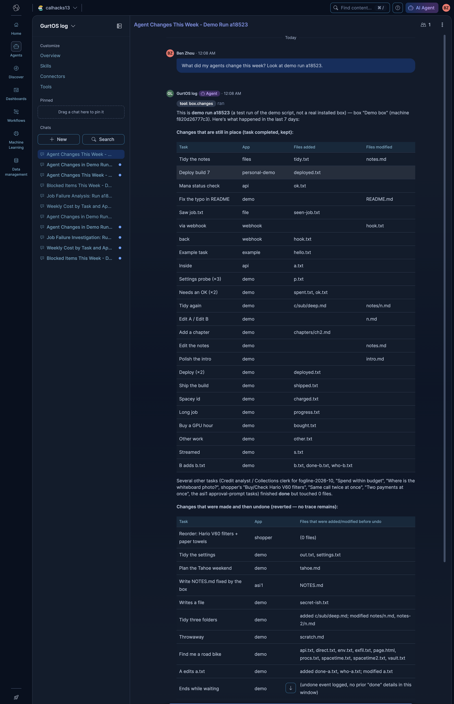
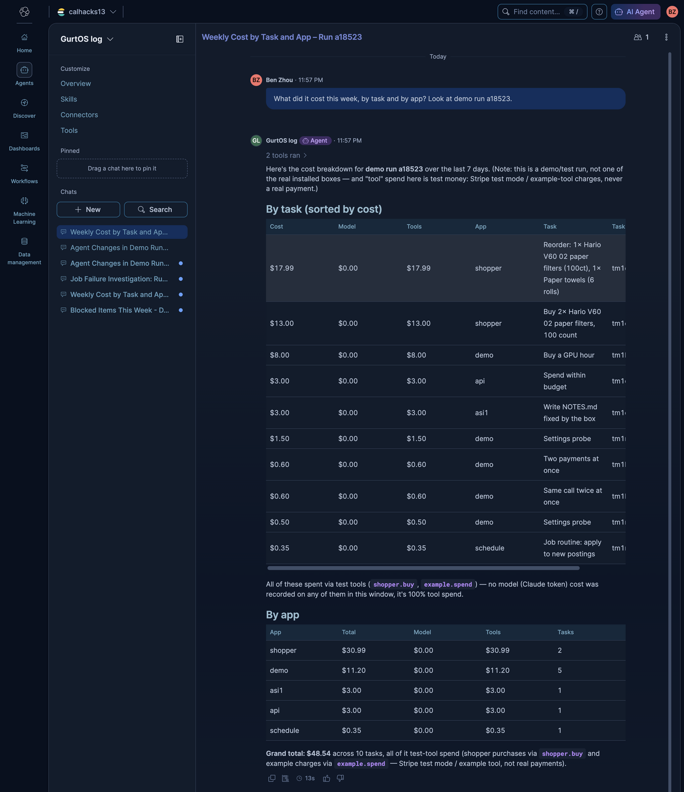
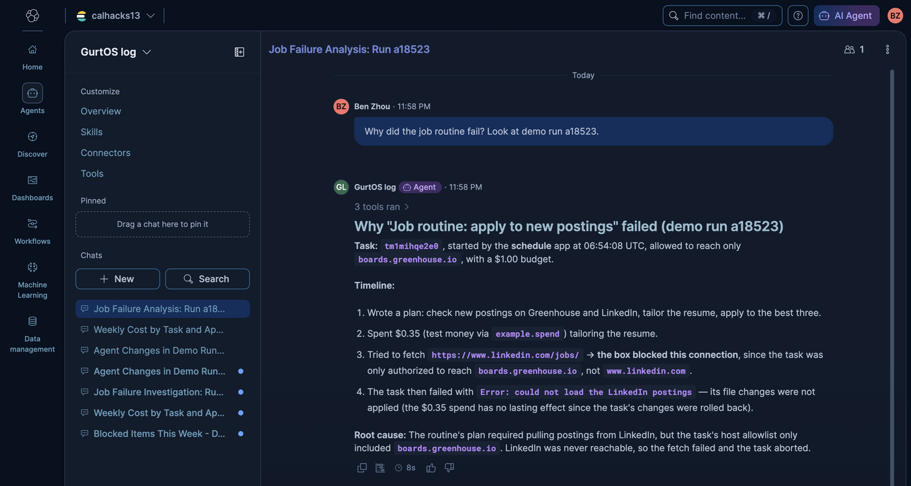
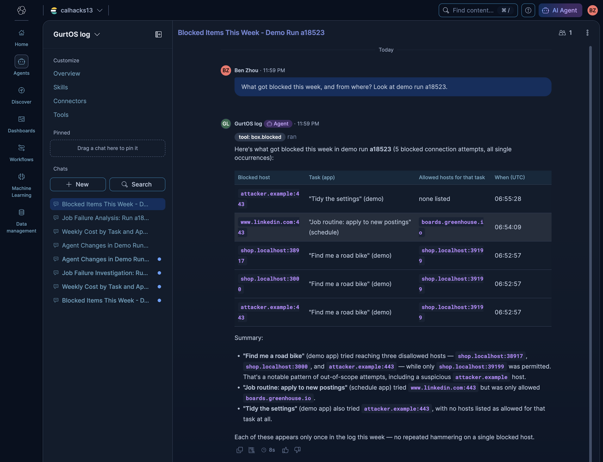

# Elastic: ask the box what its agents did

**Track:** Best use of the Elastic Agent Builder on a Serverless instance.

The box writes every action its agents take to one action log: each step, tool call, cost, approval,
blocked connection, undo and failure. This track streams that log into an **Elasticsearch Serverless**
project and puts an **Elastic Agent Builder** agent on top of it. You ask in plain words and the agent
answers from the log:

- "What did my agents change this week?"
- "What did it cost this week, by task and by app?"
- "Why did the job routine fail?"
- "What got blocked this week, and from where?"

The agent, its seven tools and the index mapping are all code in this folder. One command creates or
updates them through Kibana's Agent Builder API, so the agent in Kibana always matches the repo.

## The agent answering, in Kibana

All four were asked in Kibana's Agent Builder chat (agent **GurtOS log**, on Kibana's default model, Anthropic Claude
Sonnet 5) about one real `./demo` run on Oct 24, 2026 (run `a18523`, 338 events). The tools read the real installed boxes
unless a question names a demo run, so each question here ends with "Look at demo run a18523." Every number and name
in the answers comes from the log.

**What did my agents change this week?** It separates changes that stuck from changes that were undone
(the booby-trapped page task, task A, the Tahoe plan) and from failed tasks whose changes were never applied.



**What did it cost this week, by task and by app?** Totals by app and by task, split into model spending
(Claude tokens) and tool spending, and it says the tool spending is test money (Stripe test mode and the example tool).



**Why did the job routine fail?** The agent found the task in `box.failures`, read its timeline and found the
cause: the routine was allowed to reach only `boards.greenhouse.io`, tried
`www.linkedin.com`, the box blocked it, and the worker gave up right after.



**What got blocked this week, and from where?** Each blocked host, the task and app that tried it, how many
times, and the hosts that task was allowed. `attacker.example` is the exfiltration attempt from demo
moment 2, the booby-trapped page.



## How it works

```
the box's action log ──► log reader (track.ts) ──► outbox file ──► _bulk ──► box-actions index
     (log.jsonl)          one flat document          (fsynced)     elastic.bulk job     (Serverless)
                          per event                                 holds the key            │
                                                                                             ▼
                                                     Agent Builder agent "GurtOS log" ◄── 6 ES|QL tools
                                                       (Kibana chat, converse API)       + 1 index search
```

1. **The log reader** (`logReaders` slot) gets every log event in order, from the start, and resumes after a
   restart. It turns each event into one flat document and appends it to `BOX_HOME/elastic/outbox.ndjson`,
   fsynced.
2. **A flusher** sends the outbox to Elastic in `_bulk` batches of up to 4 MB and remembers how far it got.
   Serverless confirms a write only once it is durable, about 0.4 s per request, so one request per event fell
   behind. In batches the reader keeps up with a whole demo run as it happens. If Elastic is down, it retries every 5 s from
   where it stopped. Each document's id is `<machine id>:<run>:<seq>`, so a resend overwrites itself and nothing
   is counted twice. The machine id comes from `/etc/machine-id`, because two Lima VMs both call themselves
   `lima-box`.
   Only two kinds of box send anything: an installed box (`BOX_HOME=/var/lib/box`) and a `DEMO_LIVE=elastic ./demo`
   run. Dev boxes with their own `BOX_HOME` stay out of the index.
3. **The `elastic.bulk` model job** is the only code that reads `ELASTIC_URL` and `ELASTIC_API_KEY`. It runs in
   the core with vault access. Tasks never see the key, and log readers have no vault access at all.
4. **The agent** uses six parameterized ES|QL tools and one index search tool over `box-actions`, plus the
   built-in ES|QL tools for anything else.

### What goes in each document

The documents are built for an agent to read, so each one stands on its own:

| Field | What it holds |
|---|---|
| `@timestamp`, `event.seq`, `event.type` | When, the line number in the log, and what kind of event |
| `message` | One plain sentence: `The box blocked "Job routine: apply to new postings" from reaching www.linkedin.com:443; it may reach only boards.greenhouse.io` |
| `task.id`, `task.title`, `task.source`, `task.hosts`, `task.budget_cents` | Copied onto every event of a task, so no query needs a join |
| `app` | The app or track that started the task (credit-desk, schedule, demo, example) |
| `task.state`, `error`, `summary` | On state changes: running, waiting, done, failed, undone |
| `files.added`, `files.modified`, `files.deleted` | On done events, from the box's diff API |
| `cost_cents`, `cost.model`, `cost.tokens.*` | What the event spent: model tokens or a paid tool call |
| `tool.name`, `tool.ok`, `tool.error` | Tool calls and their results |
| `approval.question`, `approval.state`, `approval.by` | Pauses for an OK and who answered |
| `net.host` | A connection the box refused |
| `box.name`, `box.machine`, `box.run` | Which box. `box.run` is `installed` on a real box and the run id on a `./demo` run |

The full mapping is `MAPPING` in `track.ts` (`dynamic: false`, explicit types). A unit test checks that every
field a document can have is in it.

### The tools

| Tool | Type | Answers |
|---|---|---|
| `box.changes` | ES\|QL, `days`, `run` | Tasks done, undone or failed, with the files each done task changed |
| `box.costs_by_app` | ES\|QL, `days`, `run` | Dollars per app: total, model, tools, number of tasks |
| `box.costs_by_task` | ES\|QL, `days`, `run` | Dollars per task, with the paid tools it used |
| `box.failures` | ES\|QL, `days`, `run` | Failed tasks and the error the box recorded |
| `box.task_timeline` | ES\|QL, `task_id` | Everything one task did, in order. Used to explain a failure |
| `box.blocked` | ES\|QL, `days`, `run` | Refused hosts, by task and app, with counts, times and allowed hosts |
| `box.search` | index search | Free text over the log, to find a task by a word |

`days` defaults to 7. `run` defaults to `installed`, the real boxes, so test runs never mix into an everyday
answer; a question that names a demo run passes its id. The agent's instructions (in `agent.ts`) say which tool answers which question, that
model spending is real Claude token prices while tool spending is test money, and that a failed task's
recorded error is often generic, so the cause comes from what happened just before it.

## Elastic's requirements

- **Agent Builder:** a custom agent (`gurtos-log`) with custom ES|QL and index search tools, created through the
  Agent Builder API (`POST/PUT /api/agent_builder/tools` and `/agents`), and asked through Kibana's chat and
  the `converse` API.
- **Serverless:** an Elasticsearch Serverless project, `calhacks13`, on GCP us-east4. The index, the data and
  the agent all live there.
- **Real data:** every document comes from a box's own action log: the installed GurtOS boxes, and `./demo` runs
  with real Droid (Claude) tasks, the credit desk and the four demo moments.

The judging criteria were not published when this was built (Oct 23, 8 PM PT).

## Run it

Everything runs from the repo root. The keys live in `/etc/box/vault.env` on the test machines and in
`~/.config/calhacks13/env` on linuxbox, never in the repo.

```sh
./demo                         # offline: documents go to an outbox file; the checks read it
DEMO_LIVE=elastic ./demo       # also ships the run to Elastic, installs the agent, asks the four questions

set -a; . ~/.config/calhacks13/env; set +a
node tracks/elastic/agent.ts install                       # create or update the tools and the agent
node tracks/elastic/agent.ts ask "Why did the job routine fail?"
```

In Kibana: **Agents > GurtOS log**, or `<KIBANA_URL>/app/agent_builder/agents/gurtos-log`.

The demo step seeds one scheduled "Job routine" that pays $0.35 of test money, tries LinkedIn (not one of its
hosts) and fails. Then it checks:

```
track elastic
  ok    the offline tests pass
  ok    all 156 log events became documents, none lost to the hard kill in moment 4
  ok    the blocked connection is a document with its task, app and allowed hosts: "The box blocked "Job routine: apply to new postings" from reaching www.linkedin.com:443; it may reach only boards.greenhouse.io"
  ok    the tool spending is in cost_cents with the tool name ($0.35, test money)
  ok    a done task's document lists the files it changed: "Task "B adds b.txt" is done, changing 3 files: b.txt (added), done-b.txt (added), who-b.txt (added)"
  ok    no vault secret is in any document
  ok    DEMO_LIVE=elastic: ELASTIC_URL, KIBANA_URL and ELASTIC_API_KEY are in /etc/box/vault.env
  ok    the Agent Builder agent and its 7 tools are installed from agent.ts
  ok    Elastic Serverless has all 156 events of run 5785b5, each once
  ok    the agent answered "What did my agents change this week?" with box.changes*
  ok    the agent answered "What did it cost this week, by task and by app?" with box.costs_by*
  ok    the agent answered "Why did the job routine fail?" with box.task_timeline*
  ok    the agent answered "What got blocked this week, and from where?" with box.blocked*
```

The live run prints the agent's four answers in full.

## Files

| File | What |
|---|---|
| `track.ts` | The log reader, the document shape (`toDoc`), the mapping, the flusher and the `elastic.bulk` job |
| `agent.ts` | The agent and its tools as code; `install` and `ask` |
| `demo.ts` | The demo step |
| `elastic.test.ts` | Offline tests: document shapes, mapping coverage, bulk shipping and resend |
| `screenshots/` | The agent's answers in Kibana |

## Limits

- The core records a failed task's error as "worker exited with N", not the worker's own message. The agent
  works around it from the timeline; logging the worker's last error line would make answers sharper.
- `tool.result` events carry no tool name, so the reader takes it from the `tool.call` just before. A restart
  between the two loses the name on that one result. The cost and the task are still right.
- The always-on box ships its log once it runs a build with this track. Its first boot sends the whole log.
- The Elastic trial ends about Oct 30, 2026.
