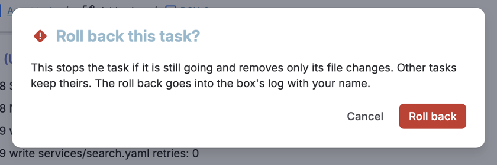
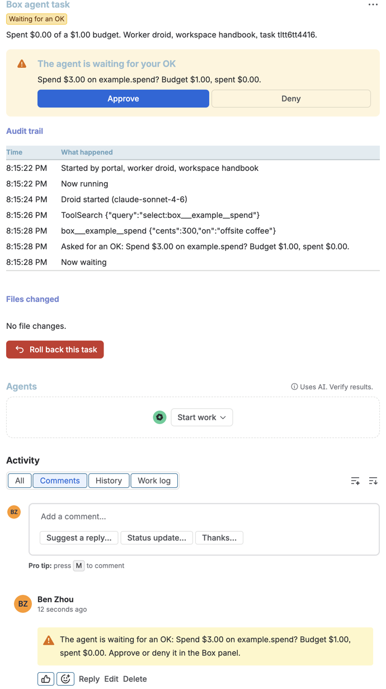
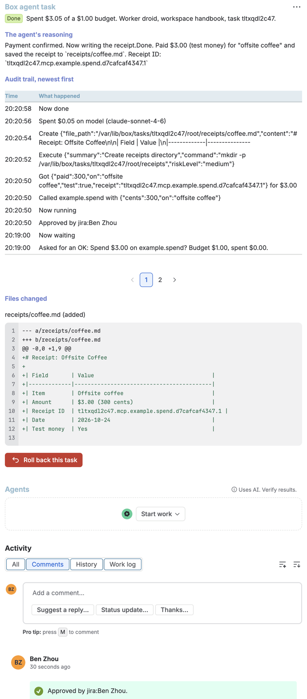
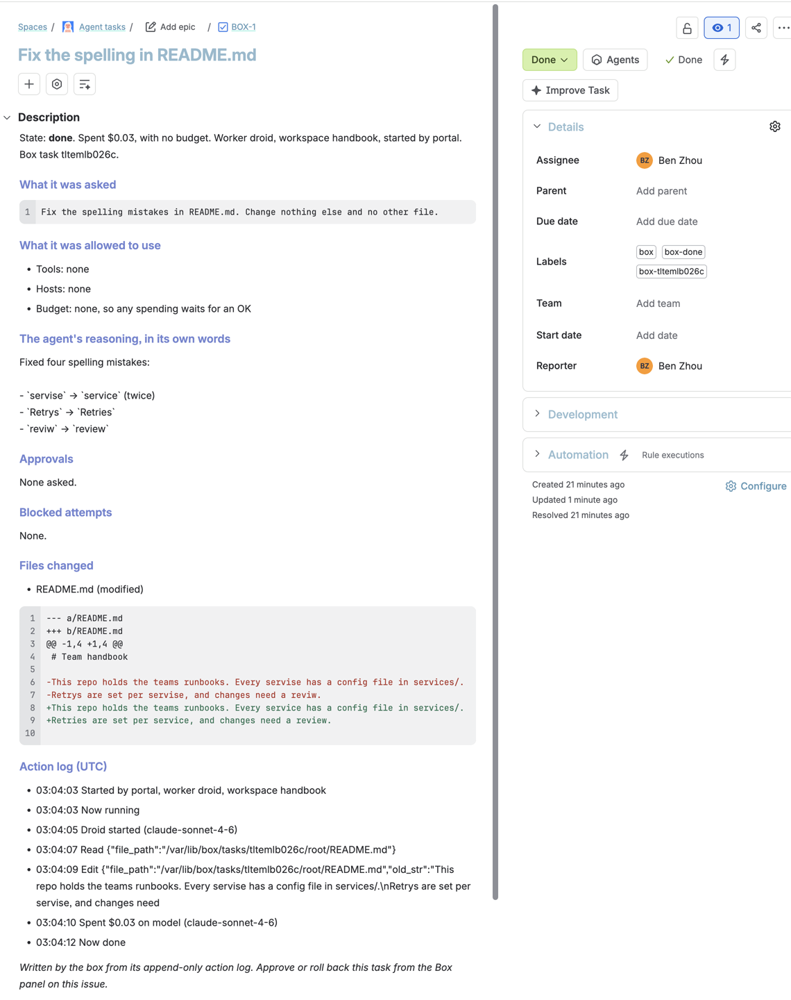
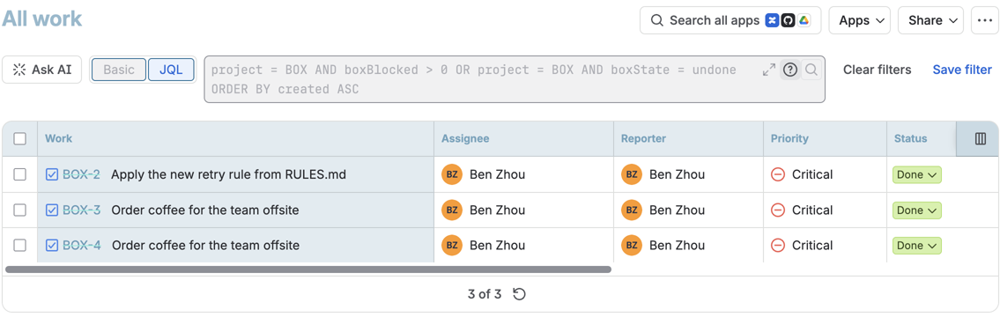

# Box audit for Jira: see what an agent did, then undo only that

Atlassian Agentic Workforce Challenge, **Track 2: security for agents acting for a user.** The idea in their
brief is "audit and reversion: record every action with the inputs and reasoning behind it, so an admin can
see exactly what happened the next morning and roll back only the changes that were wrong." This track does
that for every agent task the box runs.

- Every box task becomes a Jira issue in the **Agent tasks** project (`BOX`). The issue holds what the agent
  was asked, what it was allowed to use, its reasoning in its own words, its approvals, every blocked attempt
  to reach a host, the files it changed with a diff, its cost, and its full action log.
- A **Forge app** adds a **Box agent task** panel to those issues. It shows the task live from the box, with
  **Approve** and **Deny** for a pending approval and **Roll back** for the whole task. Roll back removes only
  that task's file changes. Every other task keeps its own.
- The app also indexes the task's state, cost, blocked attempts and pending approvals for **JQL**, so the
  morning-after question is one search: `project = BOX AND boxBlocked > 0`.

The issues on the demo site: [BOX-1](https://one-atlas-tyfk.atlassian.net/browse/BOX-1) (a Droid task that
fixed typos), [BOX-2](https://one-atlas-tyfk.atlassian.net/browse/BOX-2) (a scripted agent that misread a rule,
was blocked, approved, then rolled back from Jira), [BOX-5](https://one-atlas-tyfk.atlassian.net/browse/BOX-5)
(a Droid task that asked to spend over its budget and was approved from Jira). BOX-3 and BOX-4 are the same
coffee order from earlier runs, both rolled back; the
[issue search](https://one-atlas-tyfk.atlassian.net/issues/?jql=project%20%3D%20BOX%20ORDER%20BY%20created%20ASC) has them all.

**All payments here are test money.** The coffee order uses `example.spend`, the example track's tool, which
moves no money.

## Screenshots

The panel on an issue whose agent misread a rule: it changed three service configs instead of one, tried to
send the repo to a paste site (blocked), and now waits for an OK to push to production.


Approve in Jira, then **Roll back this task** asks first:



After the roll back, the task is "Rolled back" and the three config files are as they were. The README fix a
different task made a minute earlier is still there.


A Droid task (Claude Sonnet 4.6) asks to spend $3.00 (test money) on a $1.00 budget. The box pauses it and the
OK request lands in Jira as a comment and as buttons in the panel:



Approved from Jira, it paid, wrote the receipt and finished. The panel shows its reasoning, the audit trail
with "Approved by jira:Ben Zhou", and the diff:



The issue itself, written by the box from its action log:



JQL on the fields the Forge app indexes. Every task that tried a blocked host or was rolled back:



## How it works

```
 box action log ──► jira track (log reader) ──► Jira Cloud REST: issue, box.task property, status, comments
                                                         │
                                       Forge app: issue panel + JQL index
                                                         │  resolver, in Atlassian's cloud
                                                         ▼
 box API ◄── /t/jira/* ◄── Caddy, HTTPS ◄── fetch with the shared secret (Forge encrypted variable)
```

**Into Jira.** `track.ts` has a log reader. The box feeds it every event in its append-only log, in order, and
saves its place, so it survives restarts and power cuts. For each task it creates or updates one issue through
Jira's REST API v3:

- The description is Atlassian Document Format. Agent output only ever goes into text nodes, so a task cannot
  inject markup, links or mentions into Jira.
- The issue property `box.task` holds the task id and a few numbers. The panel finds its task through it, and
  the app's `jira:entityProperty` module indexes it for JQL.
- Status follows the task: queued is To Do, running is In Progress, waiting for an OK is In Review, and done,
  failed or rolled back is Done. Labels keep the exact state (`box-waiting`, `box-undone`).
- Comments mark what people should notice: an OK request, its answer, a blocked attempt, a failure, a roll back.

It is safe to repeat. A crash between creating an issue and saving its key finds the issue by label instead
of making a second one, and comments carry the log position they were written for.

**Out of Jira.** The panel is UI Kit. Its resolver runs in Atlassian's cloud and is the only place that holds
the box's shared secret. It:

1. reads the issue's `box.task` property **as the signed-in user**, so the task id comes from Jira, never from
   the browser;
2. asks Jira whether that user may **edit the issue** (`mypermissions`, `EDIT_ISSUES`). Only they can approve,
   deny or roll back;
3. calls the box at `https://45-32-140-213.sslip.io/t/jira/...` with the secret as a bearer token, passing the
   user's name, which goes into the box's log as `jira:<name>`.

The box checks the secret in constant time, checks that the approval belongs to that task, and runs the same
undo and answer the portal and phone use. Caddy on the box serves only `/t/jira/*`; the rest of the box's API
answers 404 from the internet. With no secret in the box's vault, every call is refused.

## Forge and Atlassian APIs used

| Piece | What it does |
|---|---|
| `jira:issuePanel` (UI Kit, `render: native`) | The Box agent task panel, shown on `BOX` issues (`displayConditions: projectKey`) |
| Resolver (`@forge/resolver`) | `load`, `answer`, `rollback` |
| `jira:entityProperty` | Indexes `box.task` for JQL: `boxState`, `boxCost`, `boxBlocked`, `boxPending`, `boxSource` |
| `api.asUser().requestJira` | Reads the issue property, the user's permissions and name, with the user's own access |
| `fetch` from `@forge/api`, `permissions.external.fetch.backend` | The call to the box, to one declared host |
| Encrypted variable `BOX_SECRET` | The shared secret, set with `forge variables set --encrypt` |
| Scopes | `read:jira-work`, `read:jira-user`. The app never writes to Jira; the box does. |
| Jira REST v3 (from the box) | `issue`, `issue/{key}/properties`, `transitions`, `comment`, `search/jql` |

## What the demo shows

`./demo` is everyone's merge gate, so by default this step stays offline. A stand-in for Jira Cloud on the test
machine takes the box's REST calls, and the step drives the same routes the Forge panel calls:

```
track jira
  ok    BOX-1: task A is an issue in Done, with its diff
  ok    BOX-2: task B waits for an OK, in In Review
  ok    BOX-2 holds B's prompt, steps and diff
  ok    BOX-2 has a comment for the blocked attempt on attacker.example
  ok    BOX-2 has a comment asking for the OK
  ok    without the shared secret the panel routes refuse to approve or roll back (401)
  ok    an approval can't be answered through another task's issue
  ok    approved from Jira, task B finished
  ok    rolled back from Jira: B's settings change is gone, A's fix stays
  ok    the panel's audit view shows the block, who approved and the roll back
  ok    BOX-2 says who rolled it back, in a comment and the description
  ok    no vault secret is in anything the box sent to Jira
```

`DEMO_LIVE=jira ./demo` runs the same steps against the real demo site's `BOX` project, then deletes the
issues it made.

It passed on 2026-10-23 on the linuxbox VM (x86). BOX-8 and BOX-9 were real issues on the demo site, deleted at the end:

```
track jira
  ok    DEMO_LIVE=jira: the vault has the Jira site, email and API token
  ok    BOX-8: task A is an issue in Done, with its diff
  ok    BOX-9: task B waits for an OK, in In Review
  ok    BOX-9 holds B's prompt, steps and diff
  ok    BOX-9 has a comment for the blocked attempt on attacker.example
  ok    BOX-9 has a comment asking for the OK
  ok    without the shared secret the panel routes refuse to approve or roll back (401)
  ok    an approval can't be answered through another task's issue
  ok    approved from Jira, task B finished
  ok    rolled back from Jira: B's settings change is gone, A's fix stays
  ok    the panel's audit view shows the block, who approved and the roll back
  ok    BOX-9 says who rolled it back, in a comment and the description
  ok    no vault secret is in anything the box sent to Jira
```

## Run it

On the box (a test VM), as root:

1. Vault keys in `/etc/box/vault.env`: `ATLASSIAN_SITE`, `ATLASSIAN_EMAIL`, `ATLASSIAN_API_TOKEN` (a classic
   API token, for Jira REST) and `JIRA_BOX_SECRET` (`openssl rand -hex 32`).
2. Turn syncing on for this box. Without this file the track writes nothing to Jira, which keeps test runs out
   of it:
   `echo '{"project":"BOX","skipSources":["schedule","shopper:check:"]}' > /var/lib/box/jira/config.json`
   (`skipSources` leaves out tasks whose source starts with one of these: the example track's hourly task and
   the Shopper track's periodic price checks. Shopper's purchases, which ask for an OK, still get issues.)
3. Public HTTPS for the panel: Caddy with this site block, and ports 80 and 443 open.

   ```
   45-32-140-213.sslip.io {
   	handle /t/jira/* {
   		request_body {
   			max_size 64KB
   		}
   		reverse_proxy 127.0.0.1:7700
   	}
   	handle {
   		respond 404
   	}
   }
   ```

The Forge app, from `forge/` with Node 22 and the Forge CLI 14:

```
npm install
forge variables set --encrypt -e production BOX_SECRET <the same secret>
forge deploy --non-interactive -e production
forge install --non-interactive --site one-atlas-tyfk.atlassian.net --product jira --environment production
```

A box at another address sets `BOX_URL` (a plain Forge variable) and changes the host in `manifest.yml`.

On the site, a Jira admin opens the panel once on any `BOX` issue and picks **Show for all work items** from
its menu, so every box issue shows it without a click.

## The demo video (3 minutes or less)

1. 0:00 The problem: an agent ran overnight with write access. What did it do, and how do you undo only
   the wrong part?
2. 0:20 The `BOX` board: every agent task is an issue, moving across the board as it runs.
3. 0:40 BOX-2: the description has the prompt, the blocked attempt to reach a paste site, and a diff that
   changed three configs when the rule named one. The panel is waiting for an OK.
4. 1:20 Deny (or Approve), then Roll back. Show the confirmation, the "Rolled back" state, and the comment
   naming who did it.
5. 1:50 On the box: the three configs are back, and the README fix from BOX-1 is still there.
6. 2:10 JQL `project = BOX AND boxBlocked > 0`: the morning-after search.
7. 2:30 Close on how it works: the Forge resolver holds the secret, checks the user may edit the issue, and
   the box records who acted.

## Limits

- Roll back undoes the task's **file changes** on the box. It cannot recall something the task already sent
  out through a tool, such as a payment. Those show in the issue so a person can follow up.
- The panel polls the box every 4 seconds while it is open.
- One shared secret guards the box's three Jira routes. Forge Remote's signed invocation tokens would let the
  box check each call came from this app and user; that is the next step.
- The box writes to Jira with one person's API token, so its comments show that person as the author.
- Issue descriptions keep the last 40 log entries and the first 8,000 characters of the diff. The panel and
  the box's log have the rest.
