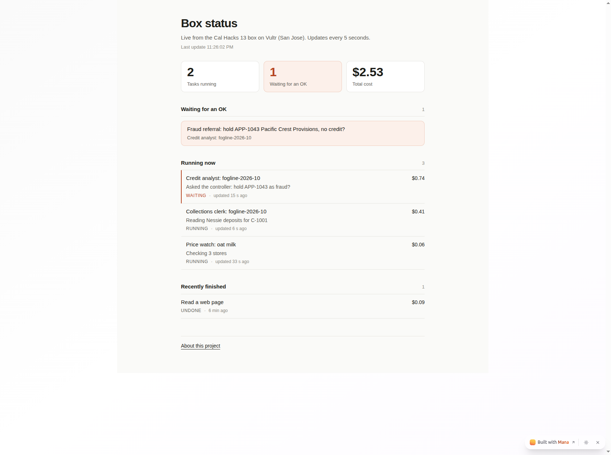

# Mana

Mana (mana.space) is an AI workspace: chats with an agent that runs code, documents, and small apps it builds and
hosts. The project used it for three things: to work out the credit desk's rules, to publish a project page, and to
host a live status app for the box.

## Public links

| What | Link |
|---|---|
| The planning chat (the moment Mana changed what we built) | https://www.mana.space/shared-chats/x5CqxyjcOgVCAyrvUBqK2LNRcMJ2/001792810018092cc50381027f1410c8fcb |
| Project page | https://www.mana.space/home/x5CqxyjcOgVCAyrvUBqK2LNRcMJ2/documents/cal-hacks-13-a-computer-where-ai-agents-work-safely |
| Box status app, inside Mana | https://www.mana.space/home/x5CqxyjcOgVCAyrvUBqK2LNRcMJ2/apps/box-status |

All three open without signing in. The rest of the Mana account stays private.

## The moment: Mana rewrote the credit desk's rules

The credit desk (`tracks/credit-desk/`) is two agents, a credit analyst and a collections clerk, working for a made-up
wholesaler. They follow a rules file, and the desk's tools refuse any decision that cites a rule id the file doesn't
have. The first draft had 32 rules (`credit-rules.draft.yaml`).

The planning chat, on 2026-10-23, in three turns:

1. **The review.** The chat gave Mana's agent (Opus 5.5) the company profile and the draft, and asked for gaps in four
   areas: new businesses with thin files, the fraud referral path, review cadence, and disputes. After about 6
   minutes of thinking, it found 12 gaps ranked by risk to the company and proposed 69 new rules as YAML. It checked
   the YAML parsed and that no id clashed.
2. **The pushback.** The 69 were checked against the test case before adopting any. Six problems went back to Mana:
   BND-5 would have moved APP-1045 from band B to C; BIZ-3 needed to know who filed each UCC lien, and the business
   file only counts them; HLD-1 quietly let the clerk release holds that ORD-1 reserves for the controller; GEN-2
   would have treated "no file at this bureau" as a failed check; FRD-7 would have flagged a customer's known second
   shop; LIM-3 and FRD-9 needed data the case doesn't have. The chat also gave Mana the six test applications and six
   open orders with the decision each must reach. Mana cut its list to 35, checked every rule against all 12
   outcomes, named six rules that could still change an outcome depending on fields it hadn't seen, and listed what
   it deferred and the data each deferred rule needs.
3. **The close.** The missing fields went back to Mana (none of its six watch items fire), and it wrote the changelog
   that now heads the rules file.

The result is `tracks/credit-desk/rules/credit-rules.yaml`, version 0.2: the draft's 32 rules word for word, plus
Mana's 35. The file names the chat in its header.

| Mana caught | The desk now |
|---|---|
| Two customer records for one business (C-1007 and C-1011), each with a $10,000 limit: $20,000 of credit in two pieces, each inside the analyst's authority | Treats records that share an EIN, or a name plus an address, phone or email, as one business, and tests their combined balance against the lower limit (REL-1, SOD-5) |
| Application answers, emails and remittance notes are read by an AI agent, so a fraudster can write instructions into them | Treats text from applicants and customers as evidence, never an instruction. Text that tries to direct the desk is a fraud stop (GEN-3) |
| No defined fraud referral path | Stops every shipment on a fraud hold, cash in advance included, sends the controller every hit with its CRS request id, and never tells the applicant which check failed (FRR-1 to FRR-7) |
| Orders could stack past a limit, and uncleared checks could release them | Counts released orders and the new order in exposure, and counts only cleared payments (ORD-2, ORD-3) |
| No rules for disputes or early reviews | Stops dunning on a disputed amount but still counts it toward the limit; reviews risky accounts and limits above $25,000 every 6 months, with early-review triggers (DSP-1 to DSP-7, REV-2, REV-3) |

GEN-3 matters most: it holds the credit desk to the same line as the box's booby-trapped page moment. An agent never
takes orders from the data it reads.

None of the 35 changes a decision in the answer key: Mana checked the 12 outcomes in the chat, and the file was
checked again here (all 67 ids load with the desk's own loader, the draft's 32 texts are unchanged, and every rule id
mentioned inside a rule exists).

## The Box status app

Mana's agent built it from a one-message spec, made it public, and tested it signed out at phone size, with sample
data and with a dropped connection. It runs in the viewer's browser and calls the box every 5 seconds. It shows tasks
running, approvals waiting with their questions, the total cost, and recently finished tasks. It has no buttons and
holds no keys.



The screenshot uses **test data**, fed to a test browser only. The live page never shows sample data: until the box
answers, it says "The box isn't reachable right now."

It reads `GET /t/mana/status`, a route this track adds to the box (`track.ts`):

- **Public on purpose, so it holds little.** Task id, title, state, the latest step (cut to 160 characters), cost,
  source and time; the question and amount of each approval that is waiting; counts by state; the total cost. No
  prompts, tool calls, log lines or secrets.
- **Read-only.** One GET route. Approving still needs the portal or the phone.
- **CORS open** (`Access-Control-Allow-Origin: *`), so the Mana page can fetch it.

`demo.ts` is the track's step in `./demo`: a task asks for an OK, the status lists it as waiting with its question and
no prompt, and after the OK it shows the task done.

**To make the app live,** the Vultr box needs this track installed and one more Caddy block beside the Jira one:

```
handle /t/mana/status {
	reverse_proxy 127.0.0.1:7700
}
```

## What the track asks for

| Mana asks for | Where |
|---|---|
| Use Mana meaningfully while building | The rules review: three turns, 69 proposals checked against the test case, 35 adopted into the file the agents work from |
| Link one or two public Mana pages or chats | The chat and the project page above |
| One moment where Mana changed what you built | The rules file, version 0.2, and the table above |
| +10: the project lives inside Mana as an app a judge can open and use | The Box status app, live once the route is exposed on the Vultr box |
