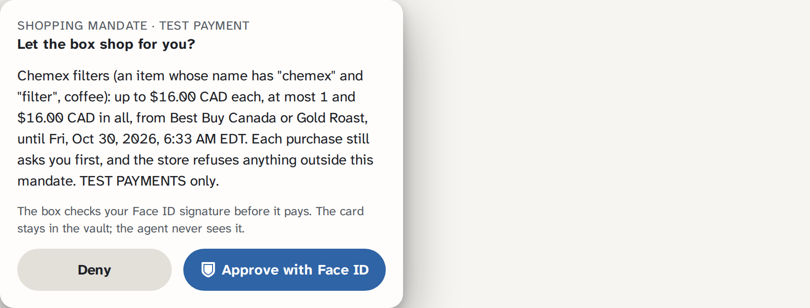
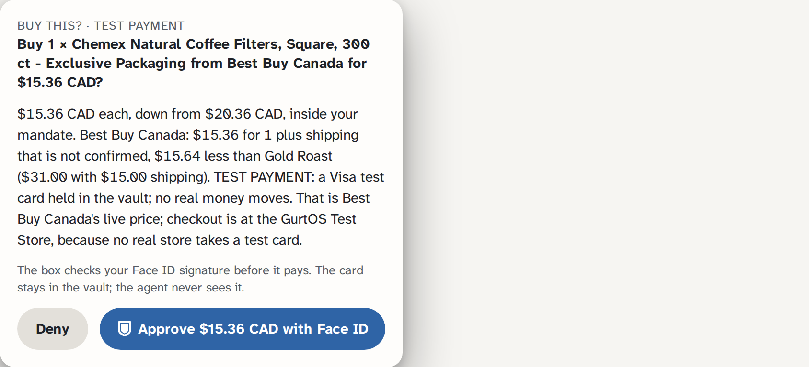
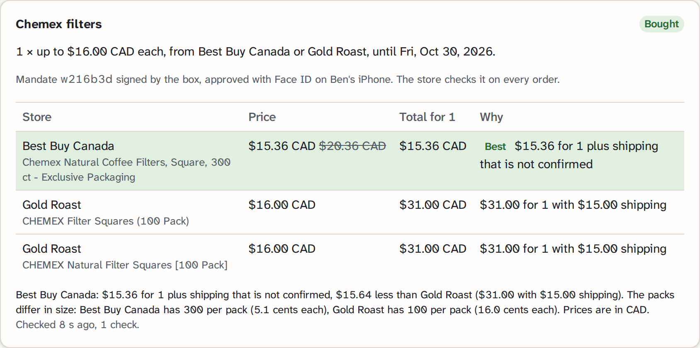
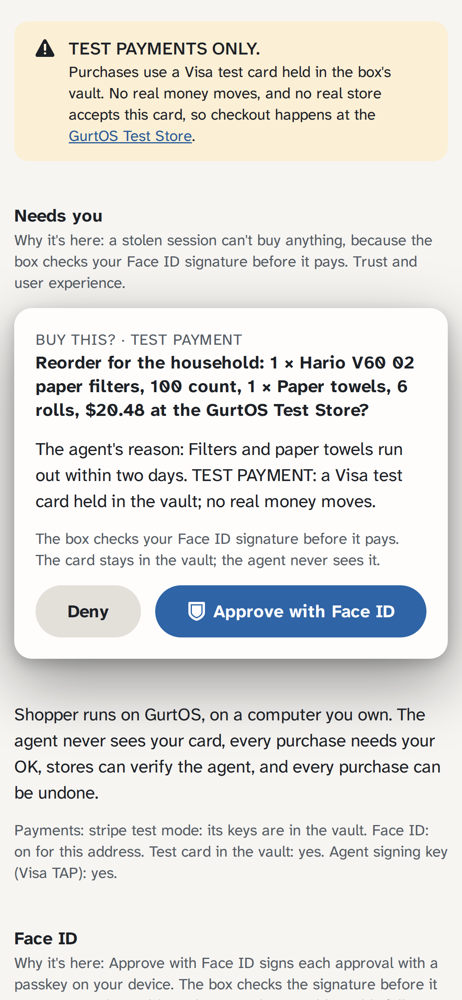
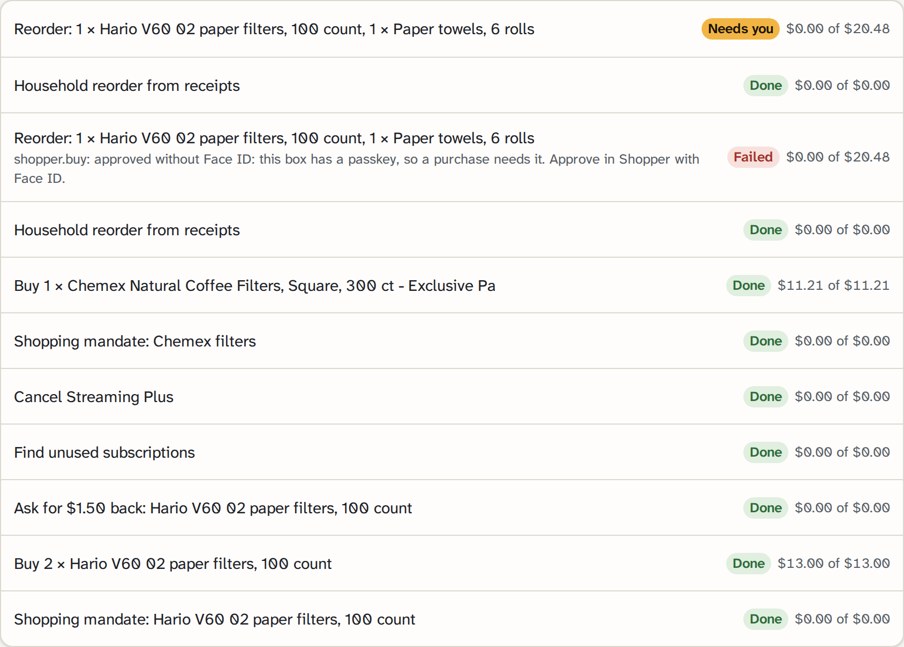
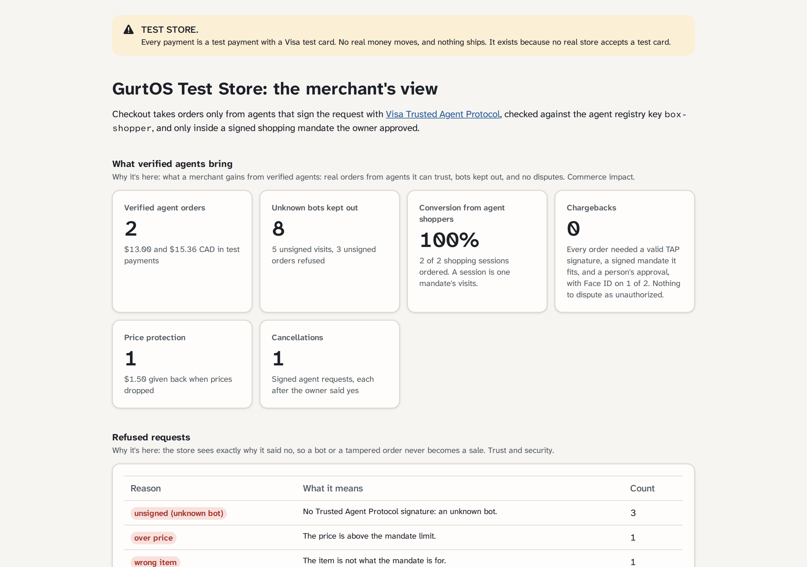
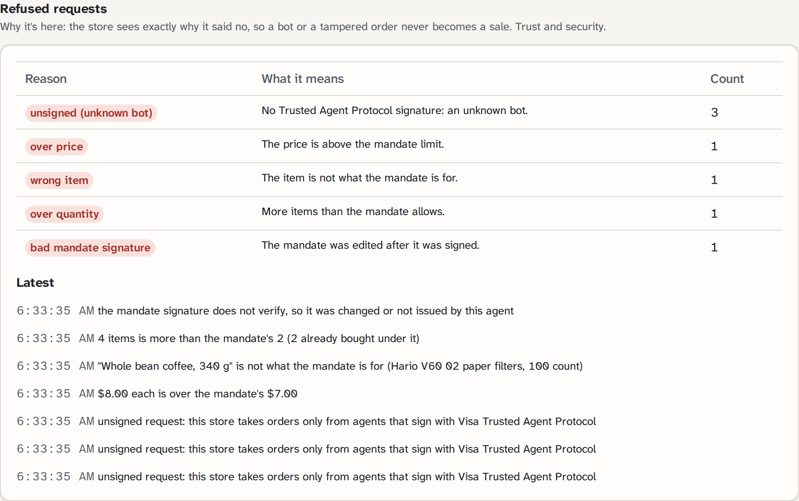
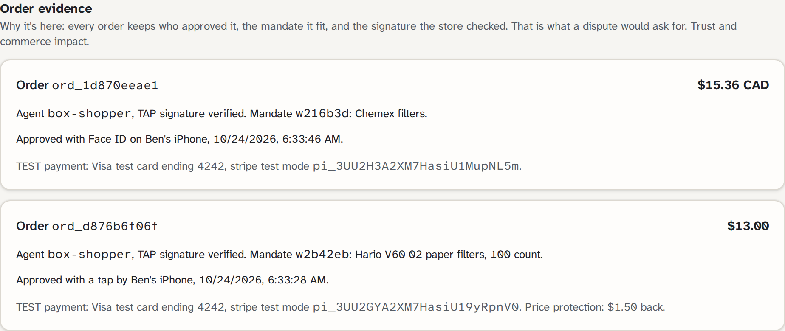

# Shopper: an agent that shops for you, on a computer you own

**Every payment here is a TEST payment.** Purchases use a Visa test card through a test-mode processor (Stripe
test mode, or the Cybersource sandbox), or are simulated and labelled so. No real money moves, nothing ships, and
no real store accepts a test card, so checkout happens at the **GurtOS Test Store**, a small store this app runs
on the box. The app, the log, the store and every order say which.

Visa track: Reimagining Shopping. Open it at `/t/shopper/` on a GurtOS box; the store is at `/t/shopper/store`.

## The problem

Today's shopping agents need your card number or your store password. Stores can't tell a good agent from a bot.
You can't see or stop what they buy. And cloud agents run on someone else's computer, where you don't know what
happens.

## So GurtOS

GurtOS is a safe place for agents on a computer you own, even an old laptop: it is a light OS. GurtOS Server needs
4 GB of memory and a 17 GB disk; GurtOS Personal needs 4 GB and 29 GB
([install-server](../../site/src/content/docs/get-started/install-server.md),
[install-personal](../../site/src/content/docs/get-started/install-personal.md)). On it, Shopper is built so that:

- **The agent never sees your card.** The card, the signing key and every payment key stay in the box's vault.
  Payments run in the box's core; the agent's task has no secrets and no network of its own.
- **Every purchase needs your tap**, with **Face ID** once you set up a passkey.
- **The store can verify the agent.** Every request is signed with Visa Trusted Agent Protocol, and every order
  carries a signed shopping mandate the store checks.
- **Every purchase can be undone.** Undo on a purchase is a refund.

The GurtOS portal and phone app show live what every agent is doing, on your laptop or your server, and let you
approve, deny, pause or undo. **Security is the headline.**

**Editions.** Shopper is best in **GurtOS Personal**, on your own computer, and in **GurtOS Server** for routines that
keep running after you close your laptop: price watching, reorders and subscription checks.

## What it does, why each part is here, and which criterion it serves

Visa's criteria: innovation in reimagining shopping 25%, user experience 25%, technical execution with AI 20%,
commerce impact 15%, trust and responsibility 15%.

| Part | Why it's here | Criterion |
|---|---|---|
| 1. Approve with Face ID | A stolen session can't buy anything: the box checks your passkey signature before it pays | Trust, user experience |
| 2. A signed shopping mandate | The store refuses anything outside what you approved: another item, a higher price, another store, more items, too late | Innovation, trust |
| 3. The store's side | Merchants see verified agent orders, bots refused, conversion, and zero chargebacks | Commerce impact |
| 4. Comparison across stores | Real prices from two real stores through Apify; the best total wins, with the reason | Technical execution, user experience |
| 5. Saving after you buy | Price protection inside the return window; unused subscriptions found and cancelled with your OK | Innovation, loyalty |
| 6. Spending rules | Card-style caps and "never buy" words, enforced by the box before any payment | Trust, user experience |
| 7. Real Visa tools behind one interface | Cybersource sandbox works today; Visa Intelligent Commerce is ready to drop in | Technical execution |
| Visa Trusted Agent Protocol | Every request to the store is signed, so the store knows it is this agent | Trust, commerce impact |
| Household reorder and x402 supplies | Claude reads receipts and proposes; agents pay for APIs they need, within a budget | Innovation, technical execution |

### 1. Approve with Face ID (passkeys)

Each purchase approval can be signed with a WebAuthn passkey on your phone or computer (Face ID, Touch ID, or the
device's PIN). The box builds what gets signed from its own records: the approval's exact question and amount, bound
into the challenge, so a signature for "Buy 2 filters for $13.00" can't approve "$130.00" or another purchase, and
can't be used twice. The box verifies the signature (`@simplewebauthn/server`) before it answers the approval.

Once a passkey is set up, `shopper.buy` refuses to pay for a purchase approved without one: "approved without Face
ID". So a stolen pairing token can still press Approve, and nothing is paid. Changing your spending rules needs Face
ID too. Only the box's own screen or the owner's phone can set up the first passkey; adding another needs a
signature from an existing one.

This follows Visa's direction for payment passkeys. It is our own implementation with open tools, not Visa's
payment passkey service.

**Where there's no HTTPS.** WebAuthn needs a secure address: the box's own `https://<name>.box.gurtos.com` (from
GurtOS remote access; TLS ends on the box) or `localhost` on the box itself. Browsers never make a passkey for an IP
address. On any other address the app says so, and approvals fall back to a plain tap. A passkey belongs to the
address it was made on.

### 2. A signed shopping mandate

"Chemex filters, under $16, from Best Buy or Gold Roast, by Friday" becomes a mandate (`mandate.ts`): the item
words or exact SKUs, the stores, the price per item, the quantity, the total, the category and the expiry (at most
30 days). You approve it on your phone, seeing every limit, and the box signs exactly those terms with its agent
key (Ed25519, with a `gurtos-mandate-v1` domain prefix). The agent carries it on every checkout. The store checks the
TAP signature, then the mandate: its signature, that its issuer is the agent that signed the request, and that the
order fits. Over the mandate's lifetime, not just one order, it refuses another item, a higher price, another store,
more items or a higher total, an expired mandate, or one edited after signing. Each purchase still asks you first.

Reorders and cancellations get a one-time mandate for exactly the approved lines, good for 15 minutes.

This mirrors the "payment instruction" in Visa Intelligent Commerce, built with open tools: here the box signs the
instruction where in Visa's version Visa would. We say so plainly; nothing here is a Visa product.

### 3. The store's side: the merchant's dashboard

The GurtOS Test Store (`store.ts`, page `store.html`) counts every request it sees:
- **Verified agent orders**, and how many were approved with Face ID.
- **Unknown bots refused**: requests without a valid TAP signature, sorted by reason (unsigned, bad signature,
  replayed, changed in transit, unknown agent) and the mandate refusals (over price, wrong item, wrong store...).
- **Conversion from agent shoppers**: shopping sessions (one mandate's visits) that ended in an order. The shopper's
  price checks browse the store with a TAP `agent-browser-auth` signature, so the store can tell them from bots.
- **Zero chargebacks**, and why: every order needed a valid TAP signature, a signed mandate it fits, and a person's
  approval, so there is nothing to dispute as unauthorized. The store keeps that evidence per order.
- Price adjustments and cancellations.

### 4. Comparison across stores

A mandate can cover several stores in one currency. Each check round is one small task per store, with no network
and no secrets of its own, calling that store's price tool through the box:

| Store | How it is read | Shipping used in the comparison | What its terms say about agents |
|---|---|---|---|
| Best Buy Canada | The Apify track's `apify.checkPrice` (Best Buy's product JSON, through Apify) | Free over $35 on Best Buy's own items; Marketplace sellers set their own, so not confirmed | robots.txt does not block product data, but its Conditions of Use, section 7, prohibit scraping. See Limits. |
| Gold Roast (goldroast.ca) | `apify.run` with Apify's Playwright Scraper on the Shopify store's open product JSON (`stores.ts`) | $15.00 under $75 in Ontario, free from $75 ([policy](https://goldroast.ca/policies/shipping-policy)) | robots.txt names no bot or agent and allows product pages; its terms page has no terms text |
| GurtOS Test Store | `shopper.checkPrice` | Free (ours) | Ours |

`compare()` ranks the in-stock offers within your limit by total for the quantity, with shipping, and explains the
choice in a sentence (including the price per filter when pack sizes differ). The purchase approval quotes it. Amazon
is left out: it refuses AI agents. Store choice, robots.txt and terms were checked on Oct 24.

### 5. Saving after you buy

- **Price protection.** For 30 days after a purchase at the GurtOS Test Store, the box re-checks the price. If it
  drops, it sends a TAP-signed request to `/store/price-adjust`; the store checks its own price and refunds the
  difference (a partial TEST refund). No approval is needed, since money only comes back. It runs only at our store,
  which knows its own price.
- **Unused subscriptions.** The demo inbox has monthly receipts for three subscriptions and one activity email for
  each. `shopper.receipts` returns each subscription with when it was last used. Claude (or the scripted agent in the
  demo) proposes cancelling what nobody uses, here Streaming Plus, unused for 74 days ($191.88 a year). You approve,
  and a signed request cancels it at the store.

### 6. Spending rules

Like the controls in a card app (`rules.ts`): a monthly cap, a cap per store, a cap per category (0 blocks it), and
"never buy" phrases matched as whole words. Set from the phone; with a passkey set up, saving needs Face ID. The box
checks them twice: before it asks you about a deal (so it never asks for something your rules forbid), and again
inside `shopper.buy` right before paying, one payment at a time. Amounts are in US dollars; CAD prices count at a
fixed 0.73.

### 7. Real Visa tools behind one interface

`payments.ts` has one `pay()` with four providers, picked by which keys are in the vault, in this order:
- **Visa Intelligent Commerce.** An adapter written against Visa's MIT-licensed toolkit
  ([github.com/visa/mcp](https://github.com/visa/mcp), `sandbox.api.visa.com`, `/vacp/v1`): x-pay-token, JWE message
  encryption, enroll card, initiate instruction, retrieve credentials. It needs onboarding with a Visa representative,
  so it has **never been called**; request values are placeholders. Ben is asking at Visa's Saturday chat.
- **Cybersource sandbox** (a Visa company). Implemented for real: REST payments and refunds with HTTP Signature
  auth, test cards only, sandbox host only. Tested live on Oct 24 with Cybersource's public sandbox sample merchant
  (a charge, a partial refund, a full refund).
- **Stripe test mode**, with Stripe's Visa test card `pm_card_visa`. Refuses a live key.
- **Simulated**, when no payment keys are set, and in offline demo runs. Labelled so.

### Visa Trusted Agent Protocol

[TAP](https://github.com/visa/trusted-agent-protocol) is Visa's open spec for a merchant to tell a trusted shopping
agent from a bot. The agent signs each request with an RFC 9421 HTTP message signature, and the merchant checks it
against the agent's public key in a registry. We follow Visa's sample agent: the `sig2` label, Ed25519, `keyId`,
`nonce`, `created`, `expires` (8 minutes), `agent-payer-auth` for checkout and `agent-browser-auth` for browsing.

```
Signature-Input: sig2=("@authority" "@path" "content-digest"); created=1761271440; expires=1761271920;
                 keyId="box-shopper"; alg="ed25519"; nonce="…"; tag="agent-payer-auth"
Signature:       sig2=:…:
Content-Digest:  sha-256=:…:
```

One addition: Visa's sample signs only `@authority` and `@path`. We also sign `content-digest` (RFC 9530), so an order
cannot be changed in transit. Visa's sample verifier only knows the first two components, so it would not accept our
signatures as they are. The box publishes its public key at `GET /t/shopper/keys/box-shopper` in the shape of TAP's
registry. In real use Visa runs that registry.

### Household reorder, and agents buying their own supplies

Claude reads the receipts in a demo mailbox (a small POP3 server on the box with sample receipts we wrote; its login
is in the vault), works out what runs out this week, and proposes one reorder. It sees the receipts and subscription
notices, never the mailbox login or other email. Agents can also pay for an API they need with the wallet track's
x402 payments (Coinbase x402, devnet USDC test money): a task asks the price, then pays exactly that, and above its
budget it waits for your OK.

## Screenshots

Taken on Oct 24 from a test box, in Chromium with a virtual authenticator standing in for Face ID. The Best Buy and
Gold Roast prices are live through Apify; the charges are Stripe test mode.

| | |
|---|---|
|  |  |
| The mandate you approve shows every limit, and the store enforces it. | The purchase names the winner and the runner-up, and is approved with Face ID. |
|  |  |
| The comparison across two real stores, with the reason. | On the phone. |
|  |  |
| A stolen pairing token taps Approve: the box refuses to pay. | The store's side. |
|  |  |
| Mandate refusals at the store, in plain words. | Every order keeps its evidence. |

## How a purchase is made safe

```
 you, in words or a form ──► a mandate ──► you approve it (Face ID) ──► the box signs it
                                                                          │
 schedule ──► one check task per store (no network, no secrets) ──► apify.checkPrice / apify.run / shopper.checkPrice
                                                                          │ results in the action log
 compare(): best total, in stock, under your limit ──► your spending rules ──► "Buy …? TEST PAYMENT" on your phone
                                                                          │ Face ID
 shopper.buy (in the core): approval checked, rules again, one at a time ──► TAP-signed checkout + mandate
                                                                          │
 GurtOS Test Store: TAP signature, mandate, its lifetime use, price, stock ──► test charge (Stripe, Cybersource or simulated)
```

- **The model never holds a buy tool or a card.** Claude gets `shopper.watch` (propose a mandate), `shopper.propose`
  (suggest a reorder) and `shopper.proposeCancel`. Only tasks the box starts hold `shopper.buy`, `shopper.sign` and
  `shopper.cancel`, and each one asks you first.
- **Prices come from the store, not the model.**
- **Power cuts don't pay twice.** Each checkout carries the broker's stable call key as its Idempotency-Key.
- **One proposal and one watch per agent task**, so a looping agent cannot flood your phone.

## Tools and routes

| Tool | Who gets it | What it does |
|---|---|---|
| `shopper.buy` | Purchase tasks the box starts, after your OK | Checks the approval (Face ID once set up) and your rules, then pays with a TAP-signed checkout carrying the mandate |
| `shopper.sign` | Mandate tasks the box starts | Signs a watch's mandate after you approved it |
| `shopper.checkPrice` | Check tasks, Claude | Price and stock at the GurtOS Test Store, browsed with a TAP signature |
| `shopper.watch` | Claude | Proposes a mandate; you approve it before anything is checked |
| `shopper.receipts` | Claude | The demo inbox's receipts and subscriptions, with what runs low and what goes unused |
| `shopper.propose` | Claude | Proposes a reorder at the store's prices |
| `shopper.proposeCancel`, `shopper.cancel` | Claude, then the box | Proposes cancelling a subscription; after your OK, cancels it with a signed request |
| `shopper.priceAdjust` | Price protection tasks | Asks the store for the difference when its price dropped |

Routes under `/t/shopper/`: `GET /` the app, `GET /state`, `POST /watches`, `/watches/check`, `/watches/cancel`,
`POST /ask` (Claude proposes a mandate), `POST /reorder`, `POST /supplies`, `POST /savings/check`,
`POST /savings/subscriptions`, `GET`/`POST /rules`, the passkey routes (`GET /passkey/status`,
`POST /passkey/register/options`, `/passkey/register`, `/passkey/options`, `/passkey/approve`) and `GET /passkey.js`
(the browser module: `approve(id)`, `enroll(name)`, `saveRules(rules)`), the store (`GET /store`, `/store/stats`,
`/store/products`, `/store/subscriptions`, `POST /store/checkout`, `/store/price-adjust`,
`/store/subscriptions/cancel`, `/store/admin` for demo price and stock changes) and the agent registry
`GET /keys/box-shopper`.

## Setup

On each box, as root: `tracks/shopper/setup.sh`. It adds `SHOPPER_CARD` (`pm_card_visa`), `SHOPPER_AGENT_KEY` (a new
Ed25519 key) and `SHOPPER_MAIL_PASSWORD` to `/etc/box/vault.env`. Payment keys are optional (without them, payments
are simulated and say so): `STRIPE_SECRET_KEY=sk_test_...`; or `CYBERSOURCE_MERCHANT_ID`, `CYBERSOURCE_KEY_ID`,
`CYBERSOURCE_SECRET_KEY` and `CYBERSOURCE_TEST_CARD` (`number|MM|YYYY`, a Cybersource test card) from a free sandbox
account at developer.cybersource.com; or the Visa Intelligent Commerce keys listed in `payments.ts` once Visa
onboards you. Live store checks need the Apify track's `APIFY_TOKEN`. For Face ID, open the box at its https address
(Settings, Reach this box from anywhere) or at `http://localhost:7700` on the box itself, and press "Set up Face ID".

## The demo step

`./demo` runs `demo.ts` offline in about 20 seconds, with the scripted agent and a software authenticator (a P-256
key, `softauth.ts`) standing in for Face ID:
- TAP at checkout: unsigned, changed and replayed orders refused; a paired phone works off the box with its token.
- A mandate you approve with a tap, a check above the limit, a price drop, a purchase inside the mandate.
- Face ID: a non-owner phone can't set up the first passkey; it is set up from the box's screen; a second needs the
  first. A reorder approved with a plain tap is refused at payment ("approved without Face ID"); approved with Face
  ID, it pays; the same signature can't be reused; undo refunds it.
- The store refuses, with a valid TAP signature, a higher price, another item, more items, and an edited mandate.
- Spending rules saved with Face ID; a cable proposal is refused before you are even asked.
- Price protection refunds $1.50 when the price drops; the unused subscription is found and cancelled with Face ID.
- The merchant's dashboard counts, x402 supplies (denied, nothing spent), and no secret anywhere in the log.

`DEMO_LIVE=shopper ./demo` (or `visa`) adds real test-mode payments and refunds, x402 on Solana devnet, and a real
comparison of Best Buy Canada and Gold Roast through Apify, bought with Face ID. `DEMO_LIVE=droid` adds Claude (in
Factory's Droid) reading the receipts for unused subscriptions and a reorder.

Unit tests, offline: `node --experimental-strip-types --test tracks/shopper/*.test.ts` (shopper, stores, payments,
passkey). `passkey.browser.mjs` runs the passkey flow in a real Chromium with a virtual authenticator.

## What is real and what is simulated

| Part | Status |
|---|---|
| Best Buy Canada and Gold Roast prices and stock | Live, through Apify |
| Product matching from your words, reading receipts, finding unused subscriptions | Live: Claude in Factory's Droid (scripted in the offline demo) |
| Face ID approvals | Real WebAuthn passkeys, verified on the box. The demo uses a software authenticator |
| Trusted Agent Protocol and the mandate | Real signatures and checks. The registry is the box's own route, not Visa's |
| The GurtOS Test Store | Ours. It stands in for every merchant, because no real store takes a test card. A Best Buy or Gold Roast deal is bought here at that store's live price |
| Payments | Stripe test mode or the Cybersource sandbox when their keys are set; simulated otherwise and in offline demo runs. Never real money |
| Visa Intelligent Commerce | An adapter only, never called (needs Visa onboarding) |
| The mailbox and the subscriptions | A demo POP3 server with sample receipts we wrote, and three sample subscriptions at the test store |
| CAD against US-dollar budgets and rules | A fixed rate of 0.73 |

## Limits

- **Best Buy Canada's Conditions of Use prohibit scraping** (section 7). The Apify track reads its public product
  JSON through Apify; we disclose it here and in the app. Gold Roast's robots.txt and terms do not prohibit it.
- **One stand-in store for every merchant.** The store reads `from` on a line to know which real store priced it, so
  in this demo the store trusts that label. In real use each store runs its own checkout and checks the mandate
  against its own id.
- **Shipping and tax are compared, not charged.** The test store charges items only, so the mandate's total and your
  caps cover items.
- **A passkey belongs to one address.** Set it up where you approve (the box's https address on your phone). There
  is no remove button yet.
- Challenges for passkeys and TAP nonces are kept in memory: a restart clears pending ones (you tap again), and the
  Idempotency-Key still stops a replayed order from being charged twice.
- The test store keeps price and stock changes in memory; orders and its dashboard counts are on disk.
- A watch closes after one purchase, or when you deny it.

## Reviews that changed it

The mandate and the rules were reviewed in a public Mana chat (written by us in Ben's voice):
https://www.mana.space/shared-chats/x5CqxyjcOgVCAyrvUBqK2LNRcMJ2/0017928345352081015a15392384766a029. Its agent ran
`outside()` and `blocked()` on test inputs and found that a mandate could be reused across orders, could name no
item, accepted NaN and negative lines, that a $0 monthly cap meant no cap, that "never buy" matched parts of words,
and that the approval text hid limits. All of those are fixed and tested. The AP2-style split into an intent mandate
and a per-store cart mandate is not built yet.
